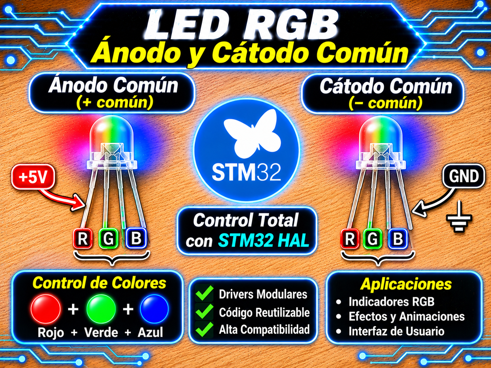

# Driver RGB LED (PWM con Corrección Gamma 2.2) para STM32 HAL

<p align="center">
  
</p>

Driver modular, encapsulado y no bloqueante para el control de LEDs RGB (Ánodo Común y Cátodo Común) mediante modulación por ancho de pulso (**PWM**) en microcontroladores STM32 utilizando la capa **HAL**.

Incorpora corrección perceptual de brillo (**Gamma 2.2**) optimizada mediante una tabla de búsqueda (**LUT**) de $1001$ entradas en memoria Flash ($O(1)$, ideal para arquitecturas sin FPU por hardware como la Blue Pill STM32F103 / ARM Cortex-M3), conversión de espacio de color **HSV** a **RGB** mediante aritmética entera en punto fijo (Q8/Q10), limitación máxima de brillo (*hardware brightness ceiling*) y un motor de efectos no bloqueante para transiciones suaves (*Rainbow Fade*).

---

## Características

- **Soporte Dual de Polaridad:** Compatible con hardware de **Cátodo Común** y **Ánodo Común** (`LED_TYPE_CATHODE_COMMON` / `LED_TYPE_ANODE_COMMON`). Inversión automática de la lógica del pulso PWM (apagado total real a $100\%$ duty en ánodo común).
- **Corrección Gamma Perceptual (2.2):** Corrección fisiológica de la visión humana para lograr transiciones de intensidad lineales.
  - **Modo LUT en Flash (por defecto):** Sin uso de punto flotante (`RGB_USE_GAMMA_LUT = 1`). Compatible con Cortex-M0 / Cortex-M3 (0 uso de FPU).
  - **Modo Dinámico FPU (`RGB_USE_GAMMA_LUT = 0`):** Utiliza `powf()` para microcontroladores con FPU activa (ej. STM32F4 / Cortex-M4F).
- **Control de Brillo Máximo Absoluto (`max_brightness`):** Permite proteger los LEDs limitando la corriente máxima de salida sin alterar los colores lógicos ni los efectos.
- **Modelo de Color HSV (Hue, Saturation, Value):** Conversión directa en punto fijo para paletas continuas de color.
- **Motor de Efectos No Bloqueante (`RGB_Effects_Handler`):** Transiciones suaves mediante una máquina de estados finitos (MEF) accionada por `HAL_GetTick()`.
- **Resolución PWM:** 1000 niveles de resolución lógica ($0 \dots 1000$).

---

## Requisitos

| Requisito | Detalle |
| :--- | :--- |
| **Microcontrolador** | Cualquier STM32 (probado en NUCLEO-F439ZI, Blue Pill STM32F103C8T6, Black Pill STM32F411CEU6). |
| **Periféricos** | 1 Timer de propósito general o avanzado con **3 canales de salida PWM** habilitados (ej. `TIM4_CH1`, `TIM4_CH2`, `TIM4_CH3`). |
| **Período de Timer (ARR)** | Configurado en **999** (`ARR = MAX_PWM_VALUE - 1 = 999`) para obtener un período exacto de $1000$ cuentas ($0$ a $1000$ en CCR). |
| **Header Principal** | `main.h` (autogenerado por CubeMX). |
| **Dependencias extra** | `<stdint.h>`, `<math.h>` (solamente si se deshabilita la LUT de Gamma). |

---

## Archivos del Driver

| Archivo | Descripción |
| :--- | :--- |
| `rgb_STM32.h` | Cabecera principal: enums, estructuras de control (`RGB_Config_t`, `RGB_LED_t`), macros y prototipos de la API. |
| `rgb_gamma_lut_STM32.h` | Tabla de búsqueda en Flash (`rgb_gamma_lut[1001]`) con el mapeo precalculado de Gamma 2.2. |
| `rgb_STM32.c` | Implementación lógica: funciones de duty cycle, conversión HSV, corrección Gamma y motor de efectos. |

---

## Conexión de Hardware

| Pin del LED RGB | Conexión en STM32 / Hardware | Configuración en CubeMX |
| :---: | :---: | :--- |
| **Red (R)** | Pin asignado a **TIM4_CH1** (ej. PD12) | `TIM4 Channel 1: PWM Generation CH1`. |
| **Green (G)** | Pin asignado a **TIM4_CH2** (ej. PD13) | `TIM4 Channel 2: PWM Generation CH2`. |
| **Blue (B)** | Pin asignado a **TIM4_CH3** (ej. PD14) | `TIM4 Channel 3: PWM Generation CH3`. |
| **VCC / GND** | **VCC (3.3V/5V)** para Ánodo Común<br>**GND** para Cátodo Común | Alimentación de potencia adecuada con resistencias limitadoras por canal. |

---

## Cálculo del Prescaler del Timer ($PSC$)

Para evitar parpadeos visibles en la vista (*flicker*), la frecuencia del PWM debe situarse entre $1\text{ kHz}$ y $10\text{ kHz}$ (frecuencia recomendada objetivo: $f_{\text{PWM}} \approx 2\text{ kHz}$).

La fórmula general para calcular la frecuencia de PWM en STM32 es:

```math
f_{\text{PWM}} = \frac{f_{\text{TIM\_CLK}}}{(PSC + 1) \times (ARR + 1)}
```

Dado que fijamos el período en $ARR = 999$ ($ARR + 1 = 1000$), la fórmula del **Prescaler ($PSC$)** se simplifica a:

```math
PSC = \frac{f_{\text{TIM\_CLK}}}{1000 \times f_{\text{PWM}}} - 1
```

### Ejemplos según la familia del Microcontrolador:

1. **NUCLEO-F439ZI (SYSCLK = 180 MHz, TIM4 en APB1 Bus):**
   - El reloj del APB1 corre a $45\text{ MHz}$ ($PCLK1 = 45\text{ MHz}$, divisor APB1 = 4). Cuando el prescaler de APB1 es mayor que 1, el reloj que alimenta a los Timers de APB1 (TIM2-TIM7, TIM12-TIM14) se multiplica x2:
     
     ```math
     f_{\text{TIM\_CLK}} = 2 \times 45\text{ MHz} = 90\text{ MHz}
     ```

   - Para obtener $f_{\text{PWM}} = 2\text{ kHz}$:

    ```math
    PSC = \frac{90\text{ MHz}}{1000 \times 2000\text{ Hz}} - 1 = \frac{90.000.000}{2.000.000} - 1 = 45 - 1 = 44
    ```
   - Configuración en CubeMX: `Prescaler = 44`, `Counter Period (ARR) = 999`.

2. **STM32F103 Blue Pill (SYSCLK = 72 MHz, TIM2-TIM4 en APB1 Bus):**
   - $PCLK1 = 36\text{ MHz}$ (Divisor APB1 = 2) 
   
   ```math
     f_{\mathrm{TIM\_CLK}} = 2 \times 36\text{ MHz} = 72\text{ MHz}
   ```
   
   - Para $f_{\text{PWM}} = 1\text{ kHz}$:
     $$PSC = \frac{72\text{ MHz}}{1000 \times 1000\text{ Hz}} - 1 = 72 - 1 = 71$$
   - Configuración en CubeMX: `Prescaler = 71`, `Counter Period (ARR) = 999`.

---

## Instalación

1. Copia `rgb_STM32.c` a la carpeta `Core/Src/` de tu proyecto STM32CubeIDE.
2. Copia `rgb_STM32.h` y `rgb_gamma_lut_STM32.h` a la carpeta `Core/Inc/`.
3. En STM32CubeMX, configura los 3 canales PWM del Timer elegido y genera el código.
4. En tu archivo `main.c`, incluye la cabecera del driver:
   ```c
   #include "rgb_STM32.h"
   ```

---

## Uso básico

El ejemplo integra la secuencia de inicialización y las tareas no bloqueantes para alternar entre modos de demostración (**Presets**, **HSV Sweep**, y **Rainbow Fade**) mediante un pulsador de usuario.

```c
#include "main.h"
#include "rgb_STM32.h"

extern TIM_HandleTypeDef htim4;

typedef enum {
    MODE_PRESETS = 0,
    MODE_HSV,
    MODE_RAINBOW,
    MODE_COUNT
} DemoMode_t;

static RGB_LED_t   led1;
static DemoMode_t  demo_mode = MODE_PRESETS;

static const RGB_PresetColor_t preset_list[] = {
    COLOR_RED, COLOR_GREEN, COLOR_BLUE, COLOR_YELLOW,
    COLOR_CYAN, COLOR_MAGENTA, COLOR_WHITE, COLOR_OFF
};
#define PRESET_COUNT  (sizeof(preset_list) / sizeof(preset_list[0]))

/* Cambia de modo y fija el estado inicial */
static void Demo_Enter_Mode(DemoMode_t mode)
{
    demo_mode = mode;
    RGB_Stop_Effect(&led1);
    RGB_Set_Preset(&led1, COLOR_OFF);

    if (mode == MODE_RAINBOW) {
        RGB_Start_Effect_Rainbow(&led1, 1000); /* Pico lógico 1000; el tope max_brightness (800) se aplica en hardware */
    }
}

/* Tarea no bloqueante de demostración */
static void Demo_Task(void)
{
    static uint32_t t_last   = 0;
    static uint8_t  preset_i = 0;
    static float    hue      = 0.0f;

    uint32_t now = HAL_GetTick();

    switch (demo_mode) {
    case MODE_PRESETS:
        if ((now - t_last) >= 1000) {
            t_last = now;
            RGB_Set_Preset(&led1, preset_list[preset_i]);
            preset_i = (preset_i + 1) % PRESET_COUNT;
        }
        break;

    case MODE_HSV:
        if ((now - t_last) >= 20) {
            t_last = now;
            hue += 2.0f;
            if (hue >= 360.0f) hue -= 360.0f;
            RGB_Set_Color_HSV(&led1, hue, 1.0f, 1.0f);
        }
        break;

    case MODE_RAINBOW:
    default:
        break; /* Se procesa vía RGB_Effects_Handler() en el loop principal */
    }
}

/* Tarea no bloqueante de lectura del pulsador */
static void Button_Task(void)
{
    static uint8_t  last_state = 0;
    static uint32_t t_change   = 0;

    uint8_t  state = (HAL_GPIO_ReadPin(USER_BTN_GPIO_Port, USER_BTN_Pin) == GPIO_PIN_SET);
    uint32_t now   = HAL_GetTick();

    if (state != last_state && (now - t_change) >= 30) {
        t_change   = now;
        last_state = state;
        if (state) { /* Flanco de subida = Botón presionado */
            Demo_Enter_Mode((DemoMode_t)((demo_mode + 1) % MODE_COUNT));
        }
    }
}

int main(void)
{
    HAL_Init();
    SystemClock_Config();
    MX_GPIO_Init();
    MX_TIM4_Init();

    /* 1. Configuración del LED RGB */
    RGB_Config_t cfg = {
        .htim           = &htim4,
        .R_channel      = TIM_CHANNEL_1,
        .G_channel      = TIM_CHANNEL_2,
        .B_channel      = TIM_CHANNEL_3,
        .led_type       = LED_TYPE_ANODE_COMMON, /* Ánodo común */
        .max_brightness = 800                    /* Tope de duty final (0-1000) */
    };
    
    RGB_Init_Single(&led1, &cfg);
    Demo_Enter_Mode(MODE_PRESETS);

    while (1)
    {
        /* 2. Ejecución no bloqueante de tareas y motor de efectos */
        Button_Task();
        Demo_Task();
        RGB_Effects_Handler(&led1, 10, 10); /* 10 ms por paso, 10 unidades por paso (~6 s por ciclo completo) */
    }
}
```

---

## API del Driver

| Función | Descripción |
| :--- | :--- |
| `RGB_Init_Single(led_ptr, config)` | Inicializa la estructura de control, asigna canales, fija estado en OFF y arranca las salidas PWM en el Timer HAL. |
| `RGB_Set_Color_Direct(led_ptr, r, g, b)` | Establece valores de intensidad lógica ($0 \dots 1000$) para R, G y B aplicando corrección Gamma y tope de brillo. |
| `RGB_Set_Preset(led_ptr, color)` | Aplica un color predefinido (`COLOR_RED`, `COLOR_GREEN`, `COLOR_BLUE`, `COLOR_YELLOW`, `COLOR_CYAN`, `COLOR_MAGENTA`, `COLOR_WHITE`, `COLOR_OFF`). |
| `RGB_Set_Color_HSV(led_ptr, h, s, v)` | Establece el color utilizando coordenadas del espacio **HSV** ($H: 0.0 \dots 360.0^\circ$, $S: 0.0 \dots 1.0$, $V: 0.0 \dots 1.0$) mediante punto fijo. |
| `RGB_Start_Effect_Rainbow(led_ptr, peak_brightness)` | Configura e inicia la transición continua por todo el círculo cromático. |
| `RGB_Effects_Handler(led_ptr, interval_ms, step)` | Manejador no bloqueante del motor de efectos. Debe llamarse periódicamente en el `while(1)`. |
| `RGB_Stop_Effect(led_ptr)` | Detiene el efecto activo reteniendo el último color mostrado en el LED. |

---

## Ecuaciones y Principio de Operación

### 1. Corrección Gamma 2.2 (Percepción Fisiológica)

La percepción de intensidad luminosa del ojo humano no es lineal sino exponencial. Para convertir una intensidad deseada $I_{\text{lógica}} \in [0, 1000]$ en un ciclo de trabajo PWM $D_{\text{corr}} \in [0, 1000]$ se aplica la ecuación:

$$D_{\text{corr}} = \text{round}\left( 1000 \times \left( \frac{I_{\text{lógica}}}{1000} \right)^{2.2} \right)$$

- **Con `RGB_USE_GAMMA_LUT = 1`:** La ecuación anterior está precalculada en la tabla constante `rgb_gamma_lut[1001]` alojada en la memoria Flash:
  $$D_{\text{corr}} = \text{rgb\_gamma\_lut}[I_{\text{lógica}}]$$
- **Escalado por Brillo Máximo Absoluto (`max_brightness`):**
  $$\text{Duty}_{\text{final}} = \min\left( D_{\text{corr}}, \; \text{max\_brightness} \right)$$

### 2. Polaridad del Hardware y Registro CCR

El valor cargado en el registro de comparación del Timer ($CCR$) depende de la topología del circuito:

$$\text{CCR} = \begin{cases} 
\text{Duty}_{\text{final}} & \text{si } \text{led\_type} = \text{LED\_TYPE\_CATHODE\_COMMON} \\
1000 - \text{Duty}_{\text{final}} & \text{si } \text{led\_type} = \text{LED\_TYPE\_ANODE\_COMMON}
\end{cases}$$

Con $ARR = 999$, en un LED de Ánodo Común un valor de $\text{Duty}_{\text{final}} = 0$ resulta en $CCR = 1000$, lo que supera al registro $ARR$ y fuerza un ciclo de trabajo nulo ($0\%$ de tiempo a masa), garantizando el apagado total del componente.

---

## Parámetros Configurables (Macros)

| Macro | Valor por defecto | Descripción |
| :--- | :---: | :--- |
| `MAX_PWM_VALUE` | `1000` | Resolución de los valores lógicos y límite del timer ($ARR = 999$). |
| `GAMMA_CORRECTION` | `2.2f` | Exponente de la corrección Gamma (utilizado solo en modo `RGB_USE_GAMMA_LUT = 0`). |
| `RGB_USE_GAMMA_LUT` | `1` | `1`: Utiliza la tabla de $1001$ elementos en Flash ($O(1)$ sin FPU). `0`: Invocación flotante a `powf()`. |

---

## Solución de Problemas

| Síntoma | Causa probable | Solución |
| :--- | :--- | :--- |
| En Ánodo Común, el LED queda tenuemente encendido al estar en `COLOR_OFF` | El valor de $ARR$ está en $1000$ en lugar de $999$, dejando un pulso residual de $1$ cuenta. | Configurar `Counter Period (ARR) = 999` en STM32CubeMX. |
| Los cambios de color son bruscos en bajos niveles de brillo | Desactivación de la corrección Gamma o baja resolución PWM. | Mantener `RGB_USE_GAMMA_LUT = 1` y verificar resolución en $1000$. |
| El efecto Rainbow no avanza o se congela | No se está llamando a `RGB_Effects_Handler()` en el loop `while(1)`. | Agregar la llamada periódica al motor de efectos en el loop principal. |
| Inversión total de colores (brilla al máximo al enviar 0) | Tipo de LED mal seleccionado en la estructura de configuración. | Cambiar `LED_TYPE_CATHODE_COMMON` por `LED_TYPE_ANODE_COMMON` (o viceversa). |

---

## Licencia

- **MIT**. Desarrollado por **Mamani Flores Carlos (UTN FRT)** 2026.