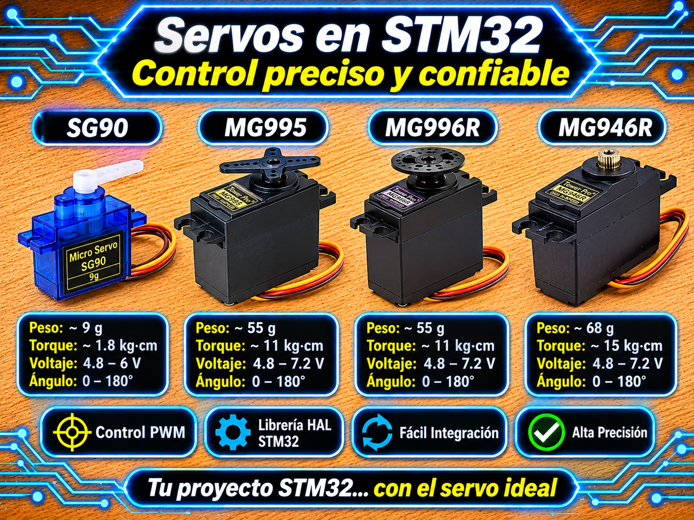

# Driver Servomotor (PWM 50 Hz con Motion Profiling) para STM32 HAL

<p align="center">
  
</p>


Driver modular, encapsulado y no bloqueante para el control de servomotores ($0^\circ \dots 180^\circ$) tipo **SG90**, **MG995**, **MG996R** y **MG946R** en microcontroladores STM32 mediante la capa **HAL**.

Soporta control individual y por grupos sincronizados (*Kinematic Servo Groups*), suavizado de movimiento (*Easing Profiles*), movimientos controlados por tiempo ($\text{ms}$) o velocidad ($\text{deg/s}$), límites por software, calibración de pulso, inversión de sentido, compensación de cero (*trim*) y ejecución de secuencias de waypoints/poses sin bloquear el hilo principal (*super-loop*).

---

## Características

- **Generación PWM a 50 Hz:** Diseñado específicamente para servos analógicos y digitales estándar (período de $20\text{ ms}$, pulsos típicos de $500\ \mu\text{s} \dots 2500\ \mu\text{s}$).
- **Movimiento Suave No Bloqueante (Easing):** 4 perfiles de velocidad integrados:
  - `SERVO_EASE_LINEAR`: Velocidad constante.
  - `SERVO_EASE_IN`: Aceleración cuadrática inicial.
  - `SERVO_EASE_OUT`: Desaceleración suave al llegar.
  - `SERVO_EASE_IN_OUT`: Aceleración y desaceleración suave (Curva S tipo Hermite).
- **Gestión por Grupos Sincronizados (`ServoGroup_t`):** Permite sincronizar múltiples servos (ej. brazos robóticos o hexápodos) ajustando automáticamente las trayectorias para que **todos los servos lleguen al mismo tiempo** a la pose destino.
- **Protecciones por Software:**
  - Límites de ángulo mínimos y máximos (`SERVO_SetLimits`).
  - Inversión lógica de sentido de giro (`SERVO_SetInverted`).
  - Ajuste fino de offset/cero (`SERVO_SetTrim`).
- **Eficiencia Energética y Seguridad:** Funciones de `Attach` / `Detach` para apagar la señal PWM, liberando el par y eliminando el parpadeo o zumbido (*jitter*) cuando el servo está estático.

---

## Requisitos

| Requisito | Detalle |
| :--- | :--- |
| **Microcontrolador** | Cualquier STM32 (probado en NUCLEO-F439ZI, Blue Pill STM32F103C8T6, Black Pill STM32F411CEU6). |
| **Periféricos** | 1 o más canales de salida PWM en un Timer de propósito general o avanzado (ej. `TIM3_CH1`, `TIM3_CH2`, `TIM3_CH3`). |
| **Frecuencia de PWM** | Exactamente **50 Hz** (período $T = 20\text{ ms}$). |
| **Base de Tiempo Recomendada** | **1 tick = $1\ \mu\text{s}$** ($ARR = 19999$). |
| **Header Principal** | `main.h` (autogenerado por CubeMX). |

---

## Archivos del Driver

| Archivo | Descripción |
| :--- | :--- |
| `servo_STM32.h` | Cabecera principal: enums de easing, estructuras (`Servo_t`, `ServoGroup_t`, `ServoWaypoint_t`), macros y prototipos de la API. |
| `servo_STM32.c` | Implementación lógica: interpolación temporal, curvas de aceleración, escritura de registros CCR y motor de grupo. |

---

## Conexión de Hardware

| Pin del Servo (SG90 / MG996R) | Conexión en STM32 / Fuente | Descripción / Notas |
| :---: | :---: | :--- |
| **Señal (Naranja / Amarillo)** | Pin PWM de Timer (ej. `PC6`, `PB4`) | Salida de pulso del Timer configurado en modo PWM1. |
| **VCC (Rojo)** | **Fuente Externa (5V - 6V)** | **NO alimentar desde el pin 5V/3.3V de la placa STM32.** Los servomotores consumen picos de corriente que reinician el MCU. |
| **GND (Marrón / Negro)** | **GND Común** | Es **estrictamente necesario unir la masa (GND) de la fuente externa con la masa (GND) del STM32**. |

---

## Configuración del Timer y Cálculo del Prescaler ($PSC$)

Para que el servo responda correctamente, la señal PWM debe tener una frecuencia de **50 Hz** ($T = 20\ \text{ms}$). Se recomienda configurar el contador del timer para que **1 tick equivalga a $1\ \mu\text{s}$**, de forma que los valores de $CCR$ correspondan directamente al pulso en microsegundos (ejemplo: $1500\ \mu\text{s} \rightarrow CCR = 1500$).

### Fórmula General de Frecuencia PWM:

```math
f_{\text{PWM}} = \frac{f_{\text{TIM}}}{(PSC + 1) \times (ARR + 1)}
```

Si fijamos el período a **20 ms** con ticks de $1\ \mu\text{s}$, el registro **Auto-Reload Register (ARR)** se configura en:

```math
ARR = 19999 \quad (ARR + 1 = 20000\ \text{cuentas})
```

### Determinación de $f_{\text{TIM}}$ según el bus APB:
> **¡Atención con los divisores de bus (APB1 / APB2)!**  
> En STM32, el reloj que alimenta a los timers ($f_{\text{TIM}}$) NO SIEMPRE es igual a la frecuencia del bus APB.  
> - Si el prescaler del bus APB correspondiente es **/1**, $f_{\text{TIM}} = f_{\text{APB}}$.  
> - Si el prescaler del bus APB correspondiente es **distinto de 1** (ej. /2 o /4), el reloj del Timer se **multiplica automáticamente por 2** ($f_{\text{TIM}} = 2 \times f_{\text{APB}}$).

Para obtener $1\ \mu\text{s}$ por tick ($f_{\text{cnt}} = 1\ \text{MHz}$), el Prescaler se calcula como:

$$PSC = \frac{f_{\text{TIM}}}{10^6} - 1$$

---

### Ejemplos Prácticos de Cálculo del Prescaler:

#### 1. NUCLEO-F439ZI (TIM3 en Bus APB1, SYSCLK = 180 MHz)
- Reloj del bus APB1: $PCLK1 = 45\ \text{MHz}$ (Divisor APB1 = /4).
- Como el divisor APB1 es $> 1$, la frecuencia para los Timers de APB1 se duplica:
  $$f_{\text{TIM}} = 2 \times 45\ \text{MHz} = 90\ \text{MHz}$$
- Cálculo del Prescaler ($PSC$):
  $$PSC = \frac{90 \times 10^6}{10^6} - 1 = 90 - 1 = 89$$
- **Configuración en CubeMX:** `Prescaler = 89`, `Counter Period (ARR) = 19999`.

#### 2. STM32F103 Blue Pill (TIM3 en Bus APB1, SYSCLK = 72 MHz)
- Reloj del bus APB1: $PCLK1 = 36\ \text{MHz}$ (Divisor APB1 = /2).
- Como el divisor APB1 es $> 1$, el reloj del timer se duplica:
  $$f_{\text{TIM}} = 2 \times 36\ \text{MHz} = 72\ \text{MHz}$$
- Cálculo del Prescaler ($PSC$):
  $$PSC = \frac{72 \times 10^6}{10^6} - 1 = 72 - 1 = 71$$
- **Configuración en CubeMX:** `Prescaler = 71`, `Counter Period (ARR) = 19999`.

---

## Uso básico

### Ejemplo 1: Control de Un Servo Individual

```c
#include "main.h"
#include "servo_STM32.h"

extern TIM_HandleTypeDef htim3;

Servo_t servo1;

int main(void)
{
    HAL_Init();
    SystemClock_Config();
    MX_GPIO_Init();
    MX_TIM3_Init();

    /* 1. Inicialización (Timer 3, Canal 1, min_pulse: 544 us, max_pulse: 2400 us) */
    SERVO_Init(&servo1, &htim3, TIM_CHANNEL_1, 544, 2400);

    /* Configurar perfil de aceleración suave EASE_IN_OUT */
    SERVO_SetEasing(&servo1, SERVO_EASE_IN_OUT);

    /* 2. Mover a 120° en 800 ms (no bloqueante) */
    SERVO_MoveTime(&servo1, 120.0f, 800);

    while (1)
    {
        /* 3. Refresco no bloqueante de la posición */
        SERVO_Update(&servo1);
    }
}
```

---

### Ejemplo 2: Brazo Robótico con 3 Servos Sincronizados y Secuencia de Poses

```c
#include "main.h"
#include "servo_STM32.h"

extern TIM_HandleTypeDef htim3;

/* 1. Declaración de servos individuales y la lista del grupo */
Servo_t base, hombro, codo;
Servo_t *lista_brazo[] = { &base, &hombro, &codo };
ServoGroup_t brazo;

/* Poses estáticas (deben ser static o globales) */
static const float pose_a[3] = {  90.0f, 45.0f, 120.0f };
static const float pose_b[3] = { 180.0f, SERVO_GROUP_KEEP, 60.0f }; /* Hombro conserva posición */

/* Secuencia de movimientos del grupo: { pose, duration_ms, hold_ms } */
static const ServoGroupStep_t rutina_brazo[] = {
    { pose_a, 1000, 500 },  /* Ir a pose_a en 1000 ms y esperar 500 ms */
    { pose_b, 1500,   0 },  /* Ir a pose_b en 1500 ms */
};

int main(void)
{
    HAL_Init();
    SystemClock_Config();
    MX_GPIO_Init();
    MX_TIM3_Init();

    /* 2. Inicialización de cada servo e integración en el grupo */
    SERVO_Init(&base,   &htim3, TIM_CHANNEL_1, 544, 2400);
    SERVO_Init(&hombro, &htim3, TIM_CHANNEL_2, 544, 2400);
    SERVO_Init(&codo,   &htim3, TIM_CHANNEL_3, 544, 2400);

    SERVO_GROUP_Init(&brazo, lista_brazo, 3);

    /* 3. Arrancar la secuencia del grupo (rutina de 2 pasos, 1 = repetir indefinidamente) */
    SERVO_GROUP_StartSequence(&brazo, rutina_brazo, 2, 1);

    while (1)
    {
        /* 4. Refresco no bloqueante del grupo en el lazo principal */
        SERVO_GROUP_Update(&brazo);
    }
}
```

---

## API del Driver

### Servos Individuales (`Servo_t`)

| Función | Descripción |
| :--- | :--- |
| `SERVO_Init(servo, htim, channel, min, max)` | Inicializa la estructura, establece límites $0^\circ \dots 180^\circ$, inicia el PWM y posiciona en $0^\circ$. |
| `SERVO_InitAt(servo, htim, channel, min, max, init_angle)` | Inicializa posicionando directamente en `init_angle` sin saltos bruscos. |
| `SERVO_SetAngle(servo, angle)` / `SERVO_SetAngleF` | Posicionamiento instantáneo (cancela movimientos/secuencias en curso). |
| `SERVO_MoveTime(servo, angle, duration_ms)` | Movimiento progresivo suave con una duración exacta definida en milisegundos. |
| `SERVO_SetSpeedAngle(servo, angle, speed_dps)` | Movimiento progresivo calculando el tiempo según la velocidad deseada ($\text{deg/s}$). |
| `SERVO_Update(servo)` | Refresca el movimiento interpolado y temporizaciones. **Llamar periódicamente en `while(1)`**. |
| `SERVO_Stop(servo)` | Congela el movimiento reteniendo la posición actual con par activo. |
| `SERVO_Detach(servo)` / `SERVO_Attach` | Apaga/Enciende la salida PWM para liberar el torque mecánico y ahorrar energía. |
| `SERVO_SetPulseUs(servo, pulse_us)` | Escribe directamente el pulso en microsegundos (útil para pruebas y calibración). |
| `SERVO_SetLimits(servo, min, max)` | Establece límites lógicos por software para evitar colisiones mecánicas. |
| `SERVO_SetTrim(servo, trim_deg)` | Define un desfasaje/offset en grados para calibración del punto cero. |
| `SERVO_SetInverted(servo, inverted)` | Invierte el sentido lógico de giro ($0^\circ \leftrightarrow 180^\circ$). |
| `SERVO_SetEasing(servo, easing)` | Selecciona la curva de aceleración (`LINEAR`, `EASE_IN`, `EASE_OUT`, `EASE_IN_OUT`). |

### Grupos de Servos (`ServoGroup_t`)

| Función | Descripción |
| :--- | :--- |
| `SERVO_GROUP_Init(group, servos, count)` | Inicializa una estructura de grupo a partir de un arreglo de servos. |
| `SERVO_GROUP_Update(group)` | Refresca los movimientos de todos los miembros del grupo. **Llamar en `while(1)`**. |
| `SERVO_GROUP_SetAngles(group, angles)` | Asigna posiciones instantáneas a los servos del grupo. |
| `SERVO_GROUP_MoveSync(group, angles, duration_ms)` | Mueve todos los servos coordinadamente para que **lleguen al unísono** tras `duration_ms`. |
| `SERVO_GROUP_MoveSyncSpeed(group, angles, speed)` | Movimiento sincronizado donde la velocidad especifica el viaje del servo de mayor recorrido. |
| `SERVO_GROUP_StartSequence(group, steps, count, loop)`| Arranca una secuencia de poses síncronas (`ServoGroupStep_t`). |
| `SERVO_GROUP_DetachAll(group)` / `AttachAll` | Deshabilita o habilita el PWM en todos los servos del grupo simultáneamente. |

---

## Ecuaciones y Principio de Operación

### 1. Conversión de Ángulo Lógico a Comparación de Timer ($CCR$)

Para obtener el valor $CCR$ cargado en el canal de salida del Timer, se aplica la transformación lineal considerando el sentido de giro invertido y el offset de *trim*:

$$\theta_{\text{físico}} = \begin{cases} 
180 - \theta_{\text{lógico}} & \text{si } \text{inverted} = 1 \\
\theta_{\text{lógico}} & \text{si } \text{inverted} = 0
\end{cases}$$

$$\theta_{\text{final}} = \text{Clamp}\left( \theta_{\text{físico}} + \text{trim}, \; 0, \; 180 \right)$$

$$CCR = \text{round}\left( \text{min\_pulse} + \frac{\text{max\_pulse} - \text{min\_pulse}}{180} \times \theta_{\text{final}} \right)$$

---

## Solución de Problemas y Verificación

| Síntoma | Causa probable | Método de Verificación / Solución |
| :--- | :--- | :--- |
| El microcontrolador se reinicia al mover los servos | Caída de tensión (*brownout*) por corriente inicial de arranque del servo. | Alimentar los servos con una fuente externa regulada de 5V/6V y verificar que la masa (GND) esté unida con el STM32. |
| El servo zumba o tiembla estando detenido (*jitter*) | Pulso fuera de rango físico o ruido en la alimentación. | Usar `SERVO_Detach()` cuando el servo esté quieto o ajustar `min_pulse` / `max_pulse` para evitar topes mecánicos. |
| El tiempo de movimiento no coincide con la duración | Mal cálculo del Prescaler ($PSC$) del Timer. | Verificar en la hoja de datos el bus APB al que pertenece el Timer y aplicar el factor $\times 2$ si el divisor APB es $>1$. |
| El movimiento no avanza | No se está llamando a `SERVO_Update()` o `SERVO_GROUP_Update()`. | Asegurarse de colocar las funciones de actualización en el bucle principal `while(1)`. |

---

## Licencia

- **MIT**. Desarrollado por **Mamani Flores Carlos (UTN FRT)** 2026.