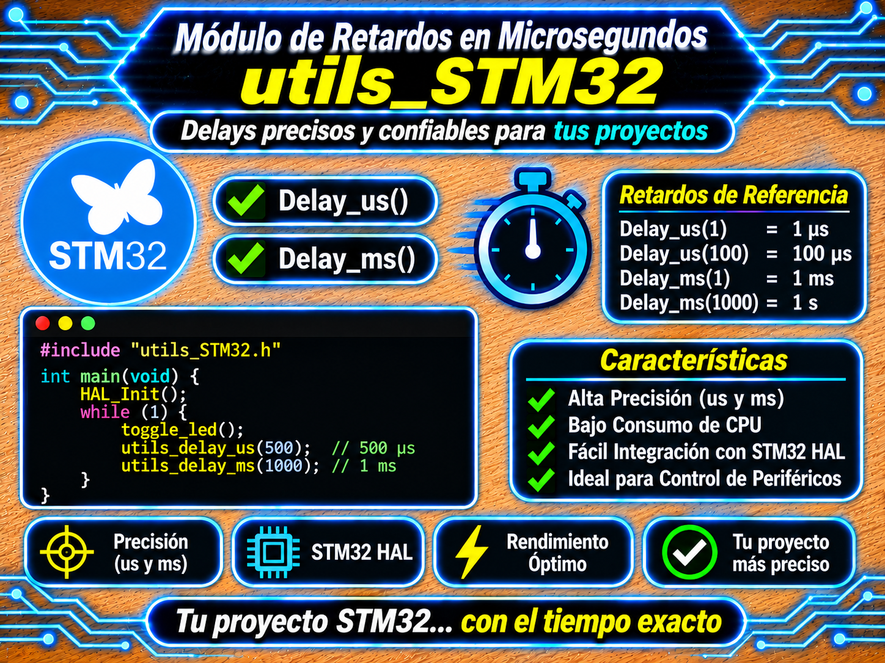

# Módulo de Retardos en Microsegundos (utils_STM32) para STM32
<p align="center">
  
</p>


Módulo auxiliar ligero, portátil y de alta precisión para la generación de retardos bloqueantes en microsegundos ($\mu\text{s}$) en microcontroladores STM32 de cualquier familia (Cortex-M0/M0+/M3/M4/M7/M33).

Diseñado y mantenido por **Mamani Flores Carlos (UTN FRT)** como el módulo central de sincronización de tiempo para la suite de drivers del repositorio **`DriversST-Github`** (materia *Técnicas Digitales 2*).

---

## 🏛️ Filosofía de Operación y Selección Automática de Hardware

El módulo implementa un esquema de **fallback transparente de doble capa** para garantizar precisión sin requerir intervención manual o configuración de macros por parte del usuario:

1. **Método Principal — DWT (Data Watchpoint and Trace):**
   - Utiliza el registro `DWT->CYCCNT` presente en núcleos **Cortex-M3, M4, M7 y M33**.
   - Resolución de un ciclo de reloj de CPU ($\Delta t = 1 / f_{\text{CPU}}$).
   - Manejo transparente de desbordamiento atómico mediante aritmética en módulo $2^{32}$ (`(DWT->CYCCNT - start) < ticks`).
   - Soporta desbloqueo de acceso en Cortex-M7 (`DWT->LAR = 0xC5ACCE55`).
2. **Método de Respaldo — SysTick Timer:**
   - Si la arquitectura es Cortex-M0/M0+, o si el contador DWT no avanza (deshabilitado por el depurador), conmuta automáticamente a medir la diferencia de cuenta decreciente del periférico `SysTick->VAL`.
   - Soporta frecuencias de SysTick configuradas a $HCLK$ o $HCLK/8$.
3. **Bucle por Software (Último recurso):**
   - Si el SysTick no está iniciado, utiliza una estimación limpia por bucle `while(n--)` basada en la frecuencia global `SystemCoreClock`.

---

## 📦 Requisitos y Compatibilidad

| Requisito | Detalle |
| :--- | :--- |
| **Microcontrolador** | Cualquier STM32 (Cortex-M0, M0+, M3, M4, M7, M33). |
| **Cabecera Base** | `main.h` (autogenerado por STM32CubeMX para incluir los registros del CMSIS). |
| **Variables de Reloj** | `SystemCoreClock` (actualizado automáticamente por `SystemClock_Config()`). |
| **Uso en el Repositorio** | **Dependencia requerida por:** `Display_TM1637`, `DHT11`, `DS18B20` (modo Bit-Banging), etc. |

---

## 📂 Archivos del Módulo

| Archivo | Ubicación | Descripción |
| :--- | :--- | :--- |
| `utils.h` | `Dependencias/Utils/utils.h` | Cabecera principal: prototipos de `Utils_DelayUs_Init()` y `Utils_DelayUs()`. |
| `utils.c` | `Dependencias/Utils/utils.c` | Implementación lógica con autodetección DWT/SysTick y secciones sin desbordamiento. |

---

## 📐 Formulación Matemática y Análisis de Precisión

### 1. Conversión de Microsegundos a Ciclos de CPU

Dado el reloj global del sistema $f_{\text{CPU}} = \text{SystemCoreClock}$ (en $\text{Hz}$), se define $C_{\mu\text{s}}$ como la cantidad de ciclos por microsegundo (`cycles_per_us` en el código):

$$C_{\mu\text{s}} = \left\lfloor \frac{f_{\text{CPU}}}{10^6} \right\rfloor$$

$$N_{\text{total}} = t_{\mu\text{s}} \times C_{\mu\text{s}}$$

donde $t_{\mu\text{s}}$ es el retardo solicitado (`us` en el código) y $N_{\text{total}}$ son los ticks totales (`ticks_totales`).

*Ejemplo:* Para un STM32F429/F439 a $180\ \text{MHz}$, $C_{\mu\text{s}} = 180$. Un retardo de $3\ \mu\text{s}$ equivale a $540$ ciclos de reloj del núcleo.

### 2. Aritmética Módulo $2^{32}$ sin Problema de Desbordamiento (*Rollover*)

El contador `DWT->CYCCNT` es de 32 bits y se reinicia a $0$ al superar $2^{32}-1$ ($4\,294\,967\,295$). Debido a la aritmética modular de los tipos `uint32_t` en C, la resta entre el valor actual y el inicial da el resultado correcto sin importar si ocurrió un desbordamiento en el intervalo:

$$\Delta N = \left( N_{\text{actual}} - N_{\text{inicio}} \right) \bmod 2^{32}$$

Esto garantiza que `Utils_DelayUs` nunca quede atrapado en un bucle infinito durante el *wrap-around* del contador.

---

## 🚀 Ejemplo de Uso Integrado en `main.c`

```c
#include "main.h"
#include "utils.h"

int main(void)
{
    HAL_Init();
    SystemClock_Config();
    MX_GPIO_Init();

    /* 1. Inicializar el temporizador de microsegundos (Idempotente) */
    Utils_DelayUs_Init();

    while (1)
    {
        /* Generar pulso de 10 us en un pin GPIO (ej. Trigger de sensor HC-SR04) */
        HAL_GPIO_WritePin(TRIG_GPIO_Port, TRIG_Pin, GPIO_PIN_SET);
        Utils_DelayUs(10);
        HAL_GPIO_WritePin(TRIG_GPIO_Port, TRIG_Pin, GPIO_PIN_RESET);

        HAL_Delay(100);
    }
}
```

---

## 🛠️ API del Módulo

| Función | Tipo de Retorno | Descripción |
| :--- | :---: | :--- |
| `Utils_DelayUs_Init()` | `void` | Configura `CoreDebug->DEMCR` y habilita `DWT->CYCCNT`. Es **idempotente** (no altera contadores si ya estaban activos). |
| `Utils_DelayUs(us)` | `void` | Genera un retardo bloqueante de al menos `us` microsegundos. |

---

## ❓ Solución de Problemas y Preguntas Frecuentes

| Síntoma | Causa probable | Solución |
| :--- | :--- | :--- |
| El retardo dura más tiempo del solicitado | Se produjo una interrupción (ISR) durante la ejecución del bucle bloqueante. | Normal. El retardo es un mínimo garantizado. Para secciones hiper-críticas, deshabilitar interrupciones temporalmente (`__disable_irq()`). |
| `DWT->CYCCNT` no cuenta en Cortex-M7 | Acceso bloqueado por registros de seguridad LAR. | `Utils_DelayUs_Init()` desbloquea automáticamente el puerto escribiendo `0xC5ACCE55` en `DWT->LAR`. |
| Error de compilación `SystemCoreClock undeclared` | Falta incluir `main.h` o la llamada a `SystemClock_Config()`. | Verificar que `main.h` esté correctamente incluido en `utils.h`. |

---

## 📜 Licencia y Autoría

- **Desarrollador:** Mamani Flores Carlos (UTN FRT) — 2026.
- **Materia:** Técnicas Digitales 2.
- **Licencia:** **MIT**. Consúltese el archivo [LICENSE](../../LICENSE) en la raíz del repositorio.