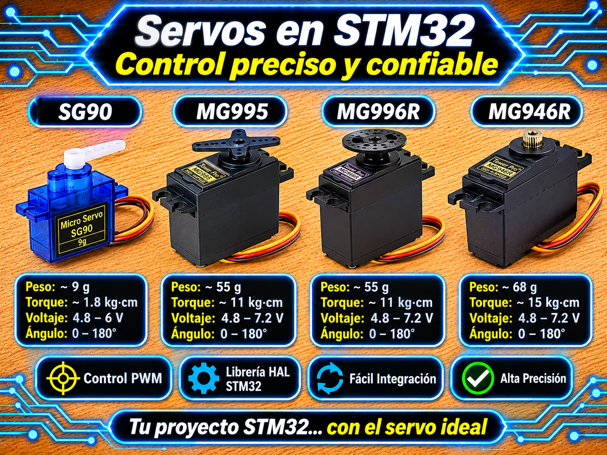

# Driver TM1637 (Controlador de Display de 7 Segmentos por Bit-Banging) para STM32 HAL

<p align="center">
  
</p>

Driver modular, ligero y no bloqueante para el controlador de displays LED de 7 segmentos de hasta 6 dígitos **TM1637** mediante la capa **HAL** de STM32.

Implementa comunicación serie mediante **bit-banging por software** con temporización configurable a nivel de microsegundos mediante el módulo auxiliar `utils_STM32` (`Utils_DelayUs`). Incluye lectura del pulso de reconocimiento (**ACK**) en el 9.º pulso de reloj para la detección automática de desconexión del display, control dinámico de brillo (8 niveles), borrado de ceros a la izquierda (*blanking*), formateo de números enteros signados, representación de reloj $HH:MM$ con parpadeo no bloqueante de dos puntos y algoritmo de reconexión en caliente (*hot-plug*).

---

## Características

- **Protocolo Personalizado por Bit-Banging:** Comunicación de 2 hilos (`CLK` y `DIO`) independiente del periférico hardware I2C/SPI, operable sobre cualquier par de pines GPIO.
- **Acceso Bidireccional Seguro (Open-Drain):** Configuración del pin `DIO` en modo **Open-Drain** (`GPIO_MODE_OUTPUT_OD`) con resistencia de *pull-up*, evitando cortocircuitos durante el muestreo del bit de ACK emitido por el integrado.
- **Detección Automática y Reconexión en Caliente (*Hot-Plug*):** Valida la presencia física del chip mediante la verificación del bit ACK en cada transacción. Si el display se desenchufa o pierde alimentación, detecta la desconexión (`HAL_ERROR`), mantiene la lógica interna del sistema y se re-inicializa automáticamente al reconectarse sin colgar la CPU.
- **Formateo Numérico Inteligente:**
  - `TM1637_DisplayDecimal()`: Formatea enteros signados entre $-999$ y $9999$ con supresión de ceros a la izquierda y ubicación dinámica del signo negativo `-`.
  - `TM1637_DisplayClock()`: Visualización de formato horario $HH:MM$ con control del bit de los dos puntos (`:`) integrado en el segmento punto del segundo dígito.
  - `TM1637_DisplaySegments()`: Escritura directa de máscaras de 7 segmentos para caracteres personalizados o símbolos hexadecimales ($0 \dots F$).
- **Gestión Eficiente de Brillo y Potencia:** 8 niveles de brillo (0 a 7) e instrucción de encendido/apagado (*Display ON/OFF*) preservada en la estructura del handler `TM1637_HandleTypeDef`.

---

## Requisitos y Dependencias Obligatorias

| Requisito / Dependencia | Detalle |
| :--- | :--- |
| **Microcontrolador** | Cualquier STM32 (probado en NUCLEO-F439ZI, Blue Pill STM32F103C8T6, Black Pill STM32F411CEU6). |
| **Módulo Auxiliar Obligatorio** | **`utils_STM32` (`utils.h` / `utils.c`)**: Provee `Utils_DelayUs_Init()` y `Utils_DelayUs()` para retardos precisos por hardware (DWT / SysTick). |
| **Pin CLK (`TM1637_CLK_Pin`)** | GPIO Salida Push-Pull (`GPIO_MODE_OUTPUT_PP`), velocidad **High**. |
| **Pin DIO (`TM1637_DIO_Pin`)** | GPIO Salida **Open-Drain obligatoria con Pull-Up** (`GPIO_MODE_OUTPUT_OD`, `GPIO_PULLUP`), velocidad **High**. |
| **Header Principal** | `main.h` (autogenerado por STM32CubeMX). |

> **¡Atención con la dependencia `utils_STM32`!**  
> Este driver requiere incluir las fuentes de `utils_STM32` (`utils.h` y `utils.c`) en el proyecto. `TM1637_Init()` llama internamente a `Utils_DelayUs_Init()` para garantizar temporizaciones exactas en microsegundos independientes de la frecuencia de reloj del procesador.

---

## Archivos del Driver

| Archivo | Descripción |
| :--- | :--- |
| `tm1637_STM32.h` | Cabecera principal: macros de comandos, definición de la estructura `TM1637_HandleTypeDef`, enum de máscaras de segmentos y prototipos de la API. |
| `tm1637_STM32.c` | Implementación de bajo nivel: primitivas de bit-banging (Start, Stop, WriteByte, ACK), tabla de decodificación a 7 segmentos y funciones de formateo alto nivel. |
| `utils.h` / `utils.c` | **Dependencia requerida:** Módulo auxiliar de retardo por hardware en microsegundos. |

---

## Conexión de Hardware y Configuración GPIO (CubeMX)

| Pin del Módulo TM1637 | Conexión en STM32 / Label CubeMX | Configuración GPIO en CubeMX |
| :---: | :---: | :--- |
| **VCC** | **3.3V o 5.0V** | Alimentación lógica y de los LEDs del display. |
| **GND** | **GND** | Masa común del circuito. |
| **CLK** | `TM1637_CLK_GPIO_Port`, `TM1637_CLK_Pin` | `Output Push-Pull`, `No Pull`, `Speed: High` |
| **DIO** | `TM1637_DIO_GPIO_Port`, `TM1637_DIO_Pin` | `Output Open-Drain`, `Pull-up`, `Speed: High` |

```
       STM32                      Módulo TM1637
  +------------------+          +---------------+
  |              3.3V|--------->|VCC            |
  |               GND|--------->|GND            |
  |  TM1637_CLK_Pin  |--------->|CLK            |
  |                  |  +------>|DIO            |
  |  TM1637_DIO_Pin  |--+       +---------------+
  +------------------+  |
                       [R] Pull-Up Interno habilitado en CubeMX
                        |  (o Pull-Up externo 4.7kΩ a 3.3V)
                       3.3V
```

---

## Formulación del Protocolo y Tiempos de Bit-Banging

### 1. Estructura de la Señal de Bus TM1637

A diferencia del protocolo $I^2C$ estándar, el TM1637 **transmite los datos enviando el bit menos significativo ($LSB$) primero** y no requiere direccionamiento de esclavo:

$$\text{Bitstream: } D_0 \rightarrow D_1 \rightarrow D_2 \rightarrow D_3 \rightarrow D_4 \rightarrow D_5 \rightarrow D_6 \rightarrow D_7$$

- **Condición de START:** Transición de flanco descendente en `DIO` mientras `CLK` permanece en nivel ALTO ($1$).
- **Condición de STOP:** Transición de flanco ascendente en `DIO` mientras `CLK` permanece en nivel ALTO ($1$).
- **Muestreo de Datos:** El pin `DIO` debe permanecer estable mientras `CLK` se encuentra en nivel ALTO ($1$) y solo puede cambiar su estado cuando `CLK` pasa a nivel BAJO ($0$).

### 2. Retardo y Frecuencia Máxima (`TM1637_DELAY_US`)

El tiempo de semiperiodo de reloj viene definido por la macro `TM1637_DELAY_US` (por defecto en $3\ \mu\text{s}$):

$$f_{\text{CLK}} \approx \frac{1}{2 \times t_{\text{delay}} + t_{\text{HAL}}}$$

Para $t_{\text{delay}} = 3\ \mu\text{s}$, la frecuencia nominal bordea los $\approx 160\text{ kHz}$ (límite físico soportado por el chip: $500\text{ kHz}$), garantizando inmunidad al ruido y estabilidad en cables largos.

---

## Ejemplo de Integración Completo (Basado en `main.c`)

Demostración de inicialización, pruebas secuenciales de números/brillo y loop principal con reloj no bloqueante $HH:MM$ más **mecanismo de reconexión automática en caliente**.

```c
#include "main.h"
#include "tm1637_STM32.h"
#include "string.h"

TM1637_HandleTypeDef htm;

int main(void)
{
    HAL_Init();
    SystemClock_Config();
    MX_GPIO_Init();
    MX_USART3_UART_Init();

    /* 1. Inicialización del Driver TM1637 */
    if (TM1637_Init(&htm, TM1637_CLK_GPIO_Port, TM1637_CLK_Pin,
                    TM1637_DIO_GPIO_Port, TM1637_DIO_Pin) != HAL_OK) {
        /* Display no detectado al arrancar (cable suelto, sin pull-up o sin alimentación) */
    }

    /* --- Prueba 1: Números enteros y negativos --- */
    TM1637_DisplayDecimal(&htm, 1234, 0);
    HAL_Delay(1000);
    TM1637_DisplayDecimal(&htm, -5, 0);
    HAL_Delay(1000);
    TM1637_DisplayDecimal(&htm, -42, 0);
    HAL_Delay(1000);
    TM1637_DisplayDecimal(&htm, -123, 0);
    HAL_Delay(1000);

    /* --- Prueba 2: Barrido de nivel de brillo --- */
    TM1637_DisplayDecimal(&htm, 8888, 1);
    for (uint8_t b = 0; b <= TM1637_MAX_BRIGHTNESS; b++) {
        TM1637_SetBrightness(&htm, b, 1);
        HAL_Delay(250);
    }

    /* --- Prueba 3: Apagar display y escribir (se mantiene apagado hasta dar ON) --- */
    TM1637_SetBrightness(&htm, 7, 0);
    TM1637_DisplayDecimal(&htm, 1111, 0);
    HAL_Delay(1000);
    TM1637_SetBrightness(&htm, 7, 1);     /* Enciende y muestra 1111 */
    HAL_Delay(1000);

    TM1637_Clear(&htm);

    /* --- Variables del Bucle Principal --- */
    uint8_t  hours = 12, minutes = 58, seconds = 0;
    uint8_t  colon = 1;
    uint8_t  display_ok = 1;                 /* Estado de conexión del display */
    uint32_t t_last  = HAL_GetTick();
    uint32_t t_retry = HAL_GetTick();

    while (1)
    {
        /* TAREA 1: Reloj simple sin bloquear (actualiza cada 500 ms con parpadeo de ":") */
        if ((HAL_GetTick() - t_last) >= 500U) {
            t_last += 500U;
            colon ^= 1U;

            if (colon) {                    /* Incrementa 1 segundo cada 2 medios periodos */
                if (++seconds >= 60U) {
                    seconds = 0U;
                    if (++minutes >= 60U) {
                        minutes = 0U;
                        if (++hours >= 24U) hours = 0U;
                    }
                }
            }

            /* El conteo del reloj continúa internamente aunque no haya display físico */
            if (display_ok) {
                if (TM1637_DisplayClock(&htm, hours, minutes, colon) != HAL_OK) {
                    display_ok = 0;         /* Sin ACK: display desconectado */
                    t_retry = HAL_GetTick();
                }
            }
        }

        /* TAREA 2: Reintento de conexión cada 1 segundo (Hot-Plug) */
        if (!display_ok && (HAL_GetTick() - t_retry) >= 1000U) {
            t_retry = HAL_GetTick();
            if (TM1637_IsConnected(&htm) == HAL_OK) {
                if (TM1637_Init(&htm, TM1637_CLK_GPIO_Port, TM1637_CLK_Pin,
                                TM1637_DIO_GPIO_Port, TM1637_DIO_Pin) == HAL_OK) {
                    display_ok = 1;         /* Módulo reconectado y re-inicializado */
                }
            }
        }

        /* Otras tareas no bloqueantes del super-loop... */
    }
}
```

---

## API del Driver

| Función | Descripción |
| :--- | :--- |
| `TM1637_Init(htm1637, clk_port, clk_pin, dio_port, dio_pin)` | Guarda los puertos/pines GPIO, inicializa la base de microsegundos de `utils_STM32`, limpia la memoria RAM del display y aplica brillo máximo. |
| `TM1637_SetBrightness(htm1637, brightness, enable)` | Modifica el nivel de intensidad luminosa ($0 \dots 7$) y el estado del display (Encendido/Apagado). |
| `TM1637_DisplaySegments(htm1637, segments, length, pos)` | Envía máscaras puras de 7 segmentos a partir de la posición `pos` ($0 \dots 5$). Transfiere los datos en modo autoincremento de dirección. |
| `TM1637_DisplayDecimal(htm1637, num, show_dots)` | Formatea e imprime números entre $-999$ y $9999$. Realiza supresión de ceros a la izquierda y alinea el signo `-`. |
| `TM1637_DisplayClock(htm1637, hours, minutes, show_colon)` | Imprime valores horarios $HH:MM$ ($0\dots99$ hrs, $0\dots59$ min). Enciende o apaga el bit de los dos puntos centrales. |
| `TM1637_IsConnected(htm1637)` | Comprueba la presencia física del chip enviando el comando de brillo actual. Devuelve `HAL_OK` si el chip emitió el bit ACK. |
| `TM1637_Clear(htm1637)` | Apaga todos los segmentos escribiendo ceros en las 6 posiciones de la RAM. |

---

## Solución de Problemas

| Síntoma | Causa probable | Solución |
| :--- | :--- | :--- |
| `TM1637_Init()` devuelve `HAL_ERROR` | Falta la resistencia de Pull-Up en `DIO`, pin no configurado como Open-Drain, o display no alimentado. | Asegurar un Pull-Up externo ($4.7\text{ k}\Omega$) o activar `GPIO_PULLUP` en CubeMX, alimentar a $3.3\text{V}/5\text{V}$ y verificar `GPIO_MODE_OUTPUT_OD`. |
| Error de compilación: `undefined reference to Utils_DelayUs` | No se agregaron las fuentes del módulo `utils_STM32` al proyecto. | Incluir `utils.h` y `utils.c` en el proyecto e incluir el path en las opciones del compilador GCC. |
| Caracteres corruptos o parpadeo errático | Retardo de bit-banging demasiado corto para cables largos o parásitos capacitivos elevados. | Aumentar el tiempo de delay definiendo `-DTM1637_DELAY_US=5` o `$10$` antes de incluir la cabecera. |
| Los dos puntos (`:`) no encienden en el módulo de reloj | Los dos puntos en módulos de 4 dígitos dependen del bit 7 (`0x80`) del **segundo dígito** (índice 1). | Usar la función `TM1637_DisplayClock()` o aplicar la máscara `TM1637_SEG_POINT` sobre `segments[1]`. |

---

## Licencia

- **MIT**. Desarrollado por **Mamani Flores Carlos (UTN FRT)** 2026.