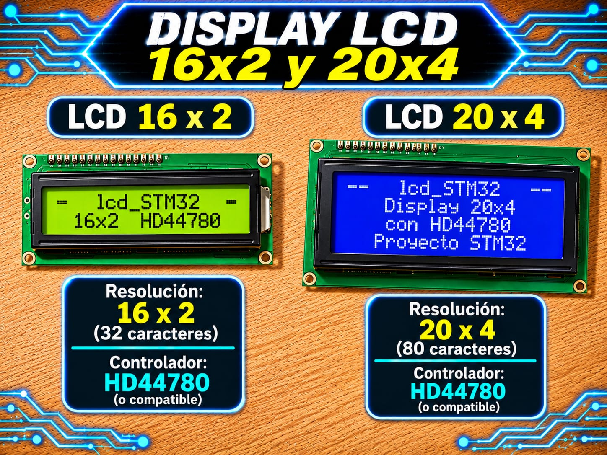

# Driver LCD HD44780 (Modo 4 bits) - STM32

Driver de Capa 2 (HAL) para displays alfanuméricos Hitachi HD44780 (16x2 y 20x4) con abstracción total de pines GPIO y retardos no bloqueantes en microsegundos.

<p align="center">
  
</p>


## Características

* Abstracción de pines GPIO por estructura (`LCD_Config_t`): permite asignar RS, EN y D4-D7 a cualquier puerto y pin del STM32.

* Soporte nativo para geometrías **16x2** y **20x4** con detección de límites por software.

* Formateo avanzado HMI integrado: enteros con signo (`LCD_PrintInt`), flotantes con redondeo y ceros a la izquierda (`LCD_PrintFloat`), y barras de progreso (`LCD_DrawProgressBar`).

* Gestión de memoria CGRAM: creación y redefinición de hasta 8 caracteres personalizados de 5x8 puntos.

* Tiempos de microsegundos garantizados mediante `utils.h` usando `DWT->CYCCNT` o SysTick como respaldo.

## Compatibilidad

| Elemento | Detalle | 
| ----- | ----- | 
| Interfaz | GPIO Push-Pull (4 bits de datos + RS + EN) | 
| Capa | Capa 2 (Driver / HAL) | 
| Probado en | STM32F439ZI (Nucleo-144), STM32F103C8T6 (Blue Pill), STM32F411CEU6 (Black Pill) | 
| Voltaje del módulo | 5 V (VCC/Logic), compatible con tolerantes a 5V en GPIO o 3.3V directa según display | 

## Archivos

| Archivo | Descripción | 
| ----- | ----- | 
| `lcd_STM32.h` | API pública, estructuras de configuración, enumeraciones y documentación Doxygen | 
| `lcd_STM32.c` | Implementación de la lógica del HD44780, secuencia de reseteo por software y formateo decimal/flotante | 
| `utils.h` | API de temporización en microsegundos (`Utils_DelayUs_Init`, `Utils_DelayUs`) | 
| `utils.c` | Implementación del timer de retardo usando DWT CYCCNT con fallback a SysTick | 

## Conexiones

| Módulo (LCD HD44780) | STM32 (Ejemplo) | Descripción | 
| ----- | ----- | ----- | 
| VSS | GND | Tierra de alimentación | 
| VDD | 5V | Alimentación del módulo | 
| V0 | Cursor Potenciómetro (10 kΩ) | Ajuste de contraste (conectado entre 5V y GND) | 
| RS | LCD_RS Pin | Register Select (0: Instrucción, 1: Datos) | 
| RW | GND | Read/Write (conectado a GND para modo solo escritura) | 
| E | LCD_EN Pin | Enable (Pulso de habilitación de lectura/escritura) | 
| D0 - D3 | No conectados | Bus bajo de datos (no usado en interfaz de 4 bits) | 
| D4 | LCD_D4 Pin | Data Bit 4 | 
| D5 | LCD_D5 Pin | Data Bit 5 | 
| D6 | LCD_D6 Pin | Data Bit 6 | 
| D7 | LCD_D7 Pin | Data Bit 7 | 
| A (Anode) | 5V (o resistencia 220 Ω) | Retroiluminación LED (+) | 
| K (Cathode) | GND | Retroiluminación LED (-) | 

> Los pines RS, EN y D4-D7 son totalmente reconfigurables en la estructura `LCD_Config_t` según la asignación realizada en STM32CubeMX.

## Integración

1. Copia `lcd_STM32.h`, `lcd_STM32.c`, `utils.h` y `utils.c` a tu proyecto (por ejemplo en `Core/Inc` y `Core/Src`).

2. Configura los 6 pines de control (RS, EN, D4, D5, D6, D7) en CubeMX como **GPIO_Output** (Push-Pull, No pull-up/pull-down, Output speed Low/Medium) y asígnales sus *User Labels* correspondientes (ej. `LCD_RS`, `LCD_EN`, `LCD_D4`, etc.).

3. Incluye el header donde lo necesites:

   ```c
   #include "lcd_STM32.h"
   ```

4. Asegúrate de que `main.h` incluya la cabecera del HAL correspondiente a tu microcontrolador (ej. `#include "stm32f4xx_hal.h"` o `#include "stm32f1xx_hal.h"`).

## Ejemplo mínimo

```c
#include "main.h"
#include "lcd_STM32.h"

/* 
 * Estructura de configuración utilizando las etiquetas definidas en STM32CubeMX.
 * Al usar las macros generadas en main.h, si cambias la asignación de pines 
 * en CubeMX, la documentación del proyecto y la inicialización se remapean 
 * automáticamente sin necesidad de modificar el código en main.c.
 */
static const LCD_Config_t myLcd = {
    .port_rs = LCD_RS_GPIO_Port, .pin_rs = LCD_RS_Pin,
    .port_en = LCD_EN_GPIO_Port, .pin_en = LCD_EN_Pin,
    .port_d4 = LCD_D4_GPIO_Port, .pin_d4 = LCD_D4_Pin,
    .port_d5 = LCD_D5_GPIO_Port, .pin_d5 = LCD_D5_Pin,
    .port_d6 = LCD_D6_GPIO_Port, .pin_d6 = LCD_D6_Pin,
    .port_d7 = LCD_D7_GPIO_Port, .pin_d7 = LCD_D7_Pin,
    .type    = LCD_16X2 // O LCD_20X4 según corresponda
};

int main(void)
{
    HAL_Init();
    SystemClock_Config();
    MX_GPIO_Init();

    /* Inicializar la pantalla LCD (incluye retardo interno DWT/SysTick) */
    LCD_Init(&myLcd);

    LCD_SetCursor(0, 0);
    LCD_Print("UTN FRT 2026");

    LCD_SetCursor(1, 0);
    LCD_PrintFloat(3.14159f, 2);

    while (1)
    {
        /* Código principal */
    }
}
```

## API principal

| Función | Descripción | 
| ----- | ----- | 
| `LCD_Init()` | Inicializa el hardware, la secuencia de reseteo por software de 4 bits y los retardos `utils` | 
| `LCD_Clear()` | Borra el contenido visible y coloca el cursor en la posición (0,0) (requiere ~2 ms) | 
| `LCD_SetCursor()` | Posiciona el cursor en una fila y columna específica con saturación de límites | 
| `LCD_Print()` | Imprime una cadena de caracteres finalizada en nulo (`\0`) | 
| `LCD_WriteChar()` | Escribe un único carácter ASCII o de la memoria CGRAM | 
| `LCD_SetCursorMode()` | Configura el cursor (oculto `LCD_CURSOR_OFF`, fijo `LCD_CURSOR_ON` o parpadeante `LCD_CURSOR_BLINK`) | 
| `LCD_Shift()` | Desplaza la pantalla visible hacia la izquierda o derecha (`LCD_SHIFT_LEFT`, `LCD_SHIFT_RIGHT`) | 
| `LCD_CreateCustomChar()` | Almacena un patrón 5x8 de 8 bytes en uno de los 8 slots de la memoria CGRAM (0 a 7) | 
| `LCD_PrintInt()` | Imprime un entero de 32 bits con signo (`int32_t`) | 
| `LCD_PrintFloat()` | Imprime un `float` especificando la cantidad de decimales, redondeo y formateo especial (`NaN`, `Ovf`) | 
| `LCD_DrawProgressBar()` | Dibuja una barra de progreso `[>>>>   ]` en una posición y ancho dados según un porcentaje (0-100%) | 
| `LCD_Test()` | Ejecuta una prueba demostrativa bloqueante de todas las capacidades del driver | 

La documentación detallada de los parámetros y comportamientos está disponible en los comentarios Javadoc/Doxygen de `lcd_STM32.h`.

## Notas y problemas conocidos

* **Remapeo dinámico de pines:** Se recomienda definir *User Labels* (`LCD_RS`, `LCD_EN`, etc.) en el asignador de pines de STM32CubeMX. De este modo, al regenerar código tras cambiar de pin o microcontrolador, la estructura `myLcd` tomará automáticamente las nuevas asignaciones sin requerir ediciones manuales en `main.c`.

* **Pin R/W:** Debe conectarse obligatoriamente a **GND**. El driver no realiza lectura del *Busy Flag* (BF) del HD44780, sino que gestiona los tiempos mediante retardos fijos calibrados en microsegundos.

* **Placas Cortex-M0/M0+:** En familias como STM32F0, G0 o L0, el periférico DWT no cuenta con el registro `CYCCNT`. En esos micros, `utils.c` conmuta automáticamente al temporizador SysTick sin requerir cambios de código.

* **Acceso a CGRAM:** Tras invocar `LCD_CreateCustomChar()`, la dirección interna del LCD apunta a la CGRAM. Es necesario ejecutar `LCD_SetCursor()` antes de imprimir texto estándar en la DDRAM.

* **Instancia Única:** El driver utiliza un estado estático privado (`_lcd`), por lo que maneja un único display por aplicación.

## Licencia

MIT. Desarrollado por **Mamani Flores Carlos (UTN FRT)** - 2026.