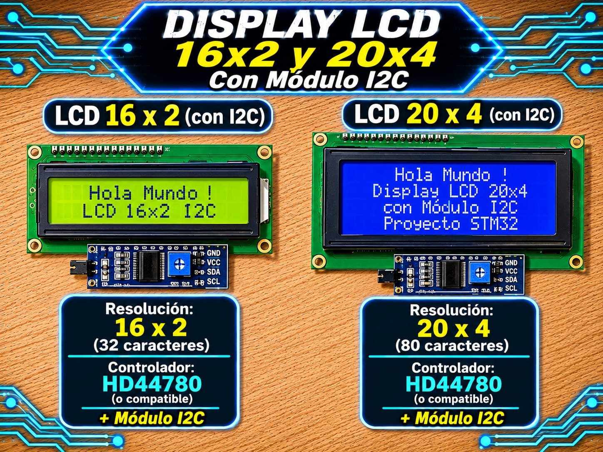

# Driver LCD HD44780 por I2C (PCF8574) - STM32

Driver de Capa 2 (HAL) para pantallas alfanuméricas Hitachi HD44780 (16x2 y 20x4) controladas a través del expansor de puerto I2C de 8 bits PCF8574.

<p align="center">
  
</p>


## Características 

- Control completo de pantallas LCD alfanuméricas mediante bus I2C (solo 2 líneas de datos: SDA y SCL).
- Transmisión optimizada por tramas I2C agrupadas: envía múltiples nibbles en una sola transacción para maximizar la velocidad y reducir la carga del bus.
- Soporte para geometrías **16x2** y **20x4** con limitación (*clamping*) de coordenadas y detección de bordes.
- Gestión de retroiluminación (*Backlight*) integrada sin alterar el estado del display.
- Detección de fallos y flag de error (`LCD_I2C_GetError`) para evitar colgar la CPU ante un bus I2C desconectado o bloqueado.
- Formateo avanzado HMI: enteros con signo (`LCD_I2C_PrintInt`), flotantes con acarreo por redondeo (`LCD_I2C_PrintFloat`), caracteres personalizados en CGRAM (`LCD_I2C_CreateCustomChar`) y barras de progreso (`LCD_I2C_DrawProgressBar`).

## Compatibilidad

| Elemento | Detalle |
|----------|---------|
| Interfaz | I2C (Standard Mode 100 kHz / Fast Mode 400 kHz) |
| Expansor HW | PCF8574 / PCF8574T (`0x27 << 1`) o PCF8574AT (`0x3F << 1`) |
| Capa | Capa 2 (Driver / HAL) |
| Probado en | STM32F439ZI (Nucleo-144), STM32F103C8T6 (Blue Pill), STM32F411CEU6 (Black Pill) |
| Voltaje del módulo | 5 V (VCC), bus I2C con pull-ups de 4.7 kΩ a 3.3V o 5V según placa *(opcional)* |

> ⚠️ **ATENCIÓN CON LA DIRECCIÓN I2C EN LA HAL DE STM32:**
> La HAL de STM32 requiere que la dirección del periférico I2C esté desplazada 1 bit a la izquierda (dirección de 8 bits). 
> Por ejemplo, si el escáner detecta la dirección estándar de 7 bits `0x27`, en la estructura de configuración debes colocar `0x27 << 1` (que equivale a `0x4E`).

## Archivos

| Archivo | Descripción |
|---------|-------------|
| `lcd_i2c_STM32.h` | API pública, enumeraciones, estructura de configuración `LCD_I2C_Config_t` y documentación Doxygen |
| `lcd_i2c_STM32.c` | Implementación del protocolo I2C para PCF8574, empaquetado de tramas, reset por software y formateo decimal/flotante |

## Conexiones

| Módulo I2C LCD (PCF8574) | STM32 (Ejemplo I2C1) | Descripción |
|--------------------------|----------------------|-------------|
| **GND** | GND | Tierra de alimentación |
| **VCC** | 5V | Alimentación del módulo y retroiluminación |
| **SDA** | PB9 (o PB7) | Línea de Datos I2C (I2C1_SDA) |
| **SCL** | PB8 (o PB6) | Línea de Reloj I2C (I2C1_SCL) |

> 📌 **Notas de hardware:** 
> - El jumper situado en la parte trasera de la módulo I2C debe estar colocado para habilitar la retroiluminación LED.
> - Regula el potenciómetro azul del módulo PCF8574 para ajustar el contraste si no observas los caracteres al encender.

## Integración

1. Copia `lcd_i2c_STM32.h` y `lcd_i2c_STM32.c` a tu proyecto (por ejemplo en `Core/Inc` y `Core/Src`).
2. Configura el periférico I2C en CubeMX (ej. `I2C1`, Standard Mode 100 kHz, Fast Mode 400 kHz).
3. Incluye el header donde lo necesites:

   ```c
   #include "lcd_i2c_STM32.h"
   ```

4. Define la estructura de configuración apuntando al handler del I2C generado por CubeMX (`hi2c1`):

   ```c
   LCD_I2C_Config_t lcd_cfg = {
       .hi2c     = &hi2c1,
       .i2c_addr = (0x27 << 1), /* Dirección de 8 bits para la HAL */
       .type     = LCD_I2C_16X2
   };
   ```

## Ejemplo mínimo

```c
#include "main.h"
#include "lcd_i2c_STM32.h"

/*
 * Configuración del LCD. Elegir según el display conectado:
 *   - 20x4 -> LCD_I2C_20X4 con dirección 0x27
 *   - 16x2 -> LCD_I2C_16X2 con dirección 0x3F
 * (0x27 suele ser un PCF8574 y 0x3F un PCF8574A; si no responde, probar la otra.)
 * Esta pantalla de usuario dibuja 4 filas, por lo que necesita el display 20x4.
 */
#define LCD_TYPE            LCD_I2C_16X2
#define LCD_ADDRESS         (0x3F << 1)

I2C_HandleTypeDef hi2c1;

static const LCD_I2C_Config_t lcd_cfg = {
    .hi2c     = &hi2c1,
    .i2c_addr = LCD_ADDRESS,
    .type     = LCD_TYPE 
};

int main(void)
{
    HAL_Init();
    SystemClock_Config();
    MX_GPIO_Init();
    MX_I2C1_Init();

    /* Inicializar la pantalla por I2C */
    LCD_I2C_Init(&lcd_cfg);

    /* Verificar si ocurrió algún error en la inicialización I2C */
    if (LCD_I2C_GetError()) {
        /* Error: el módulo no respondió o la dirección es incorrecta */
    }

    LCD_I2C_SetCursor(0, 0);
    LCD_I2C_Print("UTN FRT 2026");

    LCD_I2C_SetCursor(1, 0);
    LCD_I2C_PrintFloat(3.14159f, 2);

    while (1)
    {
        /* Bucle principal */
    }
}
```

## API principal

| Función | Descripción |
|---------|-------------|
| `LCD_I2C_Init()` | Verifica presencia en el bus I2C y ejecuta el reset por software a modo 4 bits |
| `LCD_I2C_GetError()` | Consulta y limpia el flag de error acumulado (fallos de comunicación I2C) |
| `LCD_I2C_Backlight()` | Enciende (`1`) o apaga (`0`) la retroiluminación sin modificar el contenido |
| `LCD_I2C_Clear()` | Limpia el display y posiciona el cursor en (0,0) (espera ~2 ms) |
| `LCD_I2C_SetCursor()` | Posiciona el cursor en fila y columna respetando la geometría declarada |
| `LCD_I2C_Print()` | Imprime una cadena de caracteres finalizada en nulo (`\0`) |
| `LCD_I2C_WriteChar()` | Escribe un único carácter ASCII o de la CGRAM |
| `LCD_I2C_SetCursorMode()` | Configura el cursor (oculto `LCD_I2C_CURSOR_OFF`, fijo `LCD_I2C_CURSOR_ON`, parpadeante `LCD_I2C_CURSOR_BLINK`) |
| `LCD_I2C_Shift()` | Desplaza la ventana visible hacia la izquierda o derecha |
| `LCD_I2C_CreateCustomChar()` | Almacena un mapa de bits de 5x8 píxeles en la memoria CGRAM (posiciones 0 a 7) |
| `LCD_I2C_PrintInt()` | Imprime un entero de 32 bits con signo (`int32_t`) |
| `LCD_I2C_PrintFloat()` | Imprime un `float` con control de decimales, redondeo e indicadores `NaN` / `OVF` |
| `LCD_I2C_DrawProgressBar()` | Dibuja una barra de progreso en texto `[>>>>   ]` según un porcentaje (0-100%) |
| `LCD_I2C_Test()` | Rutina bloqueante de prueba completa del hardware y sus funciones |

## Notas y problemas conocidos

- **Mochilas I2C con chip PCF8574AT:** Si el integrado en la placa adaptadora finaliza en **AT**, la dirección base por defecto suele ser `0x3F` (por lo que en la configuración se debe usar `0x3F << 1`).
- **Resistencias de Pull-Up:** El bus I2C requiere resistencias de elevación (pull-ups) en las líneas SDA y SCL (habitualmente de 4.7 kΩ). La mayoría de los módulos mochila para LCD ya las traen incorporadas.
- **Retardos de Microsegundos:** El driver utiliza `utils.h` para el tiempo de espera del comando Clear (~2 ms), garantizando la compatibilidad con Cortex-M3/M4/M7 vía DWT y Cortex-M0 vía SysTick.
- **Configuración del LCD**. Elegir según el display conectado:
   - 20x4 -> LCD_I2C_20X4 con dirección 0x27
   - 16x2 -> LCD_I2C_16X2 con dirección 0x3F

## Licencia

MIT. Desarrollado por **Mamani Flores Carlos (UTN FRT)** - 2026.