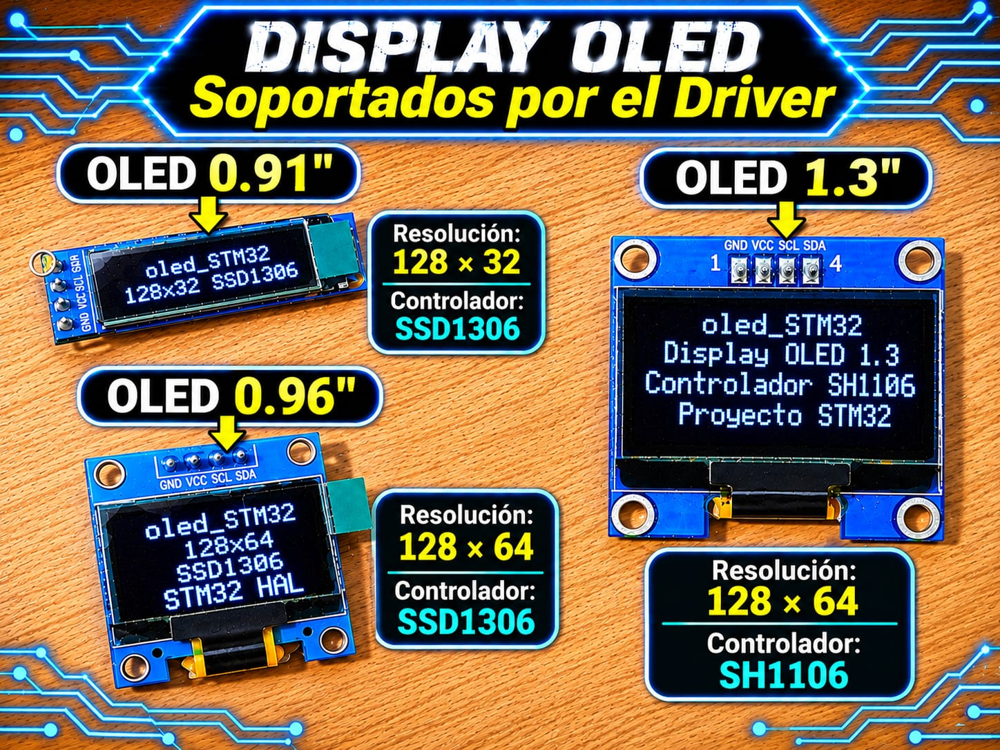

# Driver Displays OLED SSD1306 / SH1106 (I2C) - STM32

Driver de Capa 2 (HAL) para displays gráficos OLED monocromos con controladores **SSD1306** y **SH1106** mediante interfaz I2C, con gestión por *framebuffer* en RAM, primitivas gráficas, recorte de bordes (*clipping*) y soporte tipográfico múltiple.

<p align="center">
  
</p>


## Características

* **Soporte Dual de Controladores:** Compatible con SSD1306 (módulos de 0.96") y SH1106 (módulos de 1.3" con compensación automática del offset de 2 columnas en RAM).
* **Resoluciones Configurables:** Compatibilidad nativa para pantallas de **128x64** (8 páginas) y **128x32** (4 páginas).
* **Gestión por Framebuffer:** Todo el renderizado se realiza en un búfer estático en RAM de 1 KB (128x64) o 512 B (128x32) y se actualiza físicamente en pantalla mediante `OLED_UpdateDisplay()`.
* **Capa Abstraída Debil (`__WEAK`):** Funciones de transmisión I2C, retardos y GPIO implementadas como débiles, permitiendo reemplazarlas fácilmente para transmisión por DMA, interrupciones o entre familias STM32.
* **Motor Gráfico Integrado:** Primitivas de dibujado (píxeles, líneas con algoritmo de Bresenham, rectángulos llenos/vacíos, triángulos, círculos por algoritmo de punto medio y bitmaps monocromos).
* **Motor de Texto Completo:** Renderizado tipográfico transparente con ajuste y salto de línea automático (*word wrap*).
* **Efectos por Hardware y Software:** Inversión de pantalla por comando hardware y desplazamiento (*scroll*) horizontal por software.

## Compatibilidad

| Elemento | Detalle |
|----------|---------|
| Interfaz | I2C (Standard Mode 100 kHz / Fast Mode 400 kHz) |
| Controladores | SSD1306 (0.96") / SH1106 (1.3") |
| Capa | Capa 2 (Driver / HAL) |
| Probado en | STM32F439ZI (Nucleo-144), STM32F103C8T6 (Blue Pill), STM32F411CEU6 (Black Pill) |
| Voltaje del módulo | 3.3 V / 5 V (generador de alta tensión Charge Pump integrado de 3.3V) |

> ⚠️ **DIRECCIÓN I2C EN HAL STM32:**
> La HAL de STM32 requiere la dirección del periférico I2C corrida 1 bit a la izquierda (formato de 8 bits).
> * Dirección 7 bits por defecto: `0x3C` ➔ Formato HAL: `0x3C << 1` (que equivale a `0x78`) para display con SH1106 y SSD1306.

## Archivos

| Archivo | Descripción |
|---------|-------------|
| `OLED_Display_STM32.h` | API pública, macros de colores, enumeraciones, estructuras de configuración (`OLED_Config_t`) y descriptores de fuentes (`FontDef`) |
| `OLED_Display_STM32.c` | Implementación del motor gráfico, gestión del framebuffer, secuencias de inicialización I2C y primitivas de dibujo |
| `OLED_Fonts_STM32.h` / `.c` | Tablas de mapas de bits para tipografías (`Font_6x8`, `Font_7x10`, `Font_11x18`, `Font_16x26`) |

## Conexiones

| Módulo OLED | STM32 (Ejemplo I2C1) | Descripción |
|-------------|----------------------|-------------|
| **GND** | GND | Tierra de alimentación |
| **VCC** | 3.3 V / 5 V | Alimentación del módulo |
| **SCK / SCL** | PB8 (o PB6) | Línea de Reloj I2C (I2C1_SCL) |
| **SDA** | PB9 (o PB7) | Línea de Datos I2C (I2C1_SDA) |
| **RES / RST** | (Opcional) GPIO | Pin de Reset por hardware (asignar `NULL` en config si se deja flotante/desconectado) |

## Integración

1. Copia `OLED_Display_STM32.h`, `OLED_Display_STM32.c`, `OLED_Fonts_STM32.h` y `OLED_Fonts_STM32.c` a tu proyecto (en `Core/Inc` y `Core/Src`).
2. Configura el periférico I2C en STM32CubeMX (Fast Mode 400 kHz recomendado para refrescos rápidos de pantalla).
3. Incluye la cabecera en tu archivo principal:

   ```c
   #include "OLED_Display_STM32.h"
   #include "OLED_Fonts_STM32.h"
   ```

4. Crea la estructura de configuración y realiza la inicialización:

   ```c
   OLED_Config_t oled_cfg = {
       .driver_type    = OLED_DRIVER_SSD1306,
       .resolution     = OLED_RESOLUTION_128x64,
       .i2c_address    = (0x3C << 1), /* Dirección I2C en formato 8 bits */
       .hal_i2c_handle = &hi2c1,
       .rst_port       = NULL,        /* Sin pin de reset dedicado */
       .rst_pin        = 0
   };
   ```

## Ejemplo mínimo

```c
#include "main.h"
#include "OLED_Display_STM32.h"
#include "OLED_Fonts_STM32.h"

extern I2C_HandleTypeDef hi2c1;

static OLED_Config_t oled = {
    .driver_type    = OLED_DRIVER_SSD1306,
    .resolution     = OLED_RESOLUTION_128x64,
    .i2c_address    = (0x3C << 1),
    .hal_i2c_handle = &hi2c1,
    .rst_port       = NULL,
    .rst_pin        = 0
};

int main(void)
{
    HAL_Init();
    SystemClock_Config();
    MX_GPIO_Init();
    MX_I2C1_Init();

    /* Inicializa pantalla y limpia el framebuffer */
    if (OLED_Init(&oled)) {
        /* Dibujar primitivas gráficas y texto en el framebuffer */
        OLED_DrawString(&oled, 0, 0, "UTN FRT 2026", &Font_7x10, OLED_COLOR_WHITE);
        OLED_DrawLine(&oled, 0, 12, 127, 12, OLED_COLOR_WHITE);
        OLED_DrawRectangle(&oled, 10, 20, 40, 30, OLED_COLOR_WHITE, false);
        OLED_DrawFilledCircle(&oled, 90, 35, 15, OLED_COLOR_WHITE);

        /* Transferir el framebuffer a la GDDRAM del OLED */
        OLED_UpdateDisplay(&oled);
    }

    while (1)
    {
        /* Bucle principal */
    }
}
```

## API principal

| Función | Descripción |
|---------|-------------|
| `OLED_Init()` | Resetea (si aplica), ejecuta la secuencia de comandos de encendido y limpia la RAM |
| `OLED_Clear()` | Borra el framebuffer en RAM (y opcionalmente la pantalla física) |
| `OLED_UpdateDisplay()` | Vuelca el framebuffer completo a la GDDRAM del display por I2C |
| `OLED_DrawPixel()` | Enciende o apaga un píxel en (x,y) con recorte de bordes |
| `OLED_DrawLine()` | Dibuja una línea entre dos puntos usando el algoritmo de Bresenham |
| `OLED_DrawRectangle()` | Dibuja un rectángulo (solo contorno o relleno) |
| `OLED_DrawTriangle()` | Dibuja un triángulo uniendo tres vértices |
| `OLED_DrawCircle()` | Dibuja un círculo usando el algoritmo del punto medio |
| `OLED_DrawFilledCircle()` | Dibuja un círculo relleno en las coordenadas especificadas |
| `OLED_DrawChar()` | Renderiza un carácter ASCII individual respetando el tipo de fuente |
| `OLED_DrawString()` | Renderiza texto con salto de línea automático si excede el ancho útil |
| `OLED_DrawBitmap()` | Dibuja un mapa de bits monocromo en formato vertical por páginas |
| `OLED_ScrollLeft_Software()` | Desplaza el contenido hacia la izquierda por software |
| `OLED_ScrollRight_Software()` | Desplaza el contenido hacia la derecha por software |
| `OLED_InvertDisplay()` | Invierte la polaridad visual de los píxeles mediante comando de hardware |
| `OLED_Test()` | Ejecuta una demostración bloqueante de las capacidades gráficas |

## Notas y problemas conocidos

* **Instancia Única:** El framebuffer en RAM es un arreglo estático estricto (`oled_framebuffer`), por lo que el driver está diseñado para controlar **un único display a la vez**.
* **Reentrancia:** La transmisión I2C utiliza un búfer de transferencia compartido (`oled_tx_buffer`). No se deben invocar funciones de dibujo o actualización desde una interrupción (ISR) mientras se ejecutan en el hilo principal.
* **Controlador SH1106:** Los módulos de 1.3" suelen incluir el chip SH1106 con 132 columnas en RAM. Al configurar `OLED_DRIVER_SH1106`, el driver aplica automáticamente un desplazamiento de 2 columnas para centrar la imagen en displays de 128 píxeles de ancho.

## Licencia

MIT. Desarrollado por **Mamani Flores Carlos (UTN FRT)** - 2026.