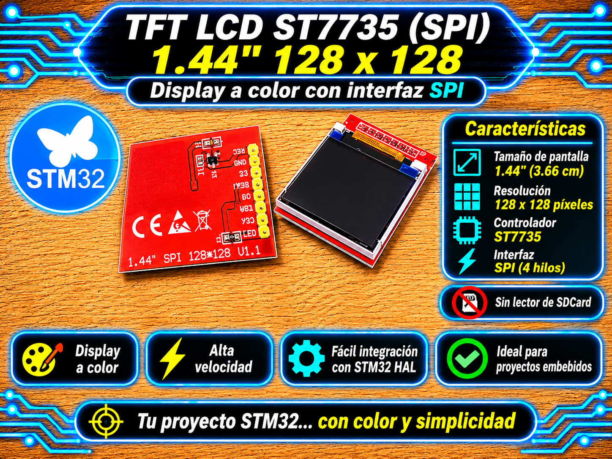

# Driver Pantalla TFT LCD ST7735 (SPI) - STM32

<p align="center">
  
</p>

Driver de Capa 2 (HAL) para pantallas color TFT LCD con controlador **ST7735** sobre bus SPI de 4 hilos (SPI + D/C + CS + RST). Ofrece gestión de orientaciones de pantalla, renderizado eficiente por lotes, motor de primitivas geométricas y soporte tipográfico integrado.

## Características

* **Soporte de Paneles Seleccionable:** Configuración por macro para pantallas de **128x128** (con offsets automáticos de RAM `COLSTART=2`, `ROWSTART=1`) y **128x160** (`COLSTART=0`, `ROWSTART=0`).

* **Optimización de Transmisiones SPI:** Agrupamiento de píxeles consecutivos en búferes de transmisión por bloques (`TFT_SPI_CHUNK_BYTES`) para maximizar la velocidad del bus y minimizar latencias en rellenado de pantallas e imágenes.

* **Formatos de Color RGB565:** Manejo nativo de color de 16 bits con macro utilitaria `color565(r,g,b)` e inversión cromática por hardware (`tft_st7735_InvertColors`).

* **Control de Orientación Dinámico:** Soporte de 4 rotaciones (0°, 90°, 180°, 270°) mediante ajuste del registro `MADCTL` con recalculado automático de ancho, alto y offsets de memoria.

* **Motor Gráfico Incorporado (`tft_graphics_STM32`):** Algoritmo de Bresenham optimizado para líneas, rectángulos planos y redondeados, círculos, arcos y triángulos.

* **Mantenimiento de Fuentes (`tft_fonts_STM32`):** Incluye 4 tipografías precargadas (`Font_6x8`, `Font_7x10`, `Font_11x18`, `Font_16x26`) con soporte para organización de mapa de bits por filas y columnas.

## Compatibilidad

| Elemento | Detalle | 
| ----- | ----- | 
| Interfaz | SPI (Modo 0, CPOL=0, CPHA=0, 8 bits, Fast Clock recomendado) | 
| Controlador | Sitronix ST7735 / ST7735R / ST7735S | 
| Capa | Capa 2 (Driver / HAL) | 
| Probado en | STM32F439ZI (Nucleo-144), STM32F103C8T6 (Blue Pill), STM32F411CEU6 (Black Pill) | 
| Voltaje del módulo | 3.3 V / 5 V (pines I/O compatibles con lógica de 3.3V) | 

> ⚠️ **CONFIGURACIÓN DE PANEL:**
> Para configurar el tamaño físico de la pantalla, ajusta la macro en `tft_st7735_STM32.h`:
>
> * Panel **128x128**: `#define TFT_ST7735_IS_128X128 1`
>
> * Panel **128x160**: `#define TFT_ST7735_IS_128X128 0`

## Archivos

| Archivo | Descripción | 
| ----- | ----- | 
| `tft_st7735_STM32.h` | API pública, comandos del ST7735, banderas MADCTL, macros de color RGB565 e inicialización | 
| `tft_st7735_STM32.c` | Lógica de control SPI, tablas de comandos comprimidas, ventanas de memoria y funciones HMI | 
| `tft_graphics_STM32.h` / `.c` | Primitivas gráficas geométricas (líneas, rectángulos, círculos, esquinas redondeadas, triángulos) | 
| `tft_fonts_STM32.h` / `.c` | Descriptores y tablas de fuentes tipográficas (`Font_6x8`, `Font_7x10`, `Font_11x18`, `Font_16x26`) | 

## Conexiones

| Módulo ST7735 | STM32 (Ejemplo SPI1) | Etiqueta (User Label) | Descripción |
|---|---|---|---|
| **VCC** | 3.3 V / 5 V | — | Alimentación |
| **GND** | GND | — | Tierra |
| **CS** | GPIOD (Ej. PD14) | `TFT_CS` | Chip Select (Salida Push-Pull) |
| **RESET / RST** | GPIOE | `TFT_RST` | Reset Hardware (Salida Push-Pull) |
| **A0 / DC** | GPIOE | `TFT_DC` | Data / Command Control (Salida Push-Pull) |
| **SDA / MOSI** | PA7 (SPI1_MOSI) | — | Línea de datos Master Out Slave In |
| **SCK / SCL** | PA5 (SPI1_SCK) | — | Línea de Reloj SPI |
| **LED / BL** | 3.3 V (o GPIO/PWM) | — | Retroiluminación backlight |

> ⚠️ **ETIQUETAS GPIO EN CUBEMX:**
> Los pines de control deben configurarse en CubeMX como **GPIO_Output** y asignarles exactamente las etiquetas de usuario (User Labels) indicadas en la tabla (`TFT_CS`, `TFT_RST`, `TFT_DC`) para garantizar el funcionamiento transparente con las macros del driver.

## Integración

1. Copia todos los archivos `.h` y `.c` a las carpetas `Core/Inc` y `Core/Src` de tu proyecto STM32.

2. Habilita el periférico SPI en STM32CubeMX:

   * **Mode:** Transmit Only Master (o Full-Duplex Master)

   * **Data Size:** 8 Bits

   * **First Bit:** MSB First

   * **Clock Polarity (CPOL):** Low (0)

   * **Clock Phase (CPHA):** 1 Edge (0)

   * **Baud Rate Prescaler:** Ajustar para lograr una frecuencia de bus SPI de aproximadamente **10 - 15 MHz** (Ej. Prescaler `/8` en buses APB de 90 MHz).

3. Incluye las cabeceras principales en tu código:

   ```c
   #include "tft_st7735_STM32.h"
   #include "tft_graphics_STM32.h"
   #include "tft_fonts_STM32.h"
   ```

## Ejemplo mínimo

```c
#include "main.h"
#include "tft_st7735_STM32.h"
#include "tft_graphics_STM32.h"
#include "tft_fonts_STM32.h"

extern SPI_HandleTypeDef hspi1;

int main(void)
{
    HAL_Init();
    SystemClock_Config();
    MX_GPIO_Init();
    MX_SPI1_Init();

    /* Inicializar el controlador ST7735 en el bus SPI1 con rotación 2 (180°) */
    tft_st7735_Init(&hspi1, 2);

    /* Test inicial de primitivas y verificación de errores */
    tft_st7735_Test();

    if (tft_st7735_GetLastError() != HAL_OK) {
        HAL_GPIO_WritePin(GPIOB, LD3_Pin, GPIO_PIN_SET);   // Indicador de error SPI
    }

    /* Fondo negro */
    tft_st7735_FillScreen(TFT_BLACK);

    /* Dibujar texto */
    tft_st7735_WriteString(10, 10, "UTN FRT 2026", Font_7x10, TFT_YELLOW, TFT_BLACK);

    /* Dibujar figuras geométricas */
    tft_drawRect(10, 30, 100, 50, TFT_RED);
    tft_fillCircle(60, 55, 15, TFT_CYAN);

    while (1)
    {
        /* Bucle principal */
    }
}
```

## API principal

| Función | Descripción | 
| ----- | ----- | 
| `tft_st7735_Init()` | Inicializa el periférico SPI, ejecuta la secuencia de reseteo y carga registros de inicio | 
| `tft_st7735_SetRotation()` | Modifica la orientación (0 a 3) recalculando dimensiones y offsets | 
| `tft_st7735_DrawPixel()` | Enciende un píxel con un color RGB565 específico | 
| `tft_st7735_WriteString()` | Imprime un string con salto de línea automático e interpretación de `\n` | 
| `tft_st7735_FillRectangle()` | Rellena una región rectangular enviando un color sólido por bloques SPI | 
| `tft_st7735_FillScreen()` | Inunda la pantalla completa con un color dado | 
| `tft_st7735_DrawImage()` | Muestra un arreglo de imagen RGB565 con conversión de endianness opcional | 
| `tft_st7735_InvertColors()` | Conmuta la inversión de color por hardware | 
| `tft_st7735_Test()` | Ejecuta una demostración de capacidades del display | 
| `tft_drawLine()` | Dibuja una línea entre dos puntos usando la función óptima (Bresenham o rápida) | 
| `tft_drawRoundRect()` | Dibuja un rectángulo con bordes redondeados | 
| `tft_fillTriangle()` | Rellena un triángulo definido por tres vértices | 

## Licencia

MIT. Desarrollado por **Mamani Flores Carlos (UTN FRT)** - 2026.