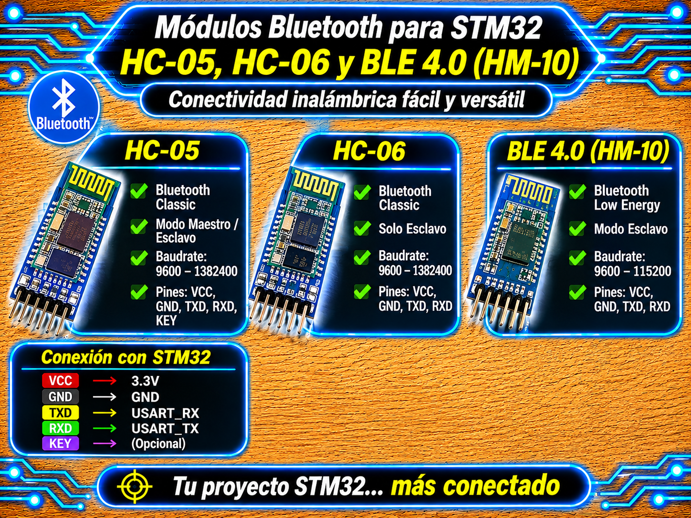
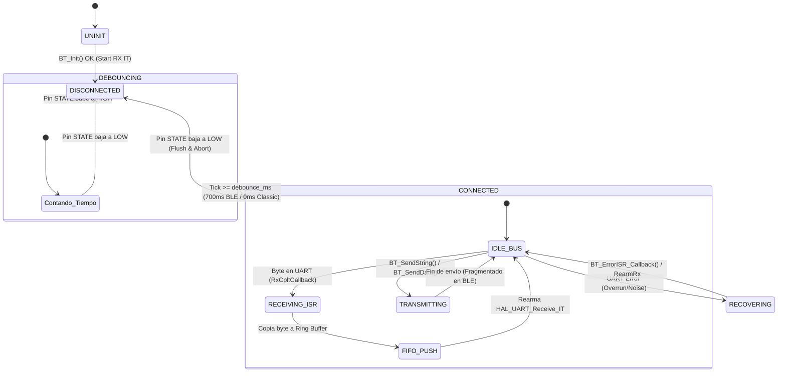

# Driver Bluetooth Classic & BLE (UART Interrupt, Non-Blocking RX) para STM32 HAL

<p align="center">
  
</p>


Driver genérico, modular e independiente para la gestión de módulos **Bluetooth Classic (HC-05, HC-06)** y **BLE 4.0 (HM-10, CC2541, AT-09, JDY-08, BT05)** sobre microcontroladores STM32 mediante la capa HAL.

Implementa un **búfer circular FIFO no bloqueante** alimentado por interrupciones de UART, supervisión de enlace mediante pin físico `STATE` con algoritmo de antirrebote para BLE, fragmentación automática de paquetes en transmisiones BLE y autorrecuperación del periférico UART ante ruidos o cuelgues del bus.

---

## Características

- **Soporte Multimódulo:** Compatible con Bluetooth Classic (HC-05 / HC-06) y BLE 4.0 (HM-10 y derivados UART transparentes).
- **Recepción No Bloqueante (ISR + FIFO):** Búfer circular sin bloqueo de ejecución alimentado por interrupción byte a byte (`HAL_UART_Receive_IT`).
- **Supervisión de Enlace con Antirrebote:** Filtrado del parpadeo del pin `STATE` (típico en módulos BLE como HM-10 mientras buscan pareja) evitando falsas desconexiones.
- **Fragmentación de Transmisión BLE:** Envío de datos por paquetes configurables (~20 bytes por defecto) con pausas temporizadas para evitar pérdida de datos por MTU en BLE.
- **Auto-recuperación de UART:** Reinicio e inmunidad automática del periférico UART ante errores de *overrun*, *framing* o ruido eléctrico.
- **Comandos AT para BLE:** Funciones integradas para configurar nombre, consultar dirección MAC, activar notificaciones (`AT+NOTI`) y realizar reset de fábrica.

---

## Requisitos

| Requisito | Detalle |
| :--- | :--- |
| **Microcontrolador** | Cualquier STM32 con HAL (probado en serie STM32F4 / Nucleo-F439ZI, BluePill, BlackPill). |
| **Periférico** | Un puerto UART/USART en modo asíncrono (ej. `UART4` o `USART3`, 8 bits de datos, 1 bit de parada, sin paridad). |
| **Interrupciones** | Interrupción de UART habilitada en CubeMX (**UARTx global interrupt**). |
| **Módulo BT/BLE** | HC-05, HC-06, HM-10, AT-09, CC2541, JDY-08, BT05. |
| **Pin Opcional** | Pin GPIO de entrada conectado al pin `STATE` (o `KEY`/`LINK`) del módulo para supervisión (`BT_STATE_Pin`). |
| **Dependencias** | Ninguna (`main.h`, `stdbool.h`, `stdint.h`, `stddef.h`, `string.h`, `stdio.h`). |

---

## Archivos

| Archivo | Descripción |
| :--- | :--- |
| `bt_STM32.h` | Interfaz pública: definición de tipos (`BT_Handler_t`, `BT_Status_t`, `BT_ModuleType_t`), macros configurables y prototipos. |
| `bt_STM32.c` | Implementación privada: búfer circular FIFO, gestión de interrupciones, supervisión de enlace y parser de comandos AT. |

---

## Conexión del sensor / módulo

| Módulo BT / BLE | Microcontrolador STM32 | Función / Descripción |
| :---: | :---: | :--- |
| **VCC** | **3.3 V o 5 V** | Alimentación (la mayoría de los módulos comerciales traen regulador a 3.3V en placa). |
| **GND** | **GND** | Tierra común del sistema. |
| **TXD** | **UART4_RX** | Recepción del STM32 (salida de datos del módulo BT). |
| **RXD** | **UART4_TX** | Transmisión del STM32 (entrada de datos al módulo BT, nivel 3.3V). |
| **STATE / LINK** | **GPIO_Input (`BT_STATE_Pin`)** | *(Opcional)* Monitoreo de estado de conexión activa / antirrebote. |
| **EN / KEY** | **GPIO_Output** | *(Opcional)* Entrada a modo comandos AT en módulos HC-05. |

> **Nota sobre lógica de 3.3V:** Los pines RX/TX del STM32 trabajan a 3.3V. Si el módulo Bluetooth se alimenta a 5V, sus líneas TX/RX suelen ser tolerantes a 3.3V. Para mayor seguridad en la línea RXD del módulo BT, se puede colocar un divisor resistivo simple.

---

## Instalación

1. Copia `bt_STM32.c` a la carpeta `Core/Src/` de tu proyecto STM32CubeIDE.
2. Copia `bt_STM32.h` a la carpeta `Core/Inc/`.
3. En STM32CubeMX, configura la UART asignada (ej. **UART4**):
   - **Baud Rate:** 9600 bps (módulos HM-10 / HC-06 de fábrica) o 38400 bps (HC-05 en modo AT).
   - **Word Length:** 8 Bits.
   - **NVIC Settings:** Habilita la casilla **UART4 global interrupt**.
4. *(Opcional)* Configura un pin GPIO de entrada con la etiqueta `BT_STATE` en CubeMX.
5. Genera el código e incluye la cabecera en tu `main.c`:
   ```c
   #include "bt_STM32.h"
   ```

---

## Uso básico

El uso se resume en 3 pasos: **Inicializar el driver y habilitar interrupciones**, **Enlazar los Callbacks de la HAL** y **Procesar la recepción no bloqueante y la telemetría en el loop**.

```c
#include "main.h"
#include "bt_STM32.h"
#include <stdio.h>

#define TELEMETRY_PERIOD_MS   200u
#define LINK_BLINK_PERIOD_MS  100u

#ifdef BT_STATE_Pin
#define BT_USE_STATE_PIN 1
#else
#define BT_USE_STATE_PIN 0
#endif

extern UART_HandleTypeDef huart4;

/* Manejador global del driver Bluetooth */
BT_Handler_t bt_mod;

uint32_t telemetry_tick = 0;
uint32_t error_tick     = 0;

int main(void)
{
    HAL_Init();
    SystemClock_Config();
    MX_GPIO_Init();
    MX_UART4_Init();

    /* Habilitar la interrupción global de la UART asignada */
    HAL_NVIC_SetPriority(UART4_IRQn, 5, 0);
    HAL_NVIC_EnableIRQ(UART4_IRQn);

    /* 1. Inicialización del driver Bluetooth HC-05 (UART4, timeout TX 100 ms) */
    if (BT_Init(&bt_mod, &huart4, BT_TYPE_HC05, 100) != BT_OK) {
        Error_Handler();
    }

#if BT_USE_STATE_PIN
    /* Configurar pin STATE si fue asignado en CubeMX (nivel alto = enlace activo) */
    if (BT_ConfigStatePin(&bt_mod, BT_STATE_GPIO_Port, BT_STATE_Pin) != BT_OK) {
        Error_Handler();
    }
#endif

    while (1)
    {
        /* 2. Supervisión del enlace + autorrecuperación de la recepción */
        BT_Status_t link = BT_CheckAndRecover(&bt_mod);

        if (link == BT_OK) {
            /* Enlace activo: apagar LED de estado de error */
            HAL_GPIO_WritePin(LD1_GPIO_Port, LD1_Pin, GPIO_PIN_RESET);

            /* Lectura no bloqueante del búfer circular byte a byte */
            int16_t c;
            while ((c = BT_ReadChar(&bt_mod)) != -1) {
                switch (c) {
                    case 'A':   /* Comando A: LED ON */
                        HAL_GPIO_WritePin(LD3_GPIO_Port, LD3_Pin, GPIO_PIN_SET);
                        BT_SendString(&bt_mod, "[STM32] Comando A ejecutado: LED ON\n");
                        break;

                    case 'B':   /* Comando B: LED OFF */
                        HAL_GPIO_WritePin(LD3_GPIO_Port, LD3_Pin, GPIO_PIN_RESET);
                        BT_SendString(&bt_mod, "[STM32] Comando B ejecutado: LED OFF\n");
                        break;

                    default:    /* Caracteres no contemplados se ignoran */
                        break;
                }
            }

            /* Telemetría periódica cada 200 ms */
            uint32_t now = HAL_GetTick();
            if ((now - telemetry_tick) >= TELEMETRY_PERIOD_MS) {
                telemetry_tick = now;

                char tele_msg[48];
                int adc_val = 1023; /* Reemplazar por lectura real del ADC */
                snprintf(tele_msg, sizeof(tele_msg), "ADC_VAL:%d | TICK:%lu\n",
                         adc_val, (unsigned long)now);
                BT_SendString(&bt_mod, tele_msg);
            }

        } else {
            /* Sin enlace: apagar actuadores y parpadear LED de estado */
            HAL_GPIO_WritePin(LD3_GPIO_Port, LD3_Pin, GPIO_PIN_RESET);

            if ((HAL_GetTick() - error_tick) >= LINK_BLINK_PERIOD_MS) {
                error_tick = HAL_GetTick();
                HAL_GPIO_TogglePin(LD1_GPIO_Port, LD1_Pin);
            }
        }
    }
}

/* 3. Redirección de callbacks de la HAL hacia el driver */
void HAL_UART_RxCpltCallback(UART_HandleTypeDef *huart)
{
    if (huart == bt_mod.huart) {
        BT_RxISR_Callback(&bt_mod);
    }
}

void HAL_UART_ErrorCallback(UART_HandleTypeDef *huart)
{
    if (huart == bt_mod.huart) {
        BT_ErrorISR_Callback(&bt_mod);
    }
}
```

---

## API

| Función | Descripción |
| :--- | :--- |
| `BT_Init(bt, huart, type, timeout)` | Inicializa el manejador, configura el tipo de módulo y arranca la recepción por IT. |
| `BT_ConfigStatePin(bt, port, pin)` | Asigna el pin GPIO del hardware para monitorear la conexión física (`STATE`). |
| `BT_SetStateDebounce(bt, ms)` | Configura el tiempo de filtrado para validar la conexión fija en nivel alto. |
| `BT_SetBLEPacketing(bt, chunk, delay)` | Ajusta el tamaño de paquete y la pausa entre fragmentos para envíos BLE. |
| `BT_SendString(bt, str)` | Transmite una cadena de caracteres terminada en nulo (Bloqueante). |
| `BT_SendData(bt, data, size)` | Transmite un arreglo de bytes binarios (Bloqueante). |
| `BT_ReadChar(bt)` | Extrae un byte del búfer circular sin bloquear (retorna `-1` si está vacío). |
| `BT_Available(bt)` | Retorna la cantidad de bytes listos para leer en el búfer circular. |
| `BT_ReadString(bt, dest, len, ms)` | Lee una línea hasta `\n` o agotar el tiempo de espera. |
| `BT_Flush(bt)` | Vacía instantáneamente todos los datos pendientes en el búfer circular. |
| `BT_IsConnected(bt)` | Evalúa si el enlace Bluetooth se encuentra activo y estabilizado. |
| `BT_CheckAndRecover(bt)` | Valida el enlace, recupera la recepción ante errores de UART y gestiona flancos. |
| `BT_BLE_SendAT(bt, cmd, resp, sz, ms)` | Envía un comando AT directo y espera respuesta por inactividad de línea (solo BLE). |
| `BT_BLE_SetName(bt, name)` | Cambia el nombre anunciado del dispositivo BLE (`AT+NAME`). |
| `BT_BLE_GetAddress(bt, mac, size)` | Obtiene la dirección MAC física del módulo BLE (`AT+ADDR?`). |

---

## Máquina de estados



---

## Ecuaciones y Búfer Circular

1. **Máscara del Búfer Circular FIFO:**  
   El tamaño del búfer (`BT_RX_BUFFER_SIZE`) debe ser obligatoriamente una potencia de $2^N$. Esto permite calcular la ocupación mediante una máscara binaria rápida sin la operación módulo (`%`):
   $$\text{MÁSCARA} = \text{BT\_RX\_BUFFER\_SIZE} - 1$$
   $$\text{Ocupación} = (\text{head} - \text{tail}) \ \& \ \text{MÁSCARA}$$

2. **Antirrebote del Pin STATE (BLE):**  
   Para descartar el parpadeo de 500 ms del pin STATE en módulos HM-10 sin conexión:
   $$\text{Enlace Válido} = (V_{\text{STATE}} == \text{HIGH}) \quad \land \quad (t_{\text{actual}} - t_{\text{inicio\_HIGH}} \ge \text{BT\_BLE\_DEFAULT\_DEBOUNCE\_MS})$$

---

## Parámetros configurables

Definidos al comienzo de `bt_STM32.h`:

| Macro | Valor por defecto | Descripción |
| :--- | :---: | :--- |
| `BT_RX_BUFFER_SIZE` | `128` | Tamaño del búfer circular (debe ser potencia de 2: 64, 128, 256). |
| `BT_BLE_DEFAULT_CHUNK` | `20u` | Cantidad máxima de bytes por ráfaga en transmisiones BLE. |
| `BT_BLE_DEFAULT_TX_DELAY_MS` | `20u` | Pausa en ms entre paquetes BLE para no desbordar el buffer remoto. |
| `BT_BLE_DEFAULT_DEBOUNCE_MS` | `700u` | Tiempo mínimo en alto del pin STATE para confirmar conexión BLE. |
| `BT_AT_TIMEOUT_MS` | `500u` | Timeout para la respuesta inicial a comandos AT. |
| `BT_AT_IDLE_GAP_MS` | `60u` | Tiempo de silencio en RX que determina el fin de una respuesta AT. |

---

## Limitaciones y advertencias

- **Transmisión Bloqueante:** Las funciones `BT_SendString()`, `BT_SendData()` y `BT_BLE_SendAT()` utilizan `HAL_UART_Transmit` y son bloqueantes durante el envío.
- **Exclusividad de Comandos AT:** Los comandos AT para módulos BLE solo pueden enviarse cuando **no hay una conexión activa**. Si hay enlace activo, la función retorna `BT_BUSY` para evitar transmitir texto AT al dispositivo remoto.
- **Tamaño del Búfer Circular:** Se aprovecha $N - 1$ posiciones útiles del arreglo para diferenciar el estado lleno del estado vacío. Si la aplicación lee despacio y el búfer se llena, los bytes entrantes se descartan y se incrementa el contador `BT_GetRxOverflowCount()`.

---

## Solución de problemas

| Síntoma | Causa probable | Solución |
| :--- | :--- | :--- |
| No recibe datos por interrupción | Interrupción global UART no activada en CubeMX o falta de callbacks en `main.c`. | Verificar que la casilla NVIC de la UART esté marcada e incluir `BT_RxISR_Callback()` en `HAL_UART_RxCpltCallback()`. |
| `BT_IsConnected()` da `false` constante | Pin STATE desconectado o mal configurado en el manejador. | Si no usas pin STATE, no invoques `BT_ConfigStatePin()`. El driver asumirá conexión siempre activa. |
| Caracteres truncados en BLE | Tamaño de ráfaga muy grande para el cliente BLE. | Ajustar `BT_SetBLEPacketing(&bt_dev, 20, 20)` a valores más conservadores. |
| Pérdida de datos por desbordamiento | El búfer circular es pequeño para el volumen de datos entrante. | Incrementar `BT_RX_BUFFER_SIZE` a `256` o `512` en `bt_STM32.h`. |

### Código de diagnóstico de desbordamiento

```c
/* Verifica si se han perdido bytes por falta de velocidad en el loop principal */
uint32_t bytes_perdidos = BT_GetRxOverflowCount(&bt_mod);
if (bytes_perdidos > 0) {
    /* El loop principal tarda demasiado en consumir el búfer */
}
```

---

## Licencia

- **MIT**. Desarrollado por **Mamani Flores Carlos (UTN FRT)** 2026.