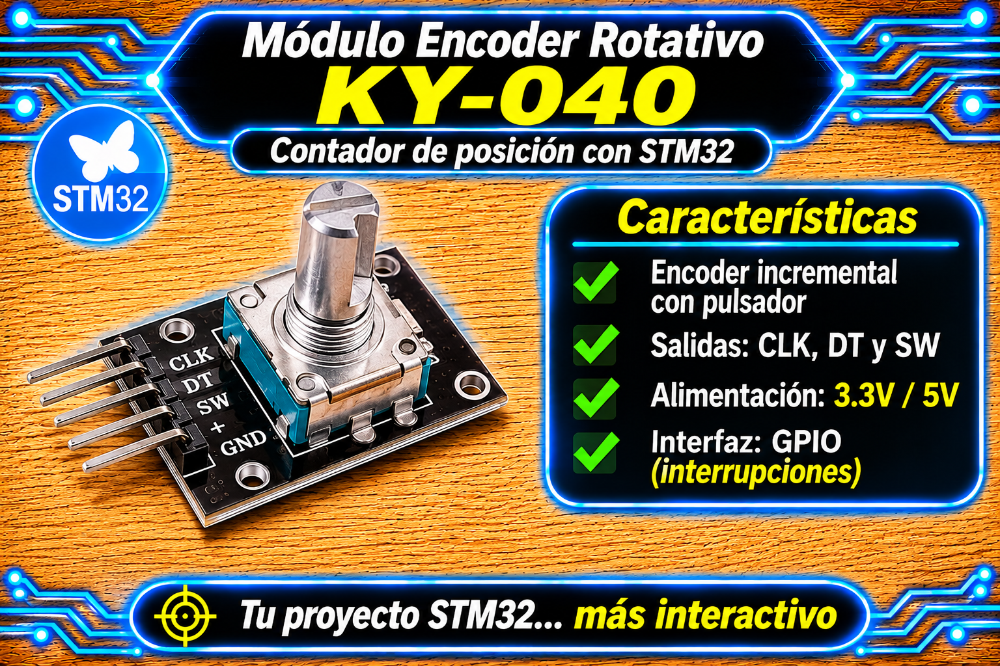

# Driver KY-040 (Encoder Rotativo por Software EXTI) para STM32 HAL

<p align="center">
  
</p>

Driver genérico e independiente para la lectura de encoders rotativos mecánicos de cuadratura **KY-040** (o equivalentes) en microcontroladores STM32 mediante la capa HAL. Implementa una máquina de estados de cuadratura completa de 16 posiciones basada en interrupciones externas (**EXTI**), filtrando de forma innata los rebotes mecánicos (*chattering*) en los canales **CLK** y **DT** sin depender de retardos por temporizador. Incluye además antirrebote temporal por SysTick para el pulsador integrado (**SW**) y secciones críticas atómicas para evitar condiciones de carrera (*race conditions*).

---

## Características

- **Decodificación por Cuadratura Completa (16 Estados):** Utiliza una tabla de transiciones estática de 16 combinaciones para procesar flancos en ambos canales (CLK y DT), descartando secuencias inválidas o ruidadas.
- **Acceso Atómico a Variables:** Protege la lectura y escritura de la posición (`position`) y la bandera del botón (`sw_pressed`) mediante secciones críticas que gestionan el registro `PRIMASK` del núcleo ARM Cortex-M.
- **Acumulador de Pasos por Detent:** Configurable mediante la macro `KY040_STEPS_PER_DETENT` (por defecto 4 flancos por muesca mecánica).
- **Control de Límites por Saturación:** Rango de conteo restringido automáticamente entre `min_val` y `max_val` (`ky040_clamp()`).
- **Antirrebote Integrado para Pulsador:** Anti-debounce temporal no bloqueante basado en `HAL_GetTick()` para el pin **SW** (Active-Low).
- **Manejador Unificado EXTI:** Una sola función (`KY040_IRQ_Handler`) para atender los eventos de los tres pines desde la rutina de interrupción global de la HAL.

---

## Requisitos

| Requisito | Detalle |
| :--- | :--- |
| **Microcontrolador** | Cualquier STM32 con soporte de interrupciones EXTI (probado en STM32F4 series / Nucleo-F439ZI, BluePill, BlackPill). |
| **Periféricos** | 3 GPIOs configurados en modo interrupción externa (`GPIO_MODE_IT_RISING_FALLING` para CLK/DT, `GPIO_MODE_IT_FALLING` para SW). |
| **Header Principal** | `main.h` (autogenerado por CubeMX). |
| **Pulsador** | Resistencia de *pull-up* (interna o externa) activada en el pin de datos del switch (**SW**). |
| **Dependencias extra** | Ninguna (C99 estándar con `<stdint.h>` y la cabecera del núcleo Cortex-M para `__get_PRIMASK()`). |

---

## Archivos

| Archivo | Descripción |
| :--- | :--- |
| `encoder_ky040_STM32.h` | Interfaz pública del driver: estructura `KY040_t` y prototipos de las funciones de control. |
| `encoder_ky040_STM32.c` | Implementación privada: tabla de cuadratura, secciones críticas, lectura física y debounce del switch. |

---

## Conexión del sensor

| Módulo KY-040 | Microcontrolador STM32 | Configuración en CubeMX / Hardware |
| :---: | :---: | :--- |
| **CLK (A)** | **GPIO (ej. PF_x / ENC_CLK)** | `External Interrupt Mode with Rising/Falling edge trigger detection`. |
| **DT (B)** | **GPIO (ej. PB_x / ENC_DT)** | `External Interrupt Mode with Rising/Falling edge trigger detection`. |
| **SW** | **GPIO (ej. PF_x / ENC_SW)** | `External Interrupt Mode with Falling edge trigger detection` + `Pull-Up`. |
| **VCC** | **3.3 V o 5 V** | Alimentación del módulo (las placas KY-040 suelen traer *pull-ups* de 10 kΩ en CLK y DT a VCC). |
| **GND** | **GND** | Tierra común del sistema. |

> **Nota sobre Resistencias de Pull-Up:**  
> Las líneas **CLK** y **DT** del módulo KY-040 incorporan resistencias de *pull-up* SMD de 10 kΩ a **VCC** en la plaqueta. El pin **SW** NO suele traer resistencia integrada en el módulo, por lo que **es obligatorio activar la resistencia Pull-Up interna en STM32CubeMX** (`GPIO_PULLUP`) o colocar una resistencia física externa de 10 kΩ a $3.3\text{ V}$.

---

## Instalación

1. Copia `encoder_ky040_STM32.c` a la carpeta `Core/Src/` de tu proyecto STM32CubeIDE.
2. Copia `encoder_ky040_STM32.h` a la carpeta `Core/Inc/`.
3. En STM32CubeMX, configura los pines correspondientes con los User Labels `ENC_CLK`, `ENC_DT` y `ENC_SW`:
   - **CLK / DT:** Mode = `External Interrupt Mode with Rising/Falling edge trigger detection`.
   - **SW:** Mode = `External Interrupt Mode with Falling edge trigger detection`, Pull-up = `Pull-up`.
   - En la pestaña **NVIC Settings**, habilita las líneas de interrupción EXTI (ejemplo: `EXTI line[15:10] interrupts`).
4. Genera el código e incluye la cabecera en tu archivo `main.c`:
   ```c
   #include "encoder_ky040_STM32.h"
   ```

---

## Uso básico

El uso consta de 3 pasos: **Inicializar**, **Derivar la interrupción EXTI** y **Leer la posición/pulsador en el super-loop**.

```c
#include "main.h"
#include "encoder_ky040_STM32.h"

/* Definiciones de rango de conteo */
#define ENC_MIN    0
#define ENC_MAX    100
#define ENC_RESET  50

/* Instancia global del encoder */
KY040_t Encoder;

int main(void)
{
    HAL_Init();
    SystemClock_Config();
    MX_GPIO_Init();

    /* 1. Inicialización de pines (CubeMX User Labels) y fijación de posición de inicio */
    KY040_Init(&Encoder,
               ENC_CLK_GPIO_Port, ENC_CLK_Pin,
               ENC_DT_GPIO_Port,  ENC_DT_Pin,
               ENC_SW_GPIO_Port,  ENC_SW_Pin,
               ENC_MIN, ENC_MAX);

    KY040_SetPosition(&Encoder, ENC_RESET);

    int32_t ultima_posicion = KY040_GetPosition(&Encoder);

    while (1)
    {
        /* 2. Lectura atómica de la posición ante cambios */
        int32_t pos = KY040_GetPosition(&Encoder);
        if (pos != ultima_posicion) {
            ultima_posicion = pos;
            
            /* ... Procesar el nuevo valor de posición ... */
            (void)pos;
        }

        /* 3. Consulta atómica del pulsador para restablecer la posición */
        if (KY040_IsButtonPressed(&Encoder)) {
            KY040_SetPosition(&Encoder, ENC_RESET);
            ultima_posicion = ENC_RESET;
        }

        /* Obras tareas no bloqueantes del loop... */
    }
}

/* ========================================================================== */
/*                CALLBACK DE INTERRUPCIÓN EXTERNA (HAL)                      */
/* ========================================================================== */

void HAL_GPIO_EXTI_Callback(uint16_t GPIO_Pin)
{
    /* Reenvía el pin que generó la interrupción EXTI al driver del encoder KY-040 */
    KY040_IRQ_Handler(&Encoder, GPIO_Pin);
}
```

---

## API

| Función | Descripción |
| :--- | :--- |
| `KY040_Init(dev, pA, pinA, pB, pinB, pSW, pinSW, min, max)` | Asigna pines, ordena límites y fija la posición en el centro del rango $[min, max]$. |
| `KY040_IRQ_Handler(dev, triggered_pin)` | Procesa la máquina de estados de cuadratura o el debounce del switch según el pin EXTI activo. |
| `KY040_GetPosition(dev)` | Obtiene la posición actual en forma atómica dentro de una sección crítica. |
| `KY040_SetPosition(dev, new_position)` | Modifica la posición saturando el valor al rango configurado y limpia los pasos acumulados. |
| `KY040_IsButtonPressed(dev)` | Consulta y resetea de forma atómica la bandera del pulsador (`sw_pressed`). Retorna `1` si fue presionado. |

---

## Principio de Operación y Fórmulas

### 1. Decodificación por Tabla de Cuadratura

Cada lectura instantánea de los pines físicos **CLK (A)** y **DT (B)** forma una palabra de 2 bits:

$$\text{Estado Actual} = (A \ll 1) \mid B \quad \in \{0, 1, 2, 3\}$$

Al concatenar el **Estado Previo** (2 bits) con el **Estado Actual** (2 bits), se genera un índice de 4 bits ($0 \dots 15$) para consultar la matriz de transición `kQuadTable`:

$$\text{Índice} = (\text{Estado Previo} \ll 2) \mid \text{Estado Actual}$$

$$\text{Matriz de Cuadratura } K = \begin{pmatrix}
 0 & -1 &  1 &  0 \\
 1 &  0 &  0 & -1 \\
-1 &  0 &  0 &  1 \\
 0 &  1 & -1 &  0
\end{pmatrix}$$

- **Valor $+1$:** Giro en sentido horario (CW).
- **Valor $-1$:** Giro en sentido antihorario (CCW).
- **Valor $0$:** Transición inválida o rebote mecánico (*chattering* ignorado).

### 2. Acumulación y Detent Mecánico

Dado que un *clic* físico del encoder KY-040 genera $4$ cambios de estado consecutivos en los flancos, la posición se incrementa solo al completar el número de pasos definido. Se definen:

- $P_k$: posición actual (`position` en el código).
- $P_{\min}$ y $P_{\max}$: límites de la posición (`min_val` y `max_val`).
- $A$: acumulador de pasos (`accum`).
- $S_{\text{det}}$: pasos por detent (`KY040_STEPS_PER_DETENT`).

$$P_{k+1} = \operatorname{clamp}\left(P_k \pm 1,\; P_{\min},\; P_{\max}\right) \quad \text{cuando} \quad |A| \ge S_{\text{det}}$$

---

## Parámetros configurables

Definidos mediante macros en `encoder_ky040_STM32.c`:

| Macro | Valor por defecto | Efecto |
| :--- | :---: | :--- |
| `KY040_STEPS_PER_DETENT` | `4` | Cantidad de pasos de cuadratura para validar un incremento o decremento de posición (1 clic mecánico). |
| `KY040_SW_DEBOUNCE_MS` | `50U` | Tiempo de silencio mínimo requerido en el pin **SW** para validar la pulsación. |

---

## Limitaciones y advertencias

- **Configuración estricta de EXTI:** Los pines **CLK** y **DT** deben ser configurados obligatoriamente para disparar en **ambos flancos** (`Rising/Falling edge`). Si solo se configura un flanco, la máquina de estados perderá el patrón de cuadratura y el contador no avanzará correctamente.
- **Secciones Críticas:** Las funciones `KY040_GetPosition()`, `KY040_SetPosition()` y `KY040_IsButtonPressed()` deshabilitan temporalmente las interrupciones globales (`__disable_irq()`) mediante el registro `PRIMASK` para garantizar lecturas y escrituras atómicas desde el hilo principal `while(1)`.
- **Compartición de Líneas EXTI:** Si dos pines pertenecen al mismo número de línea EXTI (por ejemplo, `PA5` y `PB5`), el microcontrolador no podrá diferenciarlos simultáneamente por hardware. Asigna pines con diferente numeración de línea (ejemplo: `PF10` para CLK, `PB10` para DT y `PF11` para SW).

---

## Solución de problemas

| Síntoma | Causa probable | Solución |
| :--- | :--- | :--- |
| El contador salta de a 2 o 4 valores por cada clic | La macro `KY040_STEPS_PER_DETENT` está ajustada para encoders de menor resolución. | Ajustar `#define KY040_STEPS_PER_DETENT 4` en `encoder_ky040_STM32.c`. |
| El giro avanza en sentido opuesto | Los pines CLK y DT están intercambiados físicamente o en el código. | Intercambiar los argumentos de `pinA` y `pinB` en la función `KY040_Init()`. |
| El botón SW genera múltiples detecciones al presionar una sola vez | Falta resistencia de *pull-up* o el tiempo de debounce es muy bajo. | Configurar `GPIO_PULLUP` en CubeMX para el pin SW y verificar `KY040_SW_DEBOUNCE_MS 50U`. |
| El contador no responde al girar | Interrupción EXTI no habilitada en la NVIC o no configurada en ambos flancos. | Verificar la casilla de habilitación en el NVIC de CubeMX (`EXTI line[15:10]`) y asegurar que el modo sea `Rising/Falling edge`. |

---

## Licencia

- **MIT**. Desarrollado por **Mamani Flores Carlos (UTN FRT)** 2026.