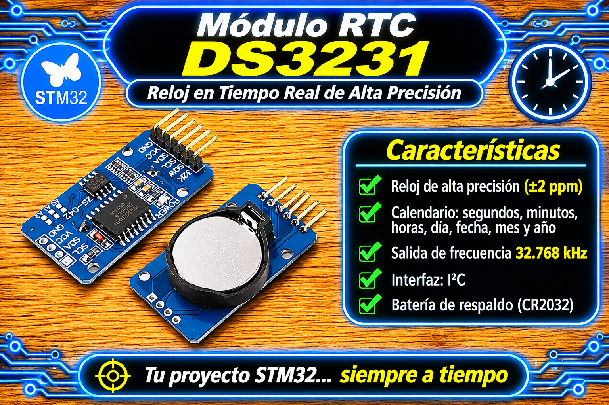

# Driver RTC DS3231 (I2C) - STM32 HAL

<p align="center">
  
</p>

Driver de Capa 2 (HAL) para el reloj en tiempo real (RTC) de alta precisión **DS3231** mediante comunicación I2C. Ofrece gestión de fecha y hora en formato 24 horas, detección de oscilador detenido (OSF), lectura del sensor de temperatura interno compensado por TCXO y configuración completa de la **Alarma 1** por hardware/interrupción EXTI.

## Características

* **Lectura y Escritura por Bloques I2C:** Optimización del bus I2C realizando transferencias en ráfaga (*burst*) de los 7 registros de tiempo (`0x00` a `0x06`) en una sola transacción.
* **Conversión BCD Autocontenida:** Funciones internas eficientes para transformación bidireccional BCD $\leftrightarrow$ Decimal sin dependencias externas.
* **Formato Unificado 24 h:** Normalización automática de datos leídos (incluso si el RTC reporta formato 12 h con bit AM/PM) y escritura con formato 24 horas.
* **Detección de Pérdida de Energía (OSF):** Verificación de la bandera *Oscillator Stop Flag* (`OSF`) para diagnosticar si el RTC perdió alimentación (Vcc + batería RTC) y requiere reconfiguración horaria. Se auto-limpia tras una llamada exitosa a `DS3231_WriteTime`.
* **Termómetro Integrado Compensado por TCXO:** Lectura directa del sensor de temperatura interno (rango de 10 bits con signo, resolución de $0.25^\circ\text{C}$).
* **Gestión Asíncrona de Alarma 1:** Configuración flexible de los 5 modos de coincidencia (Cada segundo, Coincidencia de S, M+S, H+M+S, D+H+M+S) habilitando la línea `INT/SQW` activa en BAJO para interrupciones hardware no bloqueantes.
* **Preservación Segura de Banderas de Estado:** Modificación atómica de registros de control y estado mediante lectura-modificación-escritura (*Read-Modify-Write*) garantizando que las banderas no objetivo (`A2F`, `EN32kHz`) no sufran borrados accidentales (*race conditions*).

## Archivos del Driver

| Archivo | Descripción |
|---------|-------------|
| `rtc_ds3231_STM32.h` | Interfaz pública, estructuras (`DS3231_Time`), enums de modos de alarma (`DS3231_Alarm1_Mode`), códigos de retorno (`DS3231_Status`) y prototipos. |
| `rtc_ds3231_STM32.c` | Implementación de driver I2C, lógica BCD, manejo de registros de control/estado y funciones de usuario. |

## Conexiones y Hardware

El módulo DS3231 se comunica a través del bus I2C estándar (dirección fija de 7 bits `0x68`, enviada a la HAL desplazada 1 bit como `0xD0`).

| Módulo DS3231 | STM32 (Ejemplo I2C1) | Etiqueta (User Label) | Descripción |
|---------------|----------------------|-----------------------|-------------|
| **VCC** | 3.3V / 5V | — | Alimentación principal |
| **GND** | GND | — | Tierra |
| **SCL** | PB6 (I2C1_SCL) | `DS3231_SCL` | Línea de reloj I2C (Salida Open-Drain con Pull-up) |
| **SDA** | PB7 (I2C1_SDA) | `DS3231_SDA` | Línea de datos I2C (E/S Open-Drain con Pull-up) |
| **SQW / INT** | PA0 (GPIO_EXTI0) | `RTC_INT_Pin` | Interrupción externa por Alarma 1 (Active-Low Open-Drain con Pull-up) |
| **32K** | N/C | — | Salida opcional de onda cuadrada de 32.768 kHz |

> ⚠️ **PULL-UPS I2C Y INT:** Asegúrate de contar con resistencias de *pull-up* (típicamente $4.7\,\text{k}\Omega$) en las líneas SDA y SCL, así como en la línea `INT/SQW` (activada internamente en el GPIO de STM32 o externa en el módulo).

## Integración en STM32CubeMX

1. Habilita el periférico **I2C1** (o el bus deseado) en modo **I2C Standard Mode** ($100\,\text{kHz}$) o **Fast Mode** ($400\,\text{kHz}$).
2. Configura el pin conectado a `INT/SQW` (ej. `PA0`) como **GPIO_EXTI** en modo **External Interrupt Mode with Falling edge trigger detection** y habilita el resistor **Pull-Up**.
3. En el controlador **NVIC**, habilita la línea de interrupción correspondiente (`EXTI line0 interrupt`).
4. Copia `rtc_ds3231_STM32.h` en `Core/Inc` y `rtc_ds3231_STM32.c` en `Core/Src`.

## Ejemplo Completo de Uso (Gestión Segura de EXTI)

```c
#include "main.h"
#include "rtc_ds3231_STM32.h"
#include <stdio.h>

extern I2C_HandleTypeDef hi2c1;

/* Bandera volatil para procesamiento asincrono en el loop principal (la setea la ISR) */
static volatile bool rtc_alarm_pending = false;

DS3231_Time current_time;
float temp_celsius;
static uint32_t last_tick = 0;

int main(void)
{
    HAL_Init();
    SystemClock_Config();
    MX_GPIO_Init();
    MX_I2C1_Init();

    /* 1. Inicializar el driver asignando el handler I2C */
    if (DS3231_Init(&hi2c1) != DS3231_OK) {
        Error_Handler();
    }

    /* 2. Verificar si se perdio la hora (bandera OSF: oscilador detenido) */
    bool clock_halted = false;
    if (DS3231_CheckClockHalted(&clock_halted) == DS3231_OK && clock_halted) {
        /* Reajustar hora por defecto. WriteTime tambien limpia la bandera OSF */
        DS3231_Time new_time = {
            .seconds      = 0,
            .minutes      = 30,
            .hours        = 14,
            .day_of_week  = 2,   /* Lunes (1 = Domingo) */
            .day_of_month = 9,
            .month        = 3,
            .year         = 26   /* 2026 */
        };
        if (DS3231_WriteTime(&new_time) != DS3231_OK) {
            Error_Handler();
        }
    }

    /* 3. Configurar Alarma 1: dispara dentro de 1 minuto respecto a la hora actual */
    DS3231_Time now_t;
    if (DS3231_ReadTime(&now_t) != DS3231_OK) {
        Error_Handler();
    }

    DS3231_Time alarm_time = {
        .seconds = now_t.seconds,
        .minutes = (uint8_t)((now_t.minutes + 1U) % 60U)
    };

    /* SetAlarm1 limpia A1F antes de habilitar la interrupcion (INTCN + A1IE) */
    if (DS3231_SetAlarm1(&alarm_time, DS3231_A1_MATCH_MS) != DS3231_OK) {
        Error_Handler();
    }

    while (1)
    {
        /* 4. Atencion de alarma: la ISR solo marca la bandera, el I2C se hace aca */
        if (rtc_alarm_pending) {
            rtc_alarm_pending = false;          /* se consume el aviso antes de tocar el RTC */

            if (DS3231_ClearAlarm1Flag() == DS3231_OK) {
                /* Acciones de la aplicacion al dispararse la alarma */
                HAL_GPIO_TogglePin(GPIOB, LD2_Pin);
            } else {
                rtc_alarm_pending = true;       /* fallo I2C: reintentar en la proxima vuelta */
            }
        }

        /* 5. Tarea periodica de lectura cada 1 segundo (no bloqueante) */
        uint32_t now = HAL_GetTick();
        if ((now - last_tick) >= 1000U) {
            last_tick = now;

            if (DS3231_ReadTime(&current_time) == DS3231_OK) {
                /* Procesar current_time.hours, current_time.minutes, etc. */
            }

            if (DS3231_ReadTemperature(&temp_celsius) == DS3231_OK) {
                /* temp_celsius contiene la temperatura en grados C (resolucion 0.25 C) */
            }
        }
    }
}

/**
 * @brief Callback de interrupcion de GPIO (EXTI).
 * @note  Se ejecuta en contexto de ISR. Solo marca la bandera: nada de I2C aca.
 */
void HAL_GPIO_EXTI_Callback(uint16_t GPIO_Pin)
{
    if (GPIO_Pin == RTC_INT_Pin) {
        rtc_alarm_pending = true;
    }
}
```

## API principal

| Función | Descripción |
|---------|-------------|
| `DS3231_Init(hi2c)` | Inicializa el driver asignando el puntero al manejador del periférico I2C (`s_hi2c`). |
| `DS3231_WriteTime(time)` | Valida rangos, escribe la estructura `DS3231_Time` en formato BCD en bloque y borra la bandera OSF. |
| `DS3231_ReadTime(time)` | Lee secuencialmente los 7 registros de tiempo (`0x00-0x06`) y los convierte a entero decimal en formato 24 h. |
| `DS3231_ReadTemperature(temp)` | Lee los registros `0x11` y `0x12` y calcula la temperatura en $^{\circ}\text{C}$ ($0.25^\circ\text{C}/\text{LSB}$). |
| `DS3231_CheckClockHalted(is_halted)` | Consulta el bit `OSF` (bit 7 del registro `0x0F`) para determinar si el oscilador se detuvo por falta de energía. |
| `DS3231_SetAlarm1(alarm_time, mode)` | Programa la Alarma 1 (registros `0x07-0x0A`), configura las máscaras de coincidencia, limpia `A1F` e habilita `INTCN` y `A1IE`. |
| `DS3231_ClearAlarm1Flag()` | Limpia manualmente la bandera de disparo `A1F` en el registro de estado `0x0F` permitiendo re-armar la interrupción física. |

## Modos de Coincidencia de Alarma 1 (`DS3231_Alarm1_Mode`)

| Modo | Valor Enum | Máscaras de Hardware | Comportamiento de Disparo |
|------|------------|----------------------|---------------------------|
| `DS3231_A1_EVERY_SECOND` | `0` | A1M1=1, A1M2=1, A1M3=1, A1M4=1 | Interrupción disparada una vez cada 1 segundo. |
| `DS3231_A1_MATCH_S` | `1` | A1M1=0, A1M2=1, A1M3=1, A1M4=1 | Dispara cuando los segundos coinciden con la alarma. |
| `DS3231_A1_MATCH_MS` | `2` | A1M1=0, A1M2=0, A1M3=1, A1M4=1 | Dispara al coincidir minutos y segundos. |
| `DS3231_A1_MATCH_HMS` | `3` | A1M1=0, A1M2=0, A1M3=0, A1M4=1 | Dispara al coincidir hora, minuto y segundo. |
| `DS3231_A1_MATCH_DHMS` | `4` | A1M1=0, A1M2=0, A1M3=0, A1M4=0 | Dispara al coincidir día del mes, hora, minuto y segundo. |

## Notas y problemas conocidos

- **Instancia Única:** El puntero al bus I2C se almacena en una variable estática del módulo (`s_hi2c`), por lo que la arquitectura está diseñada para controlar **un único RTC DS3231 por proyecto**.
- **Reentrancia e Interrupciones:** Las funciones del driver efectúan comunicaciones I2C bloqueantes (`HAL_I2C_Mem_Read` / `HAL_I2C_Mem_Write`). **Nunca deben llamarse dentro de callbacks de interrupción (ISR)** como `HAL_GPIO_EXTI_Callback`. La ISR debe limitarse a marcar una bandera volátil procesada luego en el loop principal.
- **Enclavamiento del pin INT/SQW:** El pin de interrupción del DS3231 es de tipo Open-Drain activo en BAJO. Una vez disparada la alarma, la línea física permanecerá en `0V` bloqueando nuevas interrupciones hasta que el microcontrolador ejecute exitosamente `DS3231_ClearAlarm1Flag()`.
- **Actualización de Temperatura:** El sensor interno TCXO realiza la conversión de temperatura automáticamente una vez cada 64 segundos. La llamada a `DS3231_ReadTemperature()` lee los registros de la última conversión realizada por el hardware.

## Licencia

- MIT. Desarrollado por **Mamani Flores Carlos (UTN FRT)** - 2026.