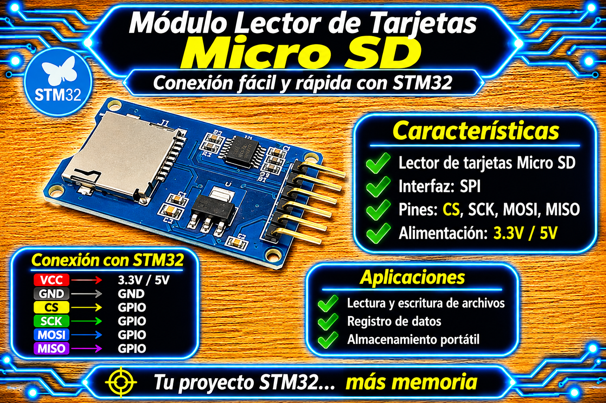

# Driver MicroSD SPI & FATFS Integration - STM32 HAL

<p align="center">
  
</p>

Driver modular de Capa 2 (HAL) e integración de Capa 3 (Middleware FatFs) para tarjetas de memoria **MicroSD / SDHC / MMC** mediante bus SPI. El sistema ofrece gestión dinámica de la frecuencia de reloj SPI (sincronización lenta en fase de arranque y alta velocidad en tiempo de ejecución), soporte multi-estándar de tarjetas (SDv1, SDv2, SDHC/SDXC, MMC), lectura y escritura de sectores LBA de 512 bytes, decodificación de registros CSD y la capa de abstracción `user_diskio.c` autogenerada y respetada por STM32CubeMX.

## Características

* **Gestión Dinámica de Reloj (Prescaler SPI):** Ajuste automático del prescaler a velocidad lenta (`SD_INIT_PRESCALER`, $< 400 \text{ kHz}$) durante la fase de sincronización inicial, conmutando dinámicamente a alta velocidad (`SD_RUN_PRESCALER`, hasta $25 \text{ MHz}$) tras completar la inicialización con éxito.
* **Soporte Multi-Estándar:** Detección automática del tipo de tarjeta conectada mediante inspección del registro OCR y comandos de aplicación (`CMD0`, `CMD8`, `ACMD41`, `CMD1`, `CMD58`):
  * Tarjetas SDv2 de alta capacidad (**SDHC / SDXC**) con direccionamiento directo por bloques de 512 bytes.
  * Tarjetas SDv1 / SDv2 de capacidad estándar (**SDSC**) con direccionamiento por byte.
  * Tarjetas **MMC** (Multimedia Card).
* **Integración Nativa con FatFs (`user_diskio.c`):** Adaptador I/O compatible con las etiquetas `/* USER CODE BEGIN */` de STM32CubeMX, implementando las funciones `USER_initialize`, `USER_status`, `USER_read`, `USER_write` y `USER_ioctl` para soportar la API estándar de archivos (`f_mount`, `f_open`, `f_write`, etc.).
* **Decodificación de Capacidad (CSD):** Consulta del registro de datos específicos de la tarjeta (`CMD9`) con decodificación de estructuras CSD v1.0 y v2.0 para calcular y reportar a FatFs la cantidad exacta de sectores de 512 bytes disponibles.
* **Sistema de Trazas de Depuración Opcional:** Registro de eventos y códigos de respuesta por UART activa mediante la macro `#define SD_DEBUG` integrada con el driver `uart_STM32.h`.

## Arquitectura del Software

El proyecto sigue una arquitectura en 3 capas bien definida:

```mermaid
graph TD
    SubGraph3[Capa 3: Aplicación / Sistema de Archivos]
        App[main.c / Lógica de Aplicación]
        FatFs[Middleware FatFs: f_mount, f_open, f_write]
    end

    SubGraph2[Capa 2: Abstracción y Driver Bare-Metal]
        DiskIO[user_diskio.c / Capa Interface FatFs]
        SDDriver[spi_sdcard_STM32.c / Driver MicroSD SPI]
    end

    SubGraph1[Capa 1: Hardware & Periféricos STM32]
        HAL_SPI[STM32 HAL SPI API]
        GPIO[Pines GPIO / Chip Select SD_CS]
    end

    App --> FatFs
    FatFs --> DiskIO
    DiskIO --> SDDriver
    SDDriver --> HAL_SPI
    SDDriver --> GPIO
```

## Archivos del Proyecto

| Archivo | Capa | Descripción |
| :--- | :--- | :--- |
| `spi_sdcard_STM32.h` | Capa 2 (Driver) | Interfaz pública, definición de tipos de estado (`SD_Status_t`) y prototipos de funciones SPI. |
| `spi_sdcard_STM32.c` | Capa 2 (Driver) | Implementación bare-metal de comandos SD por SPI, secuencia de init y lectura/escritura de bloques LBA. |
| `user_diskio.h` | Capa 2-3 (Puente) | Declaración de la estructura `USER_Driver` del middleware FatFs. |
| `user_diskio.c` | Capa 2-3 (Puente) | Adaptador I/O para FatFs que mapea las llamadas del sistema de archivos hacia la API del driver `SPI_SD_*`. |
| `main.c` | Capa 3 (Aplicación) | Ejemplo práctico de montaje del sistema de archivos (`f_mount`) y creación/escritura de archivos (`f_open`, `f_write`). |

## Conexiones y Hardware

El módulo lector de tarjetas MicroSD se comunica mediante un bus SPI en modo Master. A continuación se detalla el esquema de conexión para una tarjeta de desarrollo STM32 (ejemplo Nucleo-F439ZI):

| Módulo MicroSD | STM32 (Ejemplo SPI1) | Etiqueta (User Label) | Descripción |
| :--- | :--- | :--- | :--- |
| **VCC** | 3.3 V / 5 V | — | Alimentación principal |
| **GND** | GND | — | Tierra |
| **CS / SS** | GPIOD / GPIOB (Ej: PB6) | `SD_CS_Pin` | Chip Select (Salida Push-Pull, High Speed) |
| **SCK / SCL** | PA5 (SPI1_SCK) | `SPI1_SCK` | Línea de reloj del bus SPI |
| **MISO / SDO** | PA6 (SPI1_MISO) | `SPI1_MISO` | Master In Slave Out (Entrada SPI) |
| **MOSI / SDI** | PA7 (SPI1_MOSI) | `SPI1_MOSI` | Master Out Slave In (Salida SPI) |

> ⚠️ **NIVEL LÓGICO Y ALIMENTACIÓN:** Asegúrate de que el módulo cuente con regulador a 3.3V o convertidor de niveles lógicos. El pin CS debe inicializarse deseleccionado (`HIGH`) antes de invocar la secuencia de inicio.

## Integración en STM32CubeMX

1. **Configuración del Periférico SPI:**
   * **Mode:** Master Synchronous.
   * **Data Size:** 8 Bits.
   * **First Bit:** MSB First.
   * **Clock Polarity (CPOL):** Low (CPOL = 0).
   * **Clock Phase (CPHA):** 1 Edge (CPHA = 0).
   * **NSS Management:** Software (`SPI_NSS_SOFT`).
   * **Baud Rate Prescaler:** Configurar inicialmente en `/256` para garantizar $<400 \text{ kHz}$ durante el arranque.
2. **Configuración del Pin CS (GPIO):**
   * Configura el pin elegido para Chip Select (ejemplo `PB6` o `PD14`) como **GPIO_Output** (Push-Pull, High Speed, sin Pull-up/Pull-down) y asigna el *User Label* `SD_CS`.
3. **Middleware FATFS:**
   * Habilita el middleware **FATFS** seleccionando **User Defined** mode.
   * Copia o conserva la lógica dentro de los bloques de usuario `/* USER CODE BEGIN */` en `user_diskio.c`.

## Capa de Interfaz FatFs (`user_diskio.c`)

Este archivo implementa la abstracción que requiere FatFs para interactuar con la tarjeta a través del driver `spi_sdcard_STM32`. Al estar contenido dentro de las etiquetas de usuario `USER CODE BEGIN`, STM32CubeMX preserva el código ante cualquier regeneración del `.ioc`.

```c
/* USER CODE BEGIN Header */
/**
 ******************************************************************************
 * @file    user_diskio.c
 * @brief   Driver diskio de FatFs sobre spi_sdcard (SPI1).
 ******************************************************************************
 * @attention
 *
 * Copyright (c) 2026 STMicroelectronics.
 * All rights reserved.
 *
 * This software is licensed under terms that can be found in the LICENSE file
 * in the root directory of this software component.
 * If no LICENSE file comes with this software, it is provided AS-IS.
 *
 ******************************************************************************
 */
/* USER CODE END Header */

/* USER CODE BEGIN DECL */

/* Includes ------------------------------------------------------------------*/
#include <string.h>
#include "ff_gen_drv.h"
#include "main.h"
#include <spi_sdcard_STM32.h>

/* SPI usado por la MicroSD (definido en main.c por CubeMX) */
extern SPI_HandleTypeDef hspi1;

/* Private variables ---------------------------------------------------------*/
/* Disk status */
static volatile DSTATUS Stat = STA_NOINIT;

/* USER CODE END DECL */

/* Private function prototypes -----------------------------------------------*/
DSTATUS USER_initialize (BYTE pdrv);
DSTATUS USER_status (BYTE pdrv);
DRESULT USER_read (BYTE pdrv, BYTE *buff, DWORD sector, UINT count);
#if _USE_WRITE == 1
  DRESULT USER_write (BYTE pdrv, const BYTE *buff, DWORD sector, UINT count);
#endif /* _USE_WRITE == 1 */
#if _USE_IOCTL == 1
  DRESULT USER_ioctl (BYTE pdrv, BYTE cmd, void *buff);
#endif /* _USE_IOCTL == 1 */

Diskio_drvTypeDef  USER_Driver =
{
  USER_initialize,
  USER_status,
  USER_read,
#if  _USE_WRITE
  USER_write,
#endif  /* _USE_WRITE == 1 */
#if  _USE_IOCTL == 1
  USER_ioctl,
#endif /* _USE_IOCTL == 1 */
};

/* Private functions ---------------------------------------------------------*/

/**
  * @brief  Initializes a Drive
  * @param  pdrv: Physical drive number (0..)
  * @retval DSTATUS: Operation status
  */
DSTATUS USER_initialize (BYTE pdrv)
{
  /* USER CODE BEGIN INIT */
    if (pdrv != 0) return STA_NOINIT;

    Stat = (SPI_SD_Init(&hspi1, SD_CS_GPIO_Port, SD_CS_Pin) == SD_OK) ? 0 : STA_NOINIT;
    return Stat;
  /* USER CODE END INIT */
}

/**
  * @brief  Gets Disk Status
  * @param  pdrv: Physical drive number (0..)
  * @retval DSTATUS: Operation status
  */
DSTATUS USER_status (BYTE pdrv)
{
  /* USER CODE BEGIN STATUS */
    if (pdrv != 0) return STA_NOINIT;
    return Stat;
  /* USER CODE END STATUS */
}

/**
  * @brief  Reads Sector(s)
  * @param  pdrv: Physical drive number (0..)
  * @param  *buff: Data buffer to store read data
  * @param  sector: Sector address (LBA)
  * @param  count: Number of sectors to read (1..128)
  * @retval DRESULT: Operation result
  */
DRESULT USER_read (BYTE pdrv, BYTE *buff, DWORD sector, UINT count)
{
  /* USER CODE BEGIN READ */
    if (pdrv != 0 || count == 0) return RES_PARERR;
    if (Stat & STA_NOINIT) return RES_NOTRDY;

    while (count--) {
        if (SPI_SD_ReadBlock(buff, sector) != SD_OK) return RES_ERROR;
        buff += 512;
        sector++;
    }
    return RES_OK;
  /* USER CODE END READ */
}

/**
  * @brief  Writes Sector(s)
  * @param  pdrv: Physical drive number (0..)
  * @param  *buff: Data to be written
  * @param  sector: Sector address (LBA)
  * @param  count: Number of sectors to write (1..128)
  * @retval DRESULT: Operation result
  */
#if _USE_WRITE == 1
DRESULT USER_write (BYTE pdrv, const BYTE *buff, DWORD sector, UINT count)
{
  /* USER CODE BEGIN WRITE */
    if (pdrv != 0 || count == 0) return RES_PARERR;
    if (Stat & STA_NOINIT) return RES_NOTRDY;

    while (count--) {
        if (SPI_SD_WriteBlock(buff, sector) != SD_OK) return RES_ERROR;
        buff += 512;
        sector++;
    }
    return RES_OK;
  /* USER CODE END WRITE */
}
#endif /* _USE_WRITE == 1 */

/**
  * @brief  I/O control operation
  * @param  pdrv: Physical drive number (0..)
  * @param  cmd: Control code
  * @param  *buff: Buffer to send/receive control data
  * @retval DRESULT: Operation result
  */
#if _USE_IOCTL == 1
DRESULT USER_ioctl (BYTE pdrv, BYTE cmd, void *buff)
{
  /* USER CODE BEGIN IOCTL */
    if (pdrv != 0) return RES_PARERR;
    if (Stat & STA_NOINIT) return RES_NOTRDY;

    switch (cmd) {
    case CTRL_SYNC:               /* Cada escritura ya espera a que la tarjeta termine */
        return RES_OK;

    case GET_SECTOR_COUNT: {
        uint32_t n;
        if (SPI_SD_GetSectorCount(&n) != SD_OK) return RES_ERROR;
        *(DWORD *)buff = n;
        return RES_OK;
    }
    case GET_SECTOR_SIZE:
        *(WORD *)buff = 512;
        return RES_OK;

    case GET_BLOCK_SIZE:          /* Tamaño de bloque de borrado en sectores (desconocido = 1) */
        *(DWORD *)buff = 1;
        return RES_OK;

    default:
        return RES_PARERR;
    }
  /* USER CODE END IOCTL */
}
#endif /* _USE_IOCTL == 1 */
```

## Ejemplo Completo de Uso (`main.c`)

```c
#include "main.h"
#include "uart_STM32.h"
#include "spi_sdcard_STM32.h"
#include "fatfs.h"
#include <stdio.h>
#include <string.h>

extern SPI_HandleTypeDef hspi1;
extern UART_HandleTypeDef huart3;

FATFS fs;
FIL f;
UINT bw;
FRESULT fr;

static void Log(const char *s)
{
    UART_Driver_SendString(s);
    HAL_Delay((uint32_t)strlen(s) * 10U * 1000U / 115200U + 2U);
}

int main(void)
{
    HAL_Init();
    SystemClock_Config();
    MX_GPIO_Init();
    MX_USART3_UART_Init();
    MX_FATFS_Init();
    MX_SPI1_Init();

    /* Inicializar driver UART para transmisión de trazas */
    UART_Driver_Init(&huart3);
    UART_Driver_StartReceive_IT();

    Log("\r\n=== Sistema Iniciado: Inicializando Modulo MicroSD ===\r\n");

    HAL_Delay(1000);

    /* Montar la unidad lógica de la tarjeta SD */
    fr = f_mount(&fs, "", 1);
    if (fr != FR_OK) {
        char msg[40];
        snprintf(msg, sizeof(msg), "[ERROR] f_mount = %d\r\n", fr);
        Log(msg);
    } else {
        Log("[EXITO] Tarjeta SD montada correctamente.\r\n");

        /* Crear y escribir un archivo de texto */
        fr = f_open(&f, "PRUEBA1.TXT", FA_CREATE_ALWAYS | FA_WRITE);
        if (fr == FR_OK) {
            const char *texto = "Hola desde STM32 con FatFs\r\n";
            f_write(&f, texto, (UINT)strlen(texto), &bw);
            f_close(&f);
            Log("[EXITO] Archivo PRUEBA1.TXT escrito con exito.\r\n");
        } else {
            char msg[40];
            snprintf(msg, sizeof(msg), "[ERROR] f_open = %d\r\n", fr);
            Log(msg);
        }
    }

    while (1)
    {
        /* Loop principal no bloqueante */
    }
}
```

## API Principal del Driver SPI

| Función | Descripción |
| :--- | :--- |
| `SPI_SD_Init(hspi, cs_port, cs_pin)` | Inicializa la tarjeta SD a baja velocidad ($< 400 \text{ kHz}$), detecta el tipo de tarjeta (SDHC/SDv2/SDv1/MMC) y conmuta el bus SPI al prescaler rápido (`SD_RUN_PRESCALER`). |
| `SPI_SD_ReadBlock(pBuffer, sector)` | Lee un sector LBA de 512 bytes desde la tarjeta SD (convierte la dirección a bytes si se detecta una tarjeta de capacidad estándar SDSC/SDv1). |
| `SPI_SD_WriteBlock(pBuffer, sector)` | Escribe un bloque LBA de 512 bytes enviando el token `0xFE` y realizando la espera activa hasta completar la programación en la memoria flash. |
| `SPI_SD_GetSectorCount(sectors)` | Lee y decodifica el registro CSD (versiones v1.0 y v2.0) para calcular la cantidad total de sectores lógicos de 512 bytes de la memoria. |

## Interfaz de Disco FatFs (`user_diskio.c`)

| Función Callback | Mapeo al Driver | Descripción |
| :--- | :--- | :--- |
| `USER_initialize(pdrv)` | `SPI_SD_Init()` | Inicializa el hardware asociando el puerto y pin `SD_CS_GPIO_Port` / `SD_CS_Pin`. |
| `USER_status(pdrv)` | Estado local `Stat` | Retorna `0` (OK) o `STA_NOINIT` según el resultado del arranque. |
| `USER_read(pdrv, buff, sector, count)` | Bucle `SPI_SD_ReadBlock()` | Lee `count` sectores consecutivos incrementando la dirección LBA y el puntero de RAM (`buff += 512`). |
| `USER_write(pdrv, buff, sector, count)` | Bucle `SPI_SD_WriteBlock()` | Escribe `count` sectores consecutivos de 512 bytes sobre la memoria flash. |
| `USER_ioctl(pdrv, cmd, buff)` | `SPI_SD_GetSectorCount()` | Procesa comandos de control de FatFs (`CTRL_SYNC`, `GET_SECTOR_COUNT`, `GET_SECTOR_SIZE`, `GET_BLOCK_SIZE`). |

## Notas y Aclaraciones Técnicas

* **Protección del Código Autogenerado:** El archivo `user_diskio.c` utiliza las secciones de usuario autogeneradas por CubeMX (`/* USER CODE BEGIN DECL */`, `/* USER CODE BEGIN INIT */`, etc.). Al volver a generar el código desde el archivo `.ioc` de CubeMX, la implementación no se perderá.
* **Instancia Única:** El driver utiliza variables estáticas de control (`sd_hspi`, `sd_cs_port`, `sd_cs_pin`, `card_type`), por lo que está diseñado para gestionar **una única tarjeta MicroSD activa**.
* **Línea MISO en Alta Impedancia:** La función interna `SD_Deselect()` envía automáticamente 8 ciclos de reloj dummy (byte `0xFF`) con el pin CS en `HIGH` para obligar a la tarjeta SD a soltar la línea MISO.
* **Resistencia Pull-Up en MISO:** Si experimentas errores `CMD0` durante `f_mount`, verifica si el módulo lector incluye resistencia de pull-up en la línea MISO. De no ser así, configura el pin GPIO de MISO en modo `GPIO_PULLUP` en STM32CubeMX.
* **Parámetros FatFs:** Asegúrate de que `#define FF_MAX_SS` en `ffconf.h` esté fijado en `512` bytes para coincidir con la arquitectura del driver.

## Licencia

- MIT. Desarrollado por **Mamani Flores Carlos (UTN FRT)** - 2026.