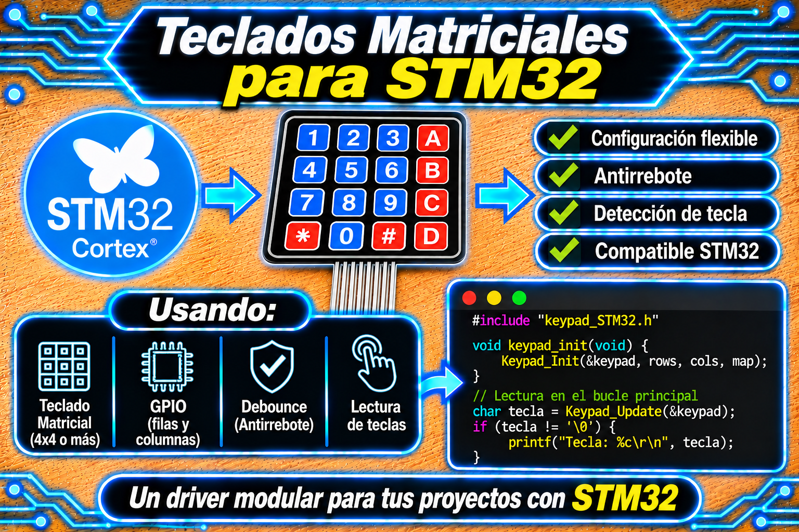
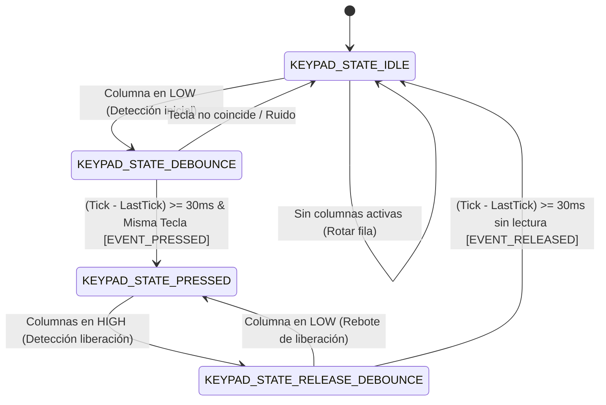

# Driver keypad_STM32 (GPIO, no bloqueante) para STM32 HAL

<p align="center">
  
</p>

Driver modular y genérico para la lectura de teclados matriciales (4x4 / 4x3) mediante barrido multiplexado asíncrono y filtrado de rebotes en pulsación y liberación por Máquina de Estados Finita (MEF) en microcontroladores STM32 con HAL. Funciona como una máquina de estados cooperativa: realiza el multiplexado fila por fila y el debounce usando `HAL_GetTick()`, sin utilizar `HAL_Delay()` ni bloquear el bucle principal de ejecución.

## Características

* **Totalmente asíncrono y no bloqueante:** El barrido de filas y la validación temporal de estabilidad se gestionan mediante marcas de tiempo (`HAL_GetTick()`), evitando esperas pasivas.

* **Doble filtrado de rebotes (Pulsación y Liberación):** Implementa una MEF de 4 estados que filtra el ruido mecánico tanto al presionar como al soltar la tecla (por defecto 30 ms).

* **Abstracción de Hardware Genérica:** Permite mapear cualquier combinación de pines y puertos GPIO (`GPIO_TypeDef*` y `uint16_t GPIO_Pin`) sin requerir pines contiguos ni del mismo puerto.

* **Configuración flexible (4x4 / 4x3):** El tamaño de filas y columnas es redefinible mediante macros de preprocesador (`KEYPAD_ROWS`, `KEYPAD_COLS`).

* **Gestión de eventos completa:** Genera y almacena eventos de tecla presionada (`KEYPAD_EVENT_PRESSED`) y liberada (`KEYPAD_EVENT_RELEASED`).

* **Seguridad defensiva:** Verificación de punteros `NULL` en toda la API pública e inmutabilidad de la estructura mediante `const` en los getters.

## Requisitos

| Requisito | Detalle | 
| ----- | ----- | 
| Microcontrolador | Cualquier STM32 con HAL (Probado en STM32F439ZI Nucleo-144) | 
| Periférico | Puertos GPIO para Filas (Salidas) y Columnas (Entradas) | 
| `main.h` | Debe incluir los headers de la HAL y las etiquetas (`#define`) de CubeMX | 
| Teclado | Matriz de contactos 4x4 o 4x3 de membranas o microswitches | 
| Velocidad del bus | Determinado por la frecuencia de llamada de `Keypad_Update()` en el super-loop | 
| Dependencias extra | Ninguna | 

Las lecturas y salidas se realizan por polling asíncrono dentro del super-loop; no requiere temporizadores por hardware ni interrupciones externas (EXTI).

## Archivos

| Archivo | Descripción | 
| ----- | ----- | 
| `keypad_STM32.h` | Interfaz pública: macros defensivas, enums de estados/eventos, estructuras Doxygen y prototipos. | 
| `keypad_STM32.c` | Implementación: funciones helper de barrido bajo nivel, FSM de 4 estados y API pública. | 

## Conexión del teclado (Ej: Nucleo-F439ZI)

| Módulo Teclado | Pin del MCU | Alias CubeMX (`main.h`) | Modo GPIO en CubeMX | 
| ----- | ----- | ----- | ----- | 
| **Fila 0 (`ROW_0`)** | `PE2` | `ROW_0_Pin` / `ROW_0_GPIO_Port` | Output Open-Drain, Inicial **HIGH** | 
| **Fila 1 (`ROW_1`)** | `PE4` | `ROW_1_Pin` / `ROW_1_GPIO_Port` | Output Open-Drain, Inicial **HIGH** | 
| **Fila 2 (`ROW_2`)** | `PB8` | `ROW_2_Pin` / `ROW_2_GPIO_Port` | Output Open-Drain, Inicial **HIGH** | 
| **Fila 3 (`ROW_3`)** | `PB9` | `ROW_3_Pin` / `ROW_3_GPIO_Port` | Output Open-Drain, Inicial **HIGH** | 
| **Columna 0 (`COL_0`)** | `PF14` | `COL_0_Pin` / `COL_0_GPIO_Port` | Input con resistencia **Pull-Up** | 
| **Columna 1 (`COL_1`)** | `PE13` | `COL_1_Pin` / `COL_1_GPIO_Port` | Input con resistencia **Pull-Up** | 
| **Columna 2 (`COL_2`)** | `PE11` | `COL_2_Pin` / `COL_2_GPIO_Port` | Input con resistencia **Pull-Up** | 
| **Columna 3 (`COL_3`)** | `PF15` | `COL_3_Pin` / `COL_3_GPIO_Port` | Input con resistencia **Pull-Up** | 

* **Recomendación de hardware:** La configuración de las filas como **Output Open-Drain** previene cortocircuitos entre salidas en caso de presionar simultáneamente dos teclas de una misma columna.

* **Estado de columnas:** Es fundamental activar las resistencias **Pull-Up** internas en los pines de entrada para fijar la línea en nivel ALTO (`1` lógico) cuando las teclas están en reposo.

## Instalación

1. Copia `keypad_STM32.c` a la carpeta `Core/Src/` y `keypad_STM32.h` a `Core/Inc/`.

2. En CubeMX / CubeIDE, asigna los nombres de etiqueta (`ROW_x` y `COL_x`) y configura las filas como **Output Open-Drain** (Nivel inicial `HIGH`) y las columnas como **Input Pull-Up**.

3. Regenera el código e incluye el header en tu aplicación:

```c
#include "keypad_STM32.h"
```

## Uso básico

El uso se resume en 3 pasos: **Mapear las estructuras GPIO con las macros del `.ioc`**, **Inicializar el driver** y **Actualizar la MEF periódicamente en el `while(1)`**.

```c
#include "main.h"
#include "keypad_STM32.h"

/* 1. Mapeo de matriz de teclas y pines GPIO utilizando alias de main.h */
const char keypad_map[KEYPAD_ROWS][KEYPAD_COLS] = {
    {'1', '2', '3', 'A'},
    {'4', '5', '6', 'B'},
    {'7', '8', '9', 'C'},
    {'*', '0', '#', 'D'}
};

const KeypadPin_t keypad_rows[KEYPAD_ROWS] = {
    {ROW_0_GPIO_Port, ROW_0_Pin},
    {ROW_1_GPIO_Port, ROW_1_Pin},
    {ROW_2_GPIO_Port, ROW_2_Pin},
    {ROW_3_GPIO_Port, ROW_3_Pin}
};

const KeypadPin_t keypad_cols[KEYPAD_COLS] = {
    {COL_0_GPIO_Port, COL_0_Pin},
    {COL_1_GPIO_Port, COL_1_Pin},
    {COL_2_GPIO_Port, COL_2_Pin},
    {COL_3_GPIO_Port, COL_3_Pin}
};

Keypad_t hkeypad;
uint32_t last_heartbeat_tick = 0;

int main(void)
{
    HAL_Init();
    SystemClock_Config();
    MX_GPIO_Init();

    /* Inicialización del Driver Keypad */
    Keypad_Init(&hkeypad, keypad_rows, keypad_cols, keypad_map);

    while (1)
    {
        /* 2. Avanzar la máquina de estados del teclado */
        char key = Keypad_Update(&hkeypad);

        /* 3. Procesar el evento de tecla detectada */
        if (key != '\0') {
            /* 
             * Aquí se puede ejecutar cualquier acción deseada:
             *  - Cambiar un estado en un menú.
             *  - Activar una salida GPIO.
             *  - Enviar por comunicación (UART, CAN, I2C, SPI).
             *  - Almacenar el carácter en un buffer de clave/password.
             */
            if (key == 'A') {
                HAL_GPIO_TogglePin(LD2_GPIO_Port, LD2_Pin);
            }
        }

        /* Tarea secundaria: Heartbeat no bloqueante */
        if ((HAL_GetTick() - last_heartbeat_tick) >= 500) {
            last_heartbeat_tick = HAL_GetTick();
            HAL_GPIO_TogglePin(LD1_GPIO_Port, LD1_Pin);
        }
    }
}
```

**Cómo funciona el ciclo:** La función `Keypad_Update()` debe ejecutarse continuamente en el super-loop. En cada llamada, la MEF conmuta la fila activa en nivel BAJO y evalúa las columnas. Si detecta una columna en nivel BAJO, inicia la temporización de *debounce*. Si la lectura se confirma estable al finalizar el tiempo, devuelve el carácter presionado y pasa al estado de retención y posterior verificación de liberación.

## API

| Función | Descripción | 
| ----- | ----- | 
| `Keypad_Init(keypad, rows, cols, map)` | Inicializa las estructuras internas de control y coloca todas las filas en reposo (`HIGH`). Retorna de forma segura si recibe punteros `NULL`. | 
| `Keypad_Update(keypad)` | Ejecuta la MEF de barrido y filtrado de rebotes. Devuelve el `char` de la tecla confirmada únicamente en el instante del evento de pulsación; de lo contrario devuelve `'\0'`. | 
| `Keypad_GetKey(keypad)` | Devuelve la última tecla registrada que fue confirmada como presionada. | 
| `Keypad_GetEvent(keypad)` | Devuelve el último evento registrado (`KEYPAD_EVENT_PRESSED`, `KEYPAD_EVENT_RELEASED` o `KEYPAD_EVENT_NONE`). | 

### Códigos de estado y eventos (`KeypadEvent_t`)

| Evento | Significado | 
| ----- | ----- | 
| `KEYPAD_EVENT_NONE` | Sin cambios ni eventos detectados. | 
| `KEYPAD_EVENT_PRESSED` | Se ha presionado y confirmado una tecla tras el periodo de debounce. | 
| `KEYPAD_EVENT_RELEASED` | Se ha liberado una tecla y confirmado el estado tras el periodo de release debounce. | 

## Máquina de estados



Duración típica de validación de pulsación o liberación: **30 ms** (configurable por preprocesador).

## Parámetros configurables

Definidos al comienzo de `keypad_STM32.h` mediante guardas de preprocesador `#ifndef`:

| Macro | Valor por defecto | Efecto | 
| ----- | ----- | ----- | 
| `KEYPAD_ROWS` | `4` | Número de filas asignadas en el barrido de la matriz. | 
| `KEYPAD_COLS` | `4` | Número de columnas leídas en la matriz. | 
| `KEYPAD_DEBOUNCE_MS` | `30` | Tiempo de ventana de estabilización en milisegundos para pulsación y liberación. | 

## Limitaciones y advertencias

* **Soporte de instancias:** Admite múltiples instancias declarando variables independientes de tipo `Keypad_t`, siempre que los pines asignados no colisionen.

* **Contexto de ejecución:** El driver no es reentrante. La función `Keypad_Update()` debe llamarse exclusivamente desde el super-loop del hilo principal y **nunca desde una ISR de interrupción**.

* **Pulsación simultánea (*Ghosting*):** Al no incluir diodos de aislamiento en matrices simples, la pulsación simultánea de 3 o más teclas puede generar falsas lecturas (*ghosting*). Se recomienda usar salidas **Open Drain** para proteger el hardware.

* **Frecuencia del super-loop:** `Keypad_Update()` debe llamarse con una periodicidad sensiblemente menor al tiempo de debounce (idealmente cada < 5 ms) para asegurar un filtrado suave y sin latencia perceptible.

## Solución de problemas

| Síntoma | Causa probable | 
| ----- | ----- | 
| Lecturas continuas o falsos disparos sin presionar teclas | Las columnas no están configuradas en modo **Input Pull-Up** en CubeMX. | 
| Al presionar una tecla se leen caracteres de la fila incorrecta | Las filas no se colocaron inicialmente en nivel **HIGH** o los pines están cruzados en `KeypadPin_t`. | 
| Las teclas tardan mucho en responder | El super-loop contiene funciones bloqueantes como `HAL_Delay()`. Elimina retardos síncronos. | 
| El microcontrolador se reinicia al presionar 2 teclas juntas | Las filas están configuradas como Push-Pull y una salida en HIGH colisiona con una salida en LOW. Cambia las filas a **Open Drain**. | 

**Comprobar que el hardware responde:**

```c
/* Prueba rápida: Forzar fila 0 en LOW y leer columna 0 en GPIO directo */
HAL_GPIO_WritePin(ROW_0_GPIO_Port, ROW_0_Pin, GPIO_PIN_RESET);
if (HAL_GPIO_ReadPin(COL_0_GPIO_Port, COL_0_Pin) == GPIO_PIN_RESET) {
    /* El microswitch físico de la intersección (0,0) funciona correctamente */
}
```

## Licencia

* MIT. Desarrollado por **Mamani Flores Carlos (UTN FRT)**, 2026.