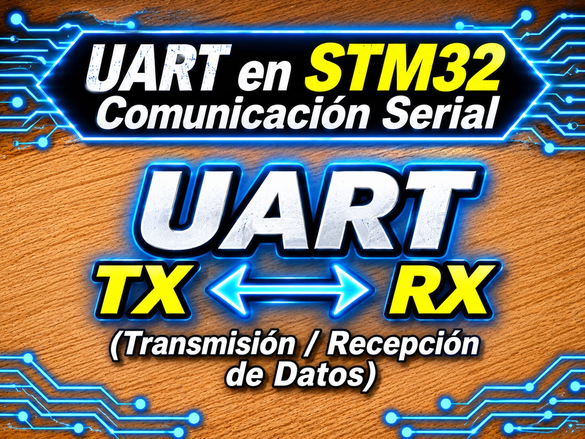

# Driver UART No Bloqueante - STM32

Driver de Capa 2 (HAL) 100% no bloqueante para periféricos UART/USART en STM32, basado en buffers circulares (Ring Buffers FIFO) e interrupciones para recepción y transmisión asíncrona.

<p align="center">
  
</p>


## Características

- Operación 100% no bloqueante en TX y RX utilizando interrupciones (`HAL_UART_Transmit_IT` y `HAL_UART_Receive_IT`).
- Buffers circulares independientes (Ring Buffers FIFO) de 128 bytes con indexación por potencia de 2 mediante máscaras de bits.
- Protección de secciones críticas thread-safe/ISR-safe mediante el registro `PRIMASK` con soporte para llamadas anidadas.
- Sistema de auto-recuperación y diagnóstico integrado (`UART_Driver_Process`) que re-arma RX ante fallos de hardware y destraba TX si la HAL queda colgada.
- Métricas de diagnóstico por contadores de desbordamiento de RX (`RxOverflow`), TX (`TxOverflow`) y fallos de re-armado (`RxRearmFail`).

## Compatibilidad

| Elemento | Detalle |
|----------|---------|
| Interfaz | UART / USART (Asíncrono) |
| Capa | Capa 2 (Driver / HAL) |
| Probado en | STM32F439ZI (Nucleo-144), STM32F103C8T6 (Blue Pill), STM32F411CEU6 (Black Pill) |
| Voltaje del módulo | 3.3 V (Niveles lógicos) |

> ⚠️ **IMPORTANTE SOBRE PLACAS DE DESARROLLO SIN DEBUGER INTEGRADO (Blue Pill, Black Pill):**
> 
> Placas como la **Blue Pill (STM32F103C8T6)** o **Black Pill (STM32F411/F401)** **NO incluyen un convertidor USB a Serie en su puerto USB nativo**. El conector micro-USB/USB-C de estas placas no expone un puerto COM de consola UART a menos que implementes la pila USB-CDC.
> 
> Para comunicarte con la PC usando este driver en esas placas, **necesitas un módulo USB a Serie TTL externo** como:
> - **FTDI FT232RL**
> - **Prolific PL2303**
> - **CH340G / CP2102**
>
> ⚠️ **Precaución:** Asegúrate de configurar el jumper de tensión del adaptador USB-TTL en **3.3V**. Aplicar 5V en un pin no tolerante puede dañar el microcontrolador.

## Archivos

| Archivo | Descripción |
|---------|-------------|
| `uart_STM32.h` | API pública del driver, declaraciones de handlers para callbacks HAL y contadores de diagnóstico |
| `uart_STM32.c` | Gestión interna de Ring Buffers, manejo de interrupciones, secciones críticas y tareas de mantenimiento |

## Conexiones

| STM32 (Ejemplo USART2) | Módulo USB-TTL (FTDI / PL2303 / CH340) | Descripción |
|------------------------|----------------------------------------|-------------|
| TX (ej. PA2 / PA9)     | **RXD**                                | Transmisión del STM32 a la lectura del módulo |
| RX (ej. PA3 / PA10)    | **TXD**                                | Recepción del STM32 desde el envío del módulo |
| GND                    | **GND**                                | Referencia de masa común (**obligatoria**) |
| NC / 3.3V              | VCC (3.3V)                             | Alimentación opcional (si el STM32 se alimenta del convertidor) |

> 📌 **Conexión Cruzada:** Recuerda que la conexión serie siempre se cruza: **TX (STM32) ➔ RX (USB-TTL)** y **RX (STM32) ➔ TX (USB-TTL)**.

## Integración

1. Copia `uart_STM32.h` y `uart_STM32.c` a tu proyecto (en `Core/Inc` y `Core/Src`).
2. Configura el periférico UART en CubeMX (ej. USART2 a 115200 baudios, 8N1) y **activa la interrupción global en el NVIC (NVIC Interrupt Enable)**.
3. Incluye el header donde lo necesites:

   ```c
   #include "uart_STM32.h"
   ```

4. En la sección de callbacks del usuario (por ejemplo en `main.c` o `stm32f4xx_it.c`), redirige las llamadas de la HAL hacia los manejadores del driver:

   ```c
void HAL_UART_RxCpltCallback(UART_HandleTypeDef *huart) {
	if (huart->Instance == USARTX) {    //USARTX o UARTX
		UART_Driver_RxHandler();
	}
}

void HAL_UART_TxCpltCallback(UART_HandleTypeDef *huart) {
	if (huart->Instance == USARTX) {    //USARTX o UARTX
		UART_Driver_TxHandler();
	}
}

void HAL_UART_ErrorCallback(UART_HandleTypeDef *huart) {
	if (huart->Instance == USARTX) {    //USARTX o UARTX
		UART_Driver_ErrorHandler();
	}
}
   ```

## Ejemplo mínimo

```c
#include "main.h"
#include "uart_STM32.h"

extern UART_HandleTypeDef huart3;

int main(void)
{
    HAL_Init();
    SystemClock_Config();
    MX_GPIO_Init();
    MX_USART2_UART_Init();

    /* 1. Inicializar el driver con la instancia de la HAL */
    UART_Driver_Init(&huart3);

    /* 2. Iniciar la escucha asíncrona por interrupción */
    UART_Driver_StartReceive_IT();

    /* 3. Enviar mensaje inicial (no bloqueante) */
    UART_Driver_SendString("Driver UART Inicializado OK\r\n");

    uint8_t rx_data;

    while (1)
    {
        /* 4. Mantenimiento periódico del driver */
        UART_Driver_Process();

        /* 5. Verificación y lectura de datos recibidos (Echo test) */
        if (UART_Driver_DataAvailable()) {
            if (UART_Driver_ReadChar(&rx_data)) {
                /* Reenvía el carácter recibido */
                UART_Driver_SendChar((char)rx_data);
            }
        }
    }
}
```

## API principal

| Función | Descripción |
|---------|-------------|
| `UART_Driver_Init()` | Asocia la instancia de la HAL y reinicia los Ring Buffers y contadores |
| `UART_Driver_StartReceive_IT()` | Arranca la primera escucha asíncrona por interrupción |
| `UART_Driver_SendChar()` | Encola un único carácter en el Ring Buffer TX sin bloquear la CPU |
| `UART_Driver_SendString()` | Encola una cadena de texto completa en el buffer TX |
| `UART_Driver_DataAvailable()` | Consulta si existen bytes pendientes de lectura en el buffer RX |
| `UART_Driver_ReadChar()` | Extrae un byte del buffer RX (FIFO) respetando la barrera de memoria |
| `UART_Driver_Process()` | Tarea de mantenimiento periódico: re-arma RX si falló y destraba TX |
| `UART_Driver_RxHandler()` | Manejador a llamar dentro de `HAL_UART_RxCpltCallback()` |
| `UART_Driver_TxHandler()` | Manejador a llamar dentro de `HAL_UART_TxCpltCallback()` |
| `UART_Driver_ErrorHandler()` | Manejador a llamar dentro de `HAL_UART_ErrorCallback()` |
| `UART_Driver_GetRxOverflowCount()` | Devuelve la cantidad de bytes recibidos descartados por buffer RX lleno |
| `UART_Driver_GetTxOverflowCount()` | Devuelve la cantidad de bytes de transmisión descartados por buffer TX lleno |
| `UART_Driver_GetRxRearmFailCount()` | Devuelve la cantidad de veces que la HAL rechazó el re-armado de recepción |

La documentación detallada de cada función se encuentra en los bloques Doxygen del archivo `uart_STM32.h`.

## Notas y problemas conocidos

- **Habilitación de NVIC:** Si olvidas habilitar la interrupción global del periférico UART en STM32CubeMX, la recepción y transmisión no funcionarán ya que dependen 100% de los callbacks de la HAL.
- **Necesidad de convertidor USB-TTL:** En placas de desarrollo económicas (Blue Pill, Black Pill) se requiere un módulo externo USB-TTL (FT232, PL2303, CH340) con niveles de 3.3V para establecer la comunicación con el monitor serie de la PC.
- **Tamaño de Buffers:** Los buffers tienen un tamaño fijo definido por `UART_BUFFER_SIZE` (128 bytes por defecto). Debe ser una potencia de 2 (`2^n`) para asegurar el cálculo circular rápido mediante `UART_INDEX_MASK`.
- **Llamadas a `UART_Driver_Process()`:** Debe invocarse regularmente en el bucle principal (`while(1)`). Si ocurre un error de Overrun (ORE) en la UART hardware, la HAL deshabilita la recepción; `Process()` se encarga de re-armarla automáticamente sin bloquear el sistema.

## Licencia

MIT. Desarrollado por **Mamani Flores Carlos (UTN FRT)** - 2026.