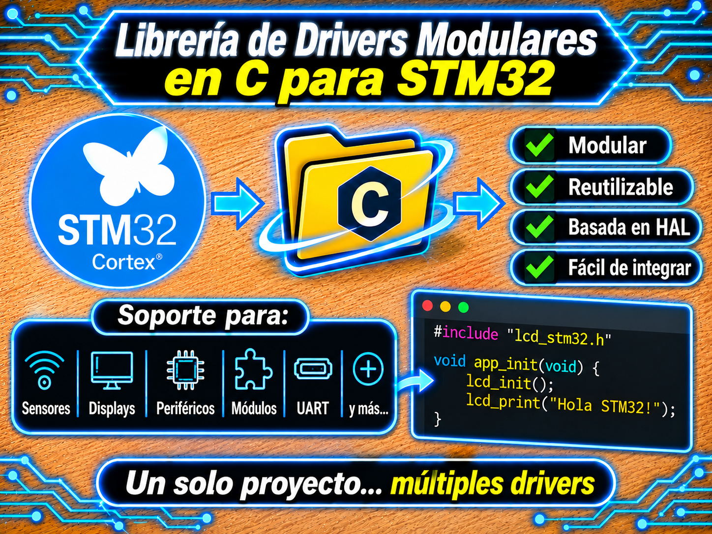

# Librería de Drivers Modulares en C para STM32

<p align="center">
  
</p>

Colección de drivers y librerías modulares en **C (C99)** para periféricos, sensores, actuadores y controladores de interfaz en microcontroladores **STM32**, desarrollados sobre la capa **ST HAL** y optimizados para arquitecturas de tiempo real **no bloqueantes (MEF / ISR)**.

Diseñado y mantenido por **Mamani Flores Carlos (UTN FRT)** como aporte académico y proyecto de desarrollo para la cátedra de **Técnicas Digitales 2** (Universidad Tecnológica Nacional - Facultad Regional Tucumán).

---

## 🏛️ Filosofía de Diseño y Pilares Técnicos

Cada driver de este repositorio respeta estándares de código industrial y embebido de alto rendimiento:

1. **Arquitectura No Bloqueante:** Máquinas de Estados Finitos (MEF) impulsadas por temporización asíncrona (`HAL_GetTick()`) e Interrupciones de Hardware (`IT`), garantizando cero bloqueos en el bucle principal (`while(1)`).
2. **Temporización Precisa:** Protocolos sensibles a microsegundos (Bit-Banging / 1-Wire) utilizan Timers dedicados de hardware o la dependencia central [`utils_STM32`](Dependencias/Utils/) (DWT/SysTick).
3. **Gestión Atómica y Hardware Directo:** Acceso a registros GPIO (`BSRR`, `IDR`) y soporte para modulación **Open-Drain con Pull-Up**.
4. **Documentación Doxygen:** Cabeceras y fuentes con rótulos formales Doxygen y descripciones exhaustivas de API.

---

## 📂 Categorías e Índice del Repositorio

El repositorio se encuentra categorizado de manera modular. Selecciona una categoría para explorar sus drivers y documentación detallada:

| Categoría | Descripción | Módulos / Drivers Integrados |
| :--- | :--- | :--- |
| 🚀 **[`Actuadores/`](Actuadores/)** | Control de elementos de salida y potencia. | `LED_RGB`, `Servo` |
| 🛠️ **[`Dependencias/`](Dependencias/)** | Librerías base y utilidades de tiempo. | `Utils` (`utils_STM32`) |
| 🖥️ **[`Displays/`](Displays/)** | Pantallas alfanuméricas, 7 segmentos y gráficas. | `Display_TM1637`, `LCD_4Bits`, `LCD_I2C`, `OLED_I2C`, `TFT_ST7735` |
| 📦 **[`Modulos/`](Modulos/)** | Comunicación, RTC, almacenamiento y entradas. | `Bluetooth`, `Encoder-KY040`, `RTC-DS3231`, `SPI-MicroSD` |
| 🔌 **[`Perifericos-BSP/`](Perifericos-BSP/)** | Abstracciones de periféricos internos STM32. | `UART` (Buffer circular IT/DMA) |
| 🌡️ **[`Sensores/`](Sensores/)** | Adquisición de variables físicas. | `BH1750`, `BMP180`, `DHT11`, `DS18B20`, `HTU2X`, `LM35` |

---

## 🚀 Guía Rápida de Integración

1. **Explora la categoría deseada** y consulta el `README.md` del driver específico para ver su tabla de conexiones, fórmulas KaTeX y dependencias.
2. **Copia los archivos `.h` y `.c`** a tu proyecto en STM32CubeIDE.
3. **Incluye la dependencia `Utils`** ([`Dependencias/Utils/`](Dependencias/Utils/)) si utilizas drivers con temporización en microsegundos (`Display_TM1637`, `LCD_I2C`, `LCD_4Bits`).
4. **Inicializa los periféricos** en `main()` e invoca las funciones de actualización dentro del `while(1)`.

```c
#include "main.h"
#include "utils.h"         /* Si se requiere temporización en us */
#include "lm35_STM32.h"
#include "tm1637_STM32.h"
```

---

## 🌳 Estructura General de Directorios

```text
DriversST-Github/
├── Actuadores/          <-- Drivers de salida (LED_RGB, Servo)
├── Dependencias/        <-- Módulo central de retardos (Utils)
├── Displays/            <-- Pantallas (TM1637, LCD 4Bits/I2C, OLED, TFT)
├── Modulos/             <-- Comunicación, RTC, SD y Encoders
├── Perifericos-BSP/     <-- Abstracciones BSP (UART por interrupción)
├── Sensores/            <-- Adquisición analógica y digital (LM35, DS18B20, etc.)
├── LICENSE              <-- Licencia MIT
└── README.md            <-- (Este archivo)
```

---

## 📩 Contacto y Soporte Académico

- **Autor:** Mamani Flores Carlos
- **Institución:** Universidad Tecnológica Nacional – Facultad Regional Tucumán (UTN FRT)
- **Materia:** Técnicas Digitales 2 (Ingeniería Electrónica)
- **GitHub:** [@CarlitozMF](https://github.com/CarlitozMF)

---

## 📜 Licencia

Este proyecto se distribuye bajo la licencia **MIT**. Consulta el archivo [LICENSE](LICENSE) para más detalles.