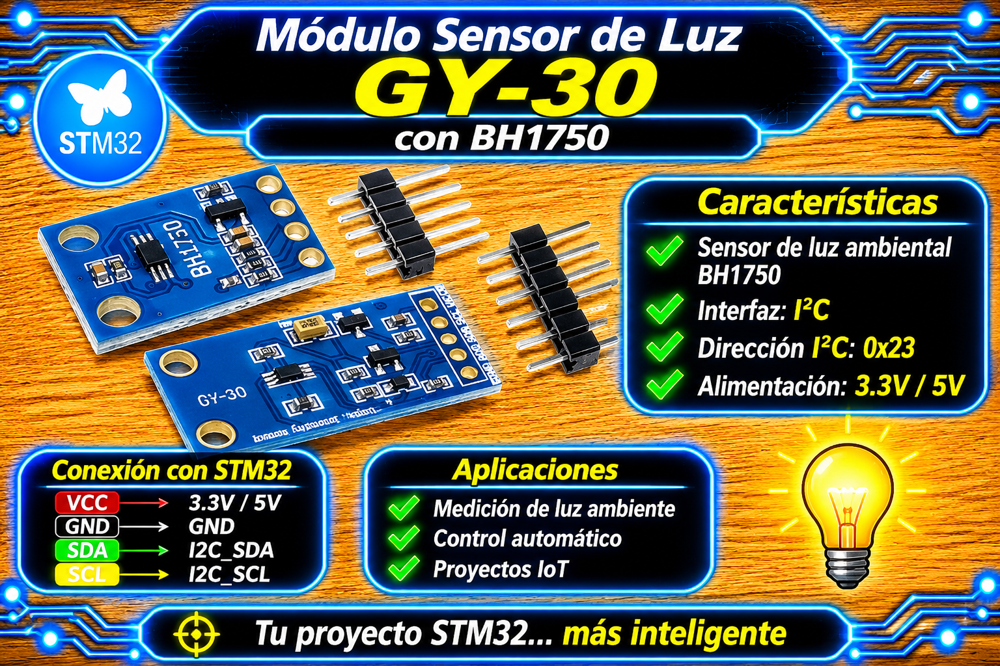

# Driver BH1750 (I2C, con autoajuste MTreg) para STM32 HAL

<p align="center">
  
</p>

Driver para medir la intensidad lumínica ambiental (en Lux) con el sensor **BH1750FVI** por bus **I2C** en microcontroladores STM32 mediante la capa HAL. Soporta múltiples modos de resolución (única o continua), temporización de integración escalada no bloqueante mediante `HAL_GetTick()` y control dinámico de sensibilidad/ganancia a través del registro de tiempo de integración (`MTreg`).

---

## Características

- **Soporte de Múltiples Modos de Medición:** Modos continuos y de disparo único (*One-Time*) en alta resolución (1 Lux), alta resolución 2 (0.5 Lux) y baja resolución (4 Lux).
- **Autoajuste Dinámico de Sensibilidad (MTreg):** Ajuste automático del registro de tiempo de integración ($31 \le \text{MTreg} \le 254$) según umbrales de iluminación para evitar saturación en luz solar directa o extender la sensibilidad en penumbra.
- **Verificación No Bloqueante de Muestras:** Función `BH1750_IsMeasurementReady()` que calcula en tiempo real el tiempo de integración requerido ($16\text{ ms}$ a $180\text{ ms}$ en función del MTreg y el modo) utilizando `HAL_GetTick()`.
- **Dirección I2C Configurable:** Soporte de direcciones físicas `0x23` (ADD LOW) y `0x5C` (ADD HIGH).
- **Abstracción de Handles HAL:** Estructura de control `BH1750_Handle_t` independiente que permite gestionar múltiples instancias en diferentes buses I2C.

---

## Requisitos

| Requisito | Detalle |
| :--- | :--- |
| **Microcontrolador** | Cualquier STM32 con HAL (probado en STM32F4 series / Nucleo-F439ZI, BluePill, BlackPill). |
| **Periférico** | Un bus I2C en modo Master (100 kHz Standard Mode o 400 kHz Fast Mode) inicializado (`MX_I2C1_Init()`). |
| **Header Principal** | `main.h` (autogenerado por CubeMX). |
| **Sensor** | Sensor de luz digital BH1750FVI / Módulo GY-302 (`0x23` por defecto con ADDR a GND). |
| **Velocidad del bus** | 100 kHz a 400 kHz. |
| **Dependencias extra** | Ninguna (`stdbool.h` y `stdint.h` estándar). |

> **Nota de temporización:** La adquisición del dato (`BH1750_ReadLightLevel`) realiza la transmisión/recepción I2C mediante polling HAL. El intervalo de espera de conversión se consulta sin bloquear mediante `BH1750_IsMeasurementReady()`.

---

## Archivos

| Archivo | Descripción |
| :--- | :--- |
| `bh1750_STM32.h` | Interfaz pública del driver: tipos (`BH1750_Handle_t`, `BH1750_Status_t`, `BH1750_Mode_t`), macros de MTreg y prototipos. |
| `bh1750_STM32.c` | Implementación privada: configuración I2C, escalado de MTreg, autoajuste dinámico de rango y cálculo de luxes. |

---

## Conexión del sensor

| Módulo BH1750 (GY-302) | Microcontrolador STM32 | Función / Descripción |
| :---: | :---: | :--- |
| **VCC** | **3.3 V o 5 V** | Alimentación (el módulo GY-302 incluye regulador interno a 3.3 V). |
| **GND** | **GND** | Tierra común del sistema. |
| **SCL** | **I2C1_SCL** | Reloj del bus I2C. |
| **SDA** | **I2C1_SDA** | Datos del bus I2C. |
| **ADDR / ADD** | **GND / 3.3 V** | Selección de dirección I2C: GND = `0x23` (`BH1750_I2C_ADDR_LO`), VCC = `0x5C` (`BH1750_I2C_ADDR_HI`). |

- **Alimentación:** Si se utiliza el chip BH1750FVI directamente, alimentar strictly con **2.4 V a 3.6 V**. En módulos comerciales tipo GY-302, se admite alimentación de **3.3 V a 5 V**.
- **Resistencias de Pull-Up:** Los módulos GY-302 **incorporan resistencias de pull-up SMD de 4.7 kΩ** en las líneas SCL y SDA.

---

## Instalación

1. Copia `bh1750_STM32.c` a la carpeta `Core/Src/` de tu proyecto STM32CubeIDE.
2. Copia `bh1750_STM32.h` a la carpeta `Core/Inc/`.
3. En STM32CubeMX, activa el periférico **I2C1** (o el asignado):
   - **I2C Speed Mode:** Standard Mode (100 kHz) o Fast Mode (400 kHz).
   - **Addressing Mode:** 7-bit.
4. Genera el código e incluye la cabecera en tu archivo `main.c`:
   ```c
   #include "bh1750_STM32.h"
   ```

---

## Uso básico

El uso se resume en 3 pasos: **Inicializar**, **Verificar si la muestra está lista** y **Leer/Trabajar con el nivel de luz en Lux**.

```c
#include "main.h"
#include "bh1750_STM32.h"

extern I2C_HandleTypeDef hi2c1;
BH1750_Handle_t bh1750_dev;

int main(void)
{
    HAL_Init();
    SystemClock_Config();
    MX_GPIO_Init();
    MX_I2C1_Init();

    /* 1. Inicialización en modo continuo de alta resolución */
    if (BH1750_Init(&bh1750_dev, &hi2c1, BH1750_I2C_ADDR_LO, BH1750_CONTINUOUS_HIGH_RES_MODE) == BH1750_OK) {
        /* Configuración inicial exitosa */
    }

    while (1)
    {
        /* 2. Comprobar si transcurrió el tiempo de integración de forma no bloqueante */
        if (BH1750_IsMeasurementReady(&bh1750_dev, false)) {
            float lux = 0.0f;

            /* 3. Leer el valor actual de iluminación */
            if (BH1750_ReadLightLevel(&bh1750_dev, &lux) == BH1750_OK) {
                
                /* ================================================================= */
                /*  AQUÍ PUEDES TRABAJAR LIBREMENTE CON LA LECTURA DEL SENSOR (lux)  */
                /*  Ejemplos: guardar en MicroSD, mostrar en Display OLED, controlar */
                /*  un relé de iluminación o transmitir vía Ethernet/telemetría.     */
                /* ================================================================= */

                /* Opcional: Ajustar automáticamente la sensibilidad para la siguiente muestra */
                BH1750_AutoAdjust(&bh1750_dev, lux);
            }
        }

        /* ... otras tareas no bloqueantes del super-loop ... */
    }
}
```

---

## API

| Función | Descripción |
| :--- | :--- |
| `BH1750_Init(dev, hi2c, addr, mode)` | Asigna el bus, dirección, establece `MTreg = 69`, factor `1.2` y configura el modo inicial. |
| `BH1750_Configure(dev, mode)` | Transmite la orden I2C para cambiar el modo de operación activo. |
| `BH1750_SetMTreg(dev, mtreg)` | Modifica los bits del registro MTreg (en 2 pasos I2C) para variar el tiempo/sensibilidad. |
| `BH1750_IsMeasurementReady(dev, max_wait)` | Retorna `true` si transcurrió el tiempo de conversión escalado según el modo y MTreg. |
| `BH1750_ReadLightLevel(dev, &lux)` | Lee los 2 bytes por I2C, aplica el factor MTreg y la corrección de 1.2 para obtener Luxes. |
| `BH1750_AutoAdjust(dev, current_lux)` | Evalúa los umbrales ($50000\text{ lx}$ y $10\text{ lx}$) y ajusta el `MTreg` dinámicamente. |

### Códigos de estado (`BH1750_Status_t`)

| Código | Significado |
| :--- | :--- |
| `BH1750_OK` | Operación completada correctamente. |
| `BH1750_ERR_INVALID_PARAM` | Puntero `dev` o `hi2c` nulo. |
| `BH1750_ERR_I2C_TRANSMIT` | Error en la transmisión I2C con la HAL. |
| `BH1750_ERR_I2C_RECEIVE` | Error en la lectura I2C de los bytes de datos. |
| `BH1750_ERR_NOT_CONFIGURED` | El sensor no se ha inicializado o la variable de resultado es nula. |
| `BH1750_ERR_OUT_OF_RANGE` | El valor de `MTreg` pasado está fuera de los límites ($31 \dots 254$). |

---

## Conversiones y Fórmulas

1. **Reconstrucción del valor crudo:**  
   $$D_{\text{raw}} = (\text{buffer}[0] \ll 8) \mid \text{buffer}[1]$$

2. **Escalamiento por MTreg (cuando $\text{MTreg} \neq 69$):**  
   $$D_{\text{scaled}} = D_{\text{raw}} \cdot \left(\frac{69}{\text{MTreg}}\right)$$

3. **Ajuste para Modo High-Res 2 (Resolución de $0.5\text{ lx}$):**  
   $$D_{\text{mode}} = \frac{D_{\text{scaled}}}{2.0}$$

4. **Conversión final a Lux (Factor de calibración típico $1.2$):**  
   $$\text{Iluminancia } [\text{Lux}] = \frac{D_{\text{mode}}}{1.2}$$

---

## Parámetros configurables

Definidos en `bh1750_STM32.h`:

| Macro | Valor por defecto | Efecto |
| :--- | :---: | :--- |
| `BH1750_I2C_ADDR_LO` | `0x23` | Dirección I2C cuando ADDR está conectado a GND. |
| `BH1750_I2C_ADDR_HI` | `0x5C` | Dirección I2C cuando ADDR está conectado a VCC. |
| `BH1750_DEFAULT_MTREG` | `69` | Tiempo de medición nominal ($120\text{ ms}$ típicos en High-Res). |
| `BH1750_MTREG_MIN` | `31` | Mínima sensibilidad (para medir iluminación muy alta sin saturar). |
| `BH1750_MTREG_MAX` | `254` | Máxima sensibilidad (para detectar variaciones finas en penumbra). |
| `BH1750_HIGH_LIGHT_THRESHOLD` | `50000.0f` | Umbral superior en luxes para reducir MTreg con `BH1750_AutoAdjust()`. |
| `BH1750_LOW_LIGHT_THRESHOLD` | `10.0f` | Umbral inferior en luxes para aumentar MTreg con `BH1750_AutoAdjust()`. |

---

## Limitaciones y advertencias

- **No reentrante:** El manejador se pasa por referencia (`BH1750_Handle_t`), pero todas las llamadas para una misma instancia deben realizarse desde el bucle principal (no mezclar con rutinas ISR).
- **Delays de estabilización:** Las funciones `BH1750_Configure()` y `BH1750_SetMTreg()` ejecutan un `HAL_Delay(10)` interno para estabilizar el registro del sensor tras la escritura.
- **Autoajuste dinámico:** Al modificar el `MTreg` mediante `BH1750_AutoAdjust()`, la siguiente lectura requerirá un tiempo de integración diferente proporcional al nuevo valor establecido.

---

## Solución de problemas

| Síntoma | Causa probable | Solución |
| :--- | :--- | :--- |
| Retorna `BH1750_ERR_I2C_TRANSMIT` | Dirección I2C errónea o pin ADDR flotando. | Conectar ADDR firmemente a GND (`0x23`) o VCC (`0x5C`). |
| Valor fijado en $65535\text{ lx}$ (Saturación) | Exceso de iluminación para el MTreg actual. | Usar `BH1750_AutoAdjust()` o reducir `MTreg` manualmente con `BH1750_SetMTreg()`. |
| Lecturas en $0\text{ lx}$ permanentes | El sensor se encuentra apagado o no se respetó el tiempo de integración. | Verificar `BH1750_IsMeasurementReady()` antes de llamar a `BH1750_ReadLightLevel()`. |

### Código de diagnóstico rápido (verificación I2C sin driver)

```c
/* Verificación de presencia en el bus I2C (desplazamiento de 1 bit para HAL) */
if (HAL_I2C_IsDeviceReady(&hi2c1, (BH1750_I2C_ADDR_LO << 1), 3, 100) == HAL_OK) {
    /* El BH1750 responde correctamente en la dirección 0x23 */
}
```

---

## Licencia

- **MIT**. Desarrollado por **Mamani Flores Carlos (UTN FRT)** 2026.