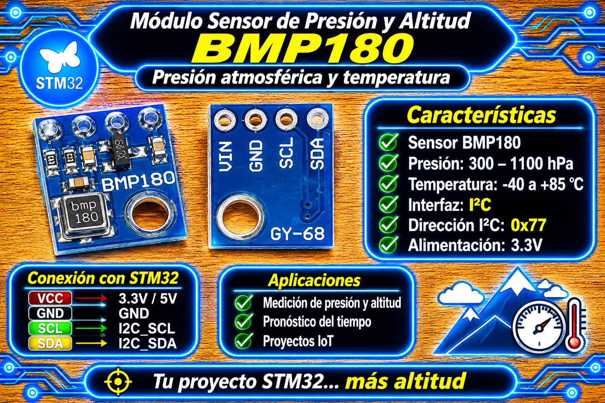
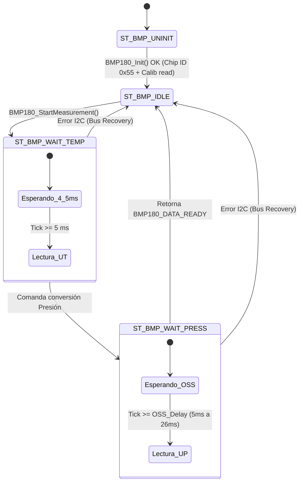

# Driver BMP180 (I2C, no bloqueante) para STM32 HAL

<p align="center">
  
</p>

Driver para leer temperatura y presión barométrica del sensor **BMP180/BMP085** por bus **I2C** en microcontroladores STM32 utilizando la capa HAL. Funciona como una máquina de estados cooperativa basada en `HAL_GetTick()`, desvinculando por completo los retardos de conversión ($T + P$) sin utilizar `HAL_Delay()`, ideal para sistemas de tiempo real y super-loops multitarea (ej. drones, estaciones meteorológicas, dataloggers).

---

## Características

- **Máquina de Estados Asíncrona Cooperativa:** Gestión no bloqueante de los tiempos de conversión de temperatura (~4.5 ms) y presión (4.5 ms a 25.5 ms según el modo OSS) mediante `HAL_GetTick()`.
- **Compensación Polinómica de Fábrica:** Lectura automática de los 11 coeficientes de calibración grabados en la EEPROM interna del sensor y aplicación de las fórmulas oficiales de Bosch.
- **Soporte de Sobremuestreo (OSS):** 4 modos de medición seleccionables (`Ultra Low Power`, `Standard`, `High Resolution`, `Ultra High Resolution`).
- **Cálculo de Altitud:** Incluye la función `BMP180_PressureToAltitude()` basada en la ecuación barométrica internacional.
- **Tolerancia a Fallos e Inmunidad I2C:** Mecanismo `recover_bus()` para liberar el bus I2C ante bloqueos o estados de desincronización por NACK.
- **Validación de Hardware:** Verificación del Chip ID fijo (`0x55`) en el registro `0xD0` antes de proceder a la operación.

---

## Requisitos

| Requisito | Detalle |
| :--- | :--- |
| **Microcontrolador** | Cualquier STM32 con HAL (probado en STM32F4 series / Nucleo-F439ZI, BluePill, BlackPill). |
| **Periférico** | Un bus I2C en modo Master (100 kHz Standard Mode o 400 kHz Fast Mode) inicializado (`MX_I2C1_Init()`). |
| **Header Principal** | `main.h` (autogenerado por CubeMX). |
| **Sensor** | Módulo BMP180 / BMP085 (Dirección I2C de 7 bits: `0x77`, enviada como `0xEE` para la HAL de ST). |
| **Velocidad del bus** | 100 kHz a 400 kHz. |
| **Dependencias extra** | Ninguna (`math.h` estándar para operaciones de flotante y potencia). |

> **Nota de temporización:** No utiliza interrupciones de I2C ni DMA. La temporización es por polling no bloqueante invocando `BMP180_Process()` periódicamente en el super-loop.

---

## Archivos

| Archivo | Descripción |
| :--- | :--- |
| `bmp180_STM32.h` | Interfaz pública del driver: tipos de datos (`BMP180_Handle_t`, `BMP180_Status_t`), modos OSS y prototipos. |
| `bmp180_STM32.c` | Implementación privada: máquina de estados, lectura I2C, compensación matemática y bus recovery. |

---

## Conexión del sensor

| Módulo BMP180 (GY-68) | Microcontrolador STM32 | Función / Descripción |
| :---: | :---: | :--- |
| **VCC / VIN** | **3.3 V o 5 V** | Alimentación principal (el módulo comercial GY-68 incluye regulador LDO interno a 3.3V). |
| **GND** | **GND** | Tierra común del sistema. |
| **SCL** | **I2C1_SCL** | Reloj del bus I2C (ej. PB8 / PB6 según micro). |
| **SDA** | **I2C1_SDA** | Datos del bus I2C (ej. PB9 / PB7 según micro). |

- **Alimentación:** Si se utiliza el chip desnudo BMP180, la tensión debe ser estrictamente de **1.8 V a 3.6 V**. En módulos comerciales tipo GY-68 (los típicos para Arduino), la presencia del regulador `662K` permite alimentar a **5 V** o **3.3 V**.
- **Resistencias de Pull-Up:** Los módulos comerciales GY-68 **ya incorporan las resistencias de pull-up SMD de 4.7 kΩ** montadas en la placa, por lo que se conectan directamente a los GPIOs del STM32 sin componentes pasivos adicionales.

---

## Instalación

1. Copia `bmp180_STM32.c` a la carpeta `Core/Src/` de tu proyecto STM32CubeIDE.
2. Copia `bmp180_STM32.h` a la carpeta `Core/Inc/`.
3. En STM32CubeMX, configura el periférico **I2C1** (o el asignado) con estos parámetros:
   - **I2C Speed Mode:** Standard Mode (100 kHz) o Fast Mode (400 kHz).
   - **Clock Speed:** 100000 Hz.
   - **Addressing Mode:** 7-bit.
4. Genera el código e incluye la cabecera en tu archivo `main.c`:
   ```c
   #include "bmp180_STM32.h"
   ```

---

## Uso básico

El uso se resume en 3 pasos: **Inicializar**, **Avanzar la máquina de estados en el loop** y **Obtener los datos cuando estén listos**.

```c
#include "main.h"
#include "bmp180_STM32.h"

/* Manejador de I2C y estructura del driver */
extern I2C_HandleTypeDef hi2c1;
BMP180_Handle_t bmp180_dev;

int main(void)
{
    HAL_Init();
    SystemClock_Config();
    MX_GPIO_Init();
    MX_I2C1_Init();

    /* 1. Inicialización (verifica Chip ID 0x55 y lee 11 coeficientes de calibración) */
    if (BMP180_Init(&bmp180_dev, &hi2c1, BMP180_MODE_STANDARD) == BMP180_OK) {
        /* Disparo inicial para arrancar la secuencia */
        BMP180_StartMeasurement(&bmp180_dev);
    }

    uint32_t last_request_tick = 0;

    while (1)
    {
        /* 2. Avanzar la máquina de estados cooperativa en cada vuelta del loop */
        if (BMP180_Process(&bmp180_dev) == BMP180_DATA_READY) {
            float temperatura_c = 0.0f;
            float presion_pa    = 0.0f;

            /* 3. Obtener los datos compensados de la última conversión */
            if (BMP180_GetData(&bmp180_dev, &temperatura_c, &presion_pa)) {
                float presion_hpa = presion_pa / 100.0f;
                float altitud_m   = BMP180_PressureToAltitude(1013.25f, presion_hpa);
                
                (void)temperatura_c;
                (void)presion_hpa;
                (void)altitud_m;
            }
        }

        /* Disparo periódico de medición cada 200 ms */
        if ((HAL_GetTick() - last_request_tick) >= 200U) {
            last_request_tick = HAL_GetTick();
            BMP180_StartMeasurement(&bmp180_dev);
        }

        /* ... otras tareas no bloqueantes ... */
    }
}
```

---

## API

| Función | Descripción |
| :--- | :--- |
| `BMP180_Init(dev, hi2c, mode)` | Valida el Chip ID (`0x55`), carga los coeficientes de la EEPROM e inicializa el manejador. |
| `BMP180_StartMeasurement(dev)` | Inicia una nueva conversión no bloqueante ($T + P$). Retorna `BMP180_BUSY` si ya hay una en curso. |
| `BMP180_Process(dev)` | Avanza la máquina de estados basada en `HAL_GetTick()`. Retorna `BMP180_DATA_READY` al finalizar. |
| `BMP180_IsIdle(dev)` | Consulta si el driver se encuentra libre para aceptar un nuevo disparo. |
| `BMP180_GetData(dev, &temp, &press)` | Obtiene la última lectura válida almacenada en el driver. |
| `BMP180_PressureToAltitude(seaLevel, atmospheric)` | Calcula la altitud estimada en metros basada en la fórmula barométrica. |

### Códigos de estado (`BMP180_Status_t`)

| Código | Significado |
| :--- | :--- |
| `BMP180_OK` | Operación exitosa o driver inactivo a la espera de comandos. |
| `BMP180_ERROR_I2C` | Error de comunicación física o fallo en la transacción del bus I2C. |
| `BMP180_ERROR_CHIPID` | El ID leído del registro `0xD0` no coincide con el valor esperado (`0x55`). |
| `BMP180_ERROR_TIMEOUT` | NACK o tiempo de espera agotado durante la comunicación I2C. |
| `BMP180_BUSY` | La máquina de estados está ejecutando una conversión en segundo plano. |
| `BMP180_DATA_READY` | Un ciclo completo de conversión finalizó y hay nuevos datos válidos listos. |

---

## Máquina de estados



---

## Conversiones y Fórmulas

1. **Temperatura compensada:**  
   $$T = \frac{B_5 + 8}{16} \cdot 0.1 \quad [^\circ\text{C}]$$
2. **Presión compensada:**  
   Calculada mediante el algoritmo de 11 coeficientes de Bosch ($AC_1 \dots AC_6, B_1, B_2, MB, MC, MD$). Retorna en **Pascales (Pa)** ($1\text{ hPa} = 100\text{ Pa}$).
3. **Altitud barométrica (Metros):**  
   $$\text{Altitud} = 44330 \cdot \left(1 - \left(\frac{P_{\text{medida}}}{P_{\text{nivel\_mar}}}\right)^{0.1903}\right) \quad [\text{m}]$$

---

## Parámetros configurables

Definidos al comienzo de `bmp180_STM32.c` y `bmp180_STM32.h`:

| Macro | Valor por defecto | Efecto |
| :--- | :---: | :--- |
| `BMP180_I2C_ADDRESS` | `(0x77 << 1)` | Dirección I2C del sensor adaptada a la HAL de ST (`0xEE`). |
| `BMP180_I2C_TIMEOUT_MS` | `10U` | Timeout de seguridad para transacciones de registro individuales. |
| `bmp180_mode_t` | `BMP180_MODE_STANDARD` | Modo de sobremuestreo OSS (ULTRALOWPOWER, STANDARD, HIGHRES, ULTRAHIGHRES). |

---

## Limitaciones y advertencias

- **Instancia Única:** El estado privado de la máquina de estados (`BMP180_Internal_t priv`) es estático. Maneja **un único sensor BMP180**.
- **No reentrante:** Todas las llamadas a la API deben realizarse desde el mismo hilo/contexto (bucle principal). **No invocar desde rutinas de interrupción (ISR)**.
- **Tiempos de espera no bloqueantes:** La función `BMP180_Process()` debe invocarse de forma continua en el bucle `while(1)`. Si el bucle principal se bloquea con funciones como `HAL_Delay()`, la máquina de estados sufrirá retrasos en la lectura.

---

## Solución de problemas

| Síntoma | Causa probable | Solución |
| :--- | :--- | :--- |
| `BMP180_Init()` retorna `BMP180_ERROR_I2C` | Sensor no alimentado o líneas SCL/SDA desconectadas. | Verificar continuidad del bus I2C y tensiones de alimentación. |
| `BMP180_Init()` retorna `BMP180_ERROR_CHIPID` | El dispositivo I2C no es un BMP180 / BMP085. | Comprobar con un I2C Scanner que la dirección responda en `0x77`. |
| La altitud leída varía drásticamente | Presión a nivel del mar fija incorrecta. | Ajustar el parámetro `seaLevel` de `BMP180_PressureToAltitude()` según la presión de la estación meteorológica local. |

### Código de diagnóstico rápido (verificación I2C sin driver)

```c
if (HAL_I2C_IsDeviceReady(&hi2c1, (0x77 << 1), 3, 100) == HAL_OK) {
    /* El BMP180 responde en la dirección 0x77 */
}
```

---

## Licencia

- **MIT**. Desarrollado por **Mamani Flores Carlos (UTN FRT)** 2026.