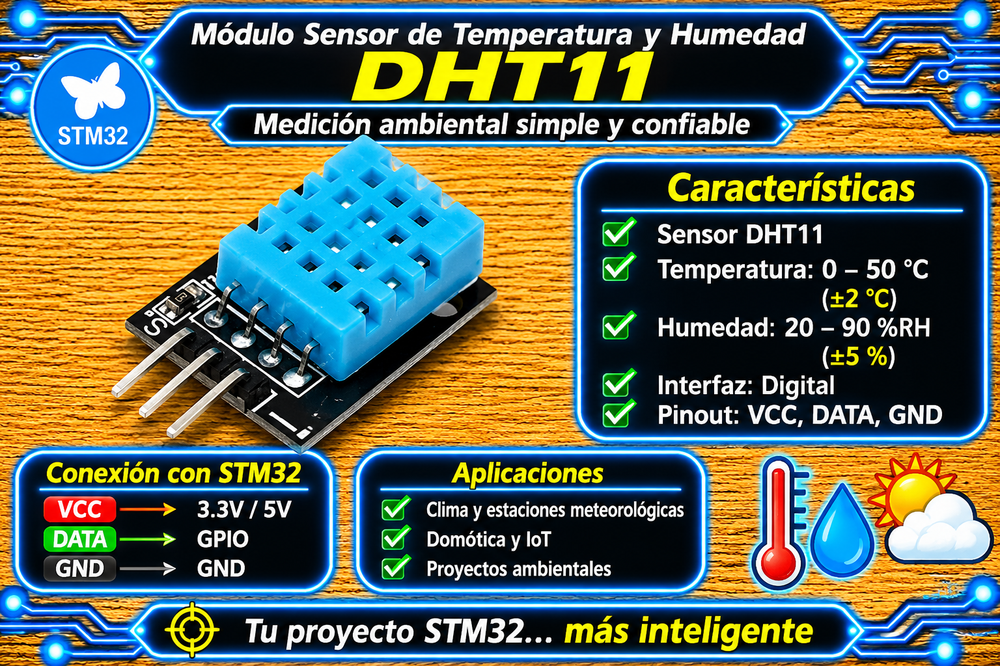

# Driver DHT11 (1-Wire, Single-Wire) para STM32 HAL

<p align="center">
  
</p>

Driver para leer temperatura y humedad relativa del sensor **DHT11** mediante el protocolo propietario de **un solo hilo (Single-Wire / 1-Wire)** en microcontroladores STM32 utilizando la capa HAL. Implementa una arquitectura basada en manejadores (`DHT11_Handle_t`), temporización por ciclo del SysTick para microsegundos de alta precisión, y protección estricta contra cuelgues mediante timeouts en cada transición del bus.

---

## Características

- **Arquitectura Basada en Manejadores (Handles):** Soporte modular e independiente para instanciar cualquier puerto y pin GPIO usando etiquetas de CubeMX (`DHT_PIN_GPIO_Port`, `DHT_PIN_Pin`).
- **Temporización de Precisión por SysTick:** Retardos en microsegundos (`DHT11_Delay_us`) calculados a partir de `SystemCoreClock` sin depender de timers HW dedicados (TIM).
- **Protección Antibloqueo por Timeouts:** Monitoreo activo en los bucles de espera de flanco para evitar que el microcontrolador quede colgado ante desconexiones o fallos en el bus.
- **Validación por Checksum:** Verificación de integridad de 8 bits al recibir la ráfaga de 40 bits (5 bytes).
- **Conmutación Dinámica de GPIO:** Alternancia automática del pin entre salida (Push-Pull) y entrada flotante durante la secuencia de handshake.

---

## Requisitos

| Requisito | Detalle |
| :--- | :--- |
| **Microcontrolador** | Cualquier STM32 con HAL (probado en STM32F4 series / Nucleo-F439ZI, BluePill, BlackPill). |
| **Periférico** | Un pin GPIO de propósito general configurado desde CubeMX con User Label (ej: `DHT_PIN`). |
| **Header Principal** | `main.h` (autogenerado por CubeMX, provee las etiquetas `DHT_PIN_GPIO_Port` y `DHT_PIN_Pin`). |
| **Sensor** | DHT11 / Módulo DHT11 de 3 o 4 pines. |
| **Velocidad de Reloj** | Requiere `SystemCoreClock` inicializado correctamente tras `SystemClock_Config()`. |
| **Dependencias extra** | Ninguna (`stdbool.h` y `stdint.h` estándar). |

> **Nota de protocolo:** El protocolo del DHT11 requiere un retardo de arranque inicial forzado a nivel bajo de $18\text{ ms}$ (`HAL_Delay(18)`) seguido de muestreos a nivel de microsegundos.

---

## Archivos

| Archivo | Descripción |
| :--- | :--- |
| `dht11_STM32.h` | Interfaz pública: definición de tipos (`DHT11_Handle_t`, `DHT11_Data_t`, `DHT11_Status_t`) y prototipos. |
| `dht11_STM32.c` | Implementación privada: gestión del protocolo 1-wire, temporización por SysTick, lectura bit a bit y checksum. |

---

## Conexión del sensor

| Pin DHT11 | Microcontrolador STM32 | Función / Descripción |
| :---: | :---: | :--- |
| **VCC** | **3.3 V o 5 V** | Alimentación principal (3.3V o 5V según la variante de la placa). |
| **DATA / OUT** | **DHT_PIN (`DHT_PIN_Pin`)** | Línea bidireccional de datos de 1 hilo (ej. PG2 / PA4). |
| **NC** | **No Conectado** | Pin no utilizado (en modelos de 4 pines). |
| **GND** | **GND** | Tierra común del sistema. |

- **Resistencia de Pull-Up:** El bus de datos del DHT11 requiere una resistencia de *pull-up* externa de $4.7\text{ k}\Omega$ a $10\text{ k}\Omega$ conectada entre el pin de DATA y $V_{CC}$. Si se utiliza un módulo comercial (de 3 pines en PCB), esta resistencia ya viene soldada en la plaqueta.

---

## Instalación

1. Copia `dht11_STM32.c` a la carpeta `Core/Src/` de tu proyecto STM32CubeIDE.
2. Copia `dht11_STM32.h` a la carpeta `Core/Inc/`.
3. En STM32CubeMX, selecciona el pin GPIO elegido (ej. `PG2`), ve a la pestaña de propiedades y asígnale el **User Label**: `DHT_PIN`.
4. Configura el pin con estos parámetros:
   - **GPIO Mode:** Output Push-Pull.
   - **GPIO Pull-up/Pull-down:** No Pull-up and no Pull-down.
   - **Maximum output speed:** Low.
5. Genera el código e incluye la cabecera en tu `main.c`:
   ```c
   #include "dht11_STM32.h"
   ```

---

## Uso básico

El uso se resume en 3 pasos: **Inicializar con la etiqueta del pin**, **Respetar el intervalo periódico de lectura ($\ge 2\text{ s}$)** y **Obtener los datos**.

```c
#include "main.h"
#include "dht11_STM32.h"

DHT11_Handle_t dht_sensor;

int main(void)
{
    HAL_Init();
    SystemClock_Config();
    MX_GPIO_Init();

    /* 1. Inicialización usando las etiquetas de CubeMX (DHT_PIN_GPIO_Port y DHT_PIN_Pin) */
    if (DHT11_Init(&dht_sensor, DHT_PIN_GPIO_Port, DHT_PIN_Pin) == DHT11_OK) {
        /* Driver inicializado correctamente */
    }

    uint32_t last_read_tick = 0;

    while (1)
    {
        /* 2. El DHT11 requiere al menos 2 segundos entre lecturas consecutivas */
        if ((HAL_GetTick() - last_read_tick) >= 2000U) {
            last_read_tick = HAL_GetTick();

            /* 3. Lectura del sensor y copia de datos */
            if (DHT11_ReadData(&dht_sensor) == DHT11_OK) {
                DHT11_Data_t lectura;
                DHT11_GetLastData(&dht_sensor, &lectura);

                /* ================================================================= */
                /*  AQUÍ PUEDES TRABAJAR LIBREMENTE CON LOS DATOS DEL SENSOR         */
                /*  Variables disponibles: lectura.temperature (°C) y lectura.humidity (%) */
                /* ================================================================= */
            }
        }

        /* ... otras tareas no bloqueantes del super-loop ... */
    }
}
```

---

## API

| Función | Descripción |
| :--- | :--- |
| `DHT11_Init(dev, gpio_port, gpio_pin)` | Configura la estructura `DHT11_Handle_t` con el puerto/pin y establece el nivel alto inactivo. |
| `DHT11_ReadData(dev)` | Ejecuta la secuencia completa de handshake, lectura de 40 bits y validación del checksum. |
| `DHT11_GetLastData(dev, &data)` | Copia de manera segura la última lectura almacenada hacia una estructura `DHT11_Data_t`. |

### Códigos de estado (`DHT11_Status_t`)

| Código | Significado |
| :--- | :--- |
| `DHT11_OK` | Lectura finalizada con éxito y checksum verificado. |
| `DHT11_ERR_INVALID_PARAM` | Puntero a estructura o puerto GPIO `NULL`. |
| `DHT11_ERR_TIMEOUT` | Tiempo de espera agotado durante la respuesta ACK o la transmisión de bits del sensor. |
| `DHT11_ERR_CHECKSUM` | La suma de los primeros 4 bytes no coincide con el quinto byte recibido. |

---

## Conversiones y Fórmulas

1. **Estructura de la ráfaga de 5 Bytes:**
   - Byte 0: Parte entera de la Humedad Relativa.
   - Byte 1: Parte decimal de la Humedad Relativa.
   - Byte 2: Parte entera de la Temperatura.
   - Byte 3: Parte decimal de la Temperatura.
   - Byte 4: Byte de Checksum.

2. **Validación del Checksum:**  
   $$\text{Checksum} = (\text{Byte}_0 + \text{Byte}_1 + \text{Byte}_2 + \text{Byte}_3) \pmod{256}$$

3. **Reconstrucción de Humedad Relativa y Temperatura:**  
$$\text{Humedad (\%)} = \text{Byte}_0 + \frac{\text{Byte}_1}{10.0}$$

$$\text{Temperatura (°C)} = \text{Byte}_2 + \frac{\text{Byte}_3}{10.0}$$

---

## Parámetros configurables

Definidos al comienzo de `dht11_STM32.c`:

| Parámetro | Valor por defecto | Efecto |
| :--- | :---: | :--- |
| `Pulso de Inicio (Reset)` | `18 ms` | Tiempo en nivel bajo para despertar al sensor. |
| `Umbral de bit '0' / '1'` | `40 us` | Ventana de muestreo tras el flanco de subida para discriminar bit 0 (~28 µs) o bit 1 (~70 µs). |
| `Timeout por ciclo` | `100 us` | Límite máximo de espera por iteración de flanco para evitar interbloqueos. |

---

## Limitaciones y advertencias

- **Tasa de refresco del sensor:** El DHT11 posee una respuesta lenta. **No debe leerse a intervalos menores a 2 segundos**, de lo contrario devolverá lecturas obsoletas o fallos de timeout.
- **Bloqueo durante la lectura:** Durante los ~4 ms que dura la secuencia de transferencia de los 40 bits, el código permanece en pequeños bucles `while` de microsegundos.
- **Sensibilidad a Interrupciones:** Si el sistema tiene rutinas de interrupción (ISR) muy largas o frecuentes durante el muestreo, el tiempo medido por `DHT11_Delay_us()` puede desfasarse y generar `DHT11_ERR_CHECKSUM`.

---

## Solución de problemas

| Síntoma | Causa probable | Solución |
| :--- | :--- | :--- |
| `DHT11_ERR_TIMEOUT` constante | Sensor desconectado, falta de resistencia pull-up o etiquetas de pin mal asignadas. | Comprobar las conexiones, asegurar la resistencia de $4.7\text{ k}\Omega$ en DATA y verificar los parámetros pasados en `DHT11_Init()`. |
| `DHT11_ERR_CHECKSUM` frecuente | Ruido eléctrico en la línea, cable largo sin apantallar o desfasaje de tiempos por ISR. | Reducir la longitud del cable, colocar un condensador de $100\text{ nF}$ cerca del $V_{CC}$ del sensor y revisar la prioridad de las interrupciones. |
| Humedad / Temperatura fijas en 0 | Intento de lectura inmediata tras el encendido. | Añadir un retardo inicial en el `main()` antes de la primera llamada a `DHT11_ReadData()`. |

### Código de diagnóstico rápido (comprobación del pin GPIO)

```c
/* Diagnóstico simple de presencia: verificar que la línea se mantenga en HIGH en reposo */
if (HAL_GPIO_ReadPin(DHT_PIN_GPIO_Port, DHT_PIN_Pin) == GPIO_PIN_SET) {
    /* La línea de datos tiene pull-up y está en reposo alto correcto */
}
```

---

## Licencia

- **MIT**. Desarrollado por **Mamani Flores Carlos (UTN FRT)** 2026.