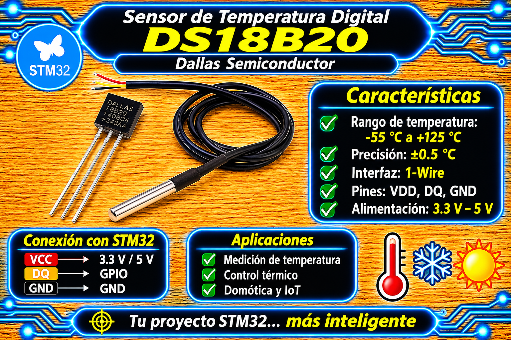

# Driver DS18B20 (1-Wire con Temporización por Hardware) para STM32 HAL

<p align="center">
  
</p>

Driver modular, seguro y de alto rendimiento para sensores de temperatura digitales **DS18B20** (protocolo **1-Wire**) en microcontroladores STM32 mediante la capa **HAL**.

Permite gestionar desde un sensor único (*monopunto*) hasta múltiples sensores sobre el mismo bus de datos (*multipunto*) mediante el algoritmo binario **Search ROM** de Dallas/Maxim. Utiliza un **Timer por hardware** exclusivo de 16 o 32 bits configurado con una base de tiempo exacta de $1\ \mu\text{s}$ y control GPIO en modo **Open-Drain**, garantizando el cumplimiento de la ventana de muestreo (*time slots*) sin reconfigurar registros GPIO en caliente y protegiendo las secciones críticas de temporización.

---

## Características

- **Temporización por Hardware ($1\ \mu\text{s}$/tick):** Retardos precisos basados en el contador de un Timer dedicado (`TIMx`), eliminando la sobrecarga y variabilidad de bucles de software (`nop`).
- **Verificación Automática de la Base de Tiempo (`DS18B20_CheckTimerBase`):** Valida en tiempo de ejecución (`DS18B20_Init`) que el Timer avance a $1\text{ MHz} \pm 5\%$ mediante sincronización con el reloj del sistema (`SysTick`).
- **Acceso Directo y Atómico a GPIO:** Manipulación instantánea de la línea de datos mediante los registros `BSRR` y `IDR` en modo **Open-Drain** (`GPIO_MODE_OUTPUT_OD`), evitando retardos que rompen las ventanas de lectura y escritura 1-Wire.
- **Protección de Secciones Críticas:** Deshabilitación temporal de interrupciones globales (`__disable_irq()`) mediante la preservación del registro `PRIMASK` únicamente durante la transmisión de los *bits y presence pulses* críticos.
- **Soporte Bus Monopunto y Multipunto:**
  - **FSM No Bloqueante con `SKIP ROM` (Monopunto):** Dispara la conversión y lee el sensor sin bloquear la CPU ni colgar la ejecución si hay fallas en la línea.
  - **FSM No Bloqueante con `MATCH ROM` (Multipunto):** Permite medir múltiples sensores en paralelo en la misma línea de datos. Dispara una conversión global colectiva y lee individualmente a cada esclavo por su código de 64 bits.
  - `DS18B20_ScanBus()`: Algoritmo de exploración binaria **Search ROM** (0xF0) para descubrir las direcciones únicas de 64 bits de todos los sensores conectados al bus.
- **Integridad de Datos:** Validación mediante **CRC8 de Dallas/Maxim** ($x^8 + x^5 + x^4 + 1$) en cada lectura del Scratchpad (9 bytes) y en el código ROM (8 bytes). Mascaramiento dinámico de bits inválidos según la resolución configurada ($9 \dots 12$ bits).

---

## Requisitos

| Requisito | Detalle |
| :--- | :--- |
| **Microcontrolador** | Cualquier STM32 (probado en NUCLEO-F439ZI, Blue Pill STM32F103C8T6, Black Pill STM32F411CEU6). |
| **Timer Dedicado** | 1 Timer de propósito general (16 o 32 bits, ej. `TIM2`, `TIM6`) en modo **Internal Clock**, sin interrupciones. |
| **Base de Tiempo de Timer** | Prescaler configurado para $1\text{ MHz}$ ($1\ \mu\text{s}$ por tick) y **ARR $\ge 65535$** (`0xFFFF` o `0xFFFFFFFF`). |
| **Pin de Datos (DQ)** | Pin etiquetado como `DALLAS_PIN` (`DALLAS_PIN_Pin` / `DALLAS_PIN_GPIO_Port`) con resistencia de **Pull-Up externa de $4.7\text{ k}\Omega$** a $VDD$ ($3.3\text{ V} / 5\text{ V}$). |
| **Alimentación** | Alimentación externa fija en $VDD$ ($3.0\text{ V} \dots 5.5\text{ V}$). **No soporta modo de potencia parásita.** |
| **Header Principal** | `main.h` (autogenerado por CubeMX). |

---

## Archivos del Driver

| Archivo | Descripción |
| :--- | :--- |
| `ds18b20_STM32.h` | Cabecera principal: enums de comandos 1-Wire, estructura de control `DS18B20_NameTypedef`, códigos de error `DS18B20_Status_t` y prototipos de la API. |
| `ds18b20_STM32.c` | Implementación de bajo nivel: primitivas 1-Wire (Reset, ReadBit, WriteBit, CRC8), verificación del Timer y algoritmo Search ROM. |

---

## Conexión de Hardware

| Pin del Sensor DS18B20 | Conexión en STM32 / Hardware | Notas de Integración |
| :---: | :---: | :--- |
| **VDD (Rojo)** | **3.3 V o 5.0 V** | Alimentación externa de potencia. |
| **GND (Negro)** | **GND** | Tierra común de la placa. |
| **DQ / Data (Amarillo)** | **DALLAS_PIN** (`DALLAS_PIN_Pin`) | Debe conectarse a un **Pull-Up externo de $4.7\text{ k}\Omega$** hacia la línea de $VDD$. |

```
        +3.3V / +5V
           |
           +---+
               |
              [R] 4.7 kΩ (Pull-Up Externa)
               |
 STM32 (DALLAS_PIN) -> DS18B20 Pin Data (DQ)
```

---

## Configuración del Timer y Prescaler ($PSC$)

El driver requiere que el contador del Timer avance exactamente a **$1\ \text{MHz}$** (1 tick por microsegundo) y que el registro de auto-recarga (**ARR**) sea mayor o igual a **65535** (`0xFFFF`).

### Fórmula del Prescaler ($PSC$):

$$PSC = \frac{f_{\text{TIM}}}{10^6} - 1$$

> **¡Atención con la frecuencia del Timer ($f_{\text{TIM}}$)!**  
> Si el divisor de bus APB correspondiente es diferente de /1, la frecuencia enviada al Timer es el **doble de la frecuencia del reloj APB** ($2 \times f_{\text{APB}}$).

### Ejemplos Prácticos de Configuración:

1. **NUCLEO-F439ZI (TIM2 en Bus APB1, SYSCLK = 180 MHz):**
   - $PCLK1 = 45\ \text{MHz}$ (Divisor APB1 = /4) $\rightarrow f_{\text{TIM}} = 2 \times 45\ \text{MHz} = 90\ \text{MHz}$.
   - $$PSC = \frac{90 \times 10^6}{10^6} - 1 = 90 - 1 = 89$$
   - **En CubeMX:** `Prescaler = 89`, `Counter Period (ARR) = 4294967295` (32 bits).

2. **STM32F103 Blue Pill (TIM2 en Bus APB1, SYSCLK = 72 MHz):**
   - $PCLK1 = 36\ \text{MHz}$ (Divisor APB1 = /2) $\rightarrow f_{\text{TIM}} = 2 \times 36\ \text{MHz} = 72\ \text{MHz}$.
   - $$PSC = \frac{72 \times 10^6}{10^6} - 1 = 72 - 1 = 71$$
   - **En CubeMX:** `Prescaler = 71`, `Counter Period (ARR) = 65535`.

---

## Uso básico

### Ejemplo 1: FSM No Bloqueante para Un Solo Sensor (Bus Monopunto)

Implementación con máquina de estados finita (FSM) basada en temporizaciones `HAL_GetTick()`. Evita bloqueos en el hilo principal y reintenta automáticamente ante desconexiones.

```c
#include "main.h"
#include "ds18b20_STM32.h"

extern TIM_HandleTypeDef htim2;

typedef enum {
    STATE_DS18B20_START_CONV = 0,
    STATE_DS18B20_MIN_WAIT,
    STATE_DS18B20_POLL_DONE,
    STATE_DS18B20_READ_TEMP,
    STATE_DS18B20_PAUSE
} DS18B20_FSM_State_t;

#define DS18B20_MIN_WAIT_MS      600U
#define DS18B20_POLL_PERIOD_MS   10U
#define DS18B20_CONV_TIMEOUT_MS  1000U
#define DS18B20_CYCLE_MS         1000U
#define DS18B20_RETRY_MS         1000U

DS18B20_NameTypedef sensor_temp;
float temperatura = 0.0f;

static void Process_Temperature_FSM(void)
{
    static DS18B20_FSM_State_t state = STATE_DS18B20_START_CONV;
    static uint32_t t_start = 0;
    static uint32_t t_poll = 0;
    static uint32_t period_ms = 0;

    DS18B20_Status_t status;
    uint8_t done = 0;
    uint32_t now = HAL_GetTick();

    switch (state)
    {
        case STATE_DS18B20_START_CONV:
            t_start = now;
            status = DS18B20_StartAllConversion(&sensor_temp);
            if (status == DS18B20_OK) {
                state = STATE_DS18B20_MIN_WAIT;
            } else {
                period_ms = DS18B20_RETRY_MS;
                state = STATE_DS18B20_PAUSE;
            }
            break;

        case STATE_DS18B20_MIN_WAIT:
            if ((now - t_start) >= DS18B20_MIN_WAIT_MS) {
                t_poll = now - DS18B20_POLL_PERIOD_MS;
                state = STATE_DS18B20_POLL_DONE;
            }
            break;

        case STATE_DS18B20_POLL_DONE:
            if ((now - t_start) > DS18B20_CONV_TIMEOUT_MS) {
                period_ms = DS18B20_RETRY_MS;
                state = STATE_DS18B20_PAUSE;
            } else if ((now - t_poll) >= DS18B20_POLL_PERIOD_MS) {
                t_poll = now;
                if ((DS18B20_IsConversionDone(&sensor_temp, &done) == DS18B20_OK) && done) {
                    state = STATE_DS18B20_READ_TEMP;
                }
            }
            break;

        case STATE_DS18B20_READ_TEMP:
            /* SKIP ROM (NULL) es válido únicamente con 1 solo sensor en el bus */
            status = DS18B20_ReadTempByROM(&sensor_temp, NULL, &temperatura);
            period_ms = (status == DS18B20_OK) ? DS18B20_CYCLE_MS : DS18B20_RETRY_MS;
            state = STATE_DS18B20_PAUSE;
            break;

        case STATE_DS18B20_PAUSE:
            if ((now - t_start) >= period_ms) {
                state = STATE_DS18B20_START_CONV;
            }
            break;

        default:
            state = STATE_DS18B20_START_CONV;
            break;
    }
}

int main(void)
{
    HAL_Init();
    SystemClock_Config();
    MX_GPIO_Init();
    MX_TIM2_Init();

    /* Inicialización del sensor usando las etiquetas autogeneradas por CubeMX */
    DS18B20_Init(&sensor_temp, DALLAS_PIN_GPIO_Port, DALLAS_PIN_Pin, &htim2);

    while (1)
    {
        /* Ejecución de la máquina de estados en segundo plano */
        Process_Temperature_FSM();

        /* Tareas adicionales no bloqueantes... */
    }
}
```

---

### Ejemplo 2: FSM No Bloqueante para Múltiples Sensores (Bus Multipunto con Escaneo ROM)

Este patrón combina **`DS18B20_ScanBus`** durante el arranque para almacenar las direcciones ROM únicas de 64 bits de cada dispositivo. En el bucle principal, dispara la conversión simultánea a todos los sensores (`SKIP ROM`) y luego lee uno a uno especificando su dirección (`MATCH ROM`).

```c
#include "main.h"
#include "ds18b20_STM32.h"

#define MAX_SENSORES 5

extern TIM_HandleTypeDef htim2;

DS18B20_NameTypedef bus_temp;
uint8_t rom_table[MAX_SENSORES][DS18B20_ROM_CODE_SIZE];
uint8_t sensores_hallados = 0;
float temperaturas[MAX_SENSORES];

typedef enum {
    STATE_MULTI_START_CONV = 0,
    STATE_MULTI_MIN_WAIT,
    STATE_MULTI_POLL_DONE,
    STATE_MULTI_READ_TEMPS,
    STATE_MULTI_PAUSE
} Multi_FSM_State_t;

static void Process_MultiSensor_FSM(void)
{
    static Multi_FSM_State_t state = STATE_MULTI_START_CONV;
    static uint32_t t_start = 0;
    static uint32_t t_poll = 0;
    static uint32_t period_ms = 0;

    DS18B20_Status_t status;
    uint8_t done = 0;
    uint32_t now = HAL_GetTick();

    switch (state)
    {
        case STATE_MULTI_START_CONV:
            t_start = now;
            /* Inicia la conversión simultánea de TODOS los sensores en paralelo */
            status = DS18B20_StartAllConversion(&bus_temp);
            if (status == DS18B20_OK) {
                state = STATE_MULTI_MIN_WAIT;
            } else {
                period_ms = 1000;
                state = STATE_MULTI_PAUSE;
            }
            break;

        case STATE_MULTI_MIN_WAIT:
            if ((now - t_start) >= 600) {
                t_poll = now - 10;
                state = STATE_MULTI_POLL_DONE;
            }
            break;

        case STATE_MULTI_POLL_DONE:
            if ((now - t_start) > 1000) {
                period_ms = 1000;
                state = STATE_MULTI_PAUSE;
            } else if ((now - t_poll) >= 10) {
                t_poll = now;
                if ((DS18B20_IsConversionDone(&bus_temp, &done) == DS18B20_OK) && done) {
                    state = STATE_MULTI_READ_TEMPS;
                }
            }
            break;

        case STATE_MULTI_READ_TEMPS:
            /* Lee secuencialmente a cada esclavo por su dirección ROM única (MATCH ROM) */
            for (uint8_t i = 0; i < sensores_hallados; i++) {
                (void)DS18B20_ReadTempByROM(&bus_temp, rom_table[i], &temperaturas[i]);
            }
            period_ms = 1000;
            state = STATE_MULTI_PAUSE;
            break;

        case STATE_MULTI_PAUSE:
            if ((now - t_start) >= period_ms) {
                state = STATE_MULTI_START_CONV;
            }
            break;

        default:
            state = STATE_MULTI_START_CONV;
            break;
    }
}

int main(void)
{
    HAL_Init();
    SystemClock_Config();
    MX_GPIO_Init();
    MX_TIM2_Init();

    /* 1. Inicialización de la interfaz */
    if (DS18B20_Init(&bus_temp, DALLAS_PIN_GPIO_Port, DALLAS_PIN_Pin, &htim2) == DS18B20_OK) {
        /* 2. Escaneo del bus 1-Wire para registrar la tabla de ROMs de 64 bits */
        DS18B20_ScanBus(&bus_temp, rom_table, MAX_SENSORES, &sensores_hallados);
    }

    while (1)
    {
        /* 3. Ejecución continua del muestreo síncrono no bloqueante */
        if (sensores_hallados > 0) {
            Process_MultiSensor_FSM();
        }

        /* Otras tareas no bloqueantes de la aplicación... */
    }
}
```

---

## API del Driver

| Función | Descripción |
| :--- | :--- |
| `DS18B20_Init(dev, GPIOx, GPIO_Pin, htim)` | Configura el pin GPIO en modo Open-Drain, inicia el Timer, valida que avance a $1\text{ MHz} \pm 5\%$ y emite un Reset 1-Wire. |
| `DS18B20_StartAllConversion(dev)` | Transmite la orden global `SKIP ROM` (0xCC) + `CONVERT T` (0x44) a todos los esclavos del bus sin bloquear. |
| `DS18B20_IsConversionDone(dev, done)` | Consulta el estado del bus 1-Wire. Setea `*done = 1` si la conversión finalizó. |
| `DS18B20_ReadTempByROM(dev, rom_code, temp)` | Lee el Scratchpad de un sensor específico direccionado por su código ROM (`MATCH ROM`). Si `rom_code = NULL`, usa `SKIP ROM`. Valida CRC8. |
| `DS18B20_ReadSingleTemp(dev, temp)` | Función de lectura bloqueante simplificada para instalaciones con 1 solo sensor en el bus. |
| `DS18B20_ScanBus(dev, rom_table, max_sensors, found_count)` | Ejecuta el algoritmo binario **Search ROM** (0xF0) descubriendo y almacenando las ROMs de 64 bits en `rom_table`. |

---

## Principio de Operación y Formulación Matemática

### 1. Timing Crítico del Protocolo 1-Wire

El protocolo 1-Wire depende de la duración precisa de impulsos manejados en microsegundos:

$$\begin{aligned}
t_{\text{RSTL}} &= 480\ \mu\text{s} \quad (\text{Master Reset Low}) \\
t_{\text{MSP}}  &= 70\ \mu\text{s} \quad (\text{Mapeo de Muestreo del Presence Pulse}) \\
t_{\text{SLOT}} &\ge 60\ \mu\text{s} \quad (\text{Duración total de cada Time Slot de bit})
\end{aligned}$$

- **Escritura de Bit '1':** Master drena a GND durante $6\ \mu\text{s}$ y libera la línea.
- **Escritura de Bit '0':** Master drena a GND durante $60\ \mu\text{s}$ y libera la línea.
- **Lectura de Bit:** Master drena a GND durante $2\ \mu\text{s}$, libera la línea y muestrea la tensión del bus tras $8\ \mu\text{s}$ ($t_{\text{sample}} = 10\ \mu\text{s} < 15\ \mu\text{s}$).

### 2. Conversión Digital de Temperatura

El Scratchpad entrega los primeros 2 bytes con la temperatura en formato de punto fijo complemento a dos (16 bits) con el bit de menor peso ($LSB$) equivalente a $0.0625^\circ\text{C}$ ($1/16^\circ\text{C}$):

$$T_{\text{raw}} = (\text{Byte}_1 \ll 8) \mid \text{Byte}_0$$

$$T_{\text{Celsius}} = \frac{(\text{int16\_t}) \, T_{\text{raw}}}{16.0}$$

---

## Solución de Problemas

| Síntoma | Causa probable | Solución |
| :--- | :--- | :--- |
| `DS18B20_Init()` devuelve `DS18B20_ERR_TIMER` | El Prescaler ($PSC$) del Timer no otorga un tick de $1\ \mu\text{s}$ o el $ARR < 65535$. | Recalcular el $PSC$ considerando el multiplicador x2 de los Timers en buses APB y configurar $ARR \ge 65535$. |
| `DS18B20_Init()` devuelve `DS18B20_ERR_NO_DEVICE` | Falta la resistencia de Pull-Up o el pin GPIO no está alimentado. | Verificar la resistencia de $4.7\text{ k}\Omega$ entre DQ y $VDD$ y asegurar que el reloj del GPIO esté habilitado (`__HAL_RCC_GPIOx_CLK_ENABLE()`). |
| Datos corruptos en bus con múltiples sensores | Se usó `DS18B20_ReadTempByROM` pasando `NULL` como dirección ROM en lugar de usar `rom_table[i]`. | Pasar la dirección ROM de 8 bytes escaneada previamente para usar `MATCH ROM` (0x55) y evitar colisiones de bus. |
| La temperatura siempre retorna $85.0^\circ\text{C}$ | Se lee el sensor sin haber esperado la finalización de la conversión ($750\text{ ms}$). | Asegurar un tiempo de espera adecuado entre `DS18B20_StartAllConversion()` y la lectura, o verificar con `DS18B20_IsConversionDone()`. |

---

## Licencia

- **MIT**. Desarrollado por **Mamani Flores Carlos (UTN FRT)** 2026.