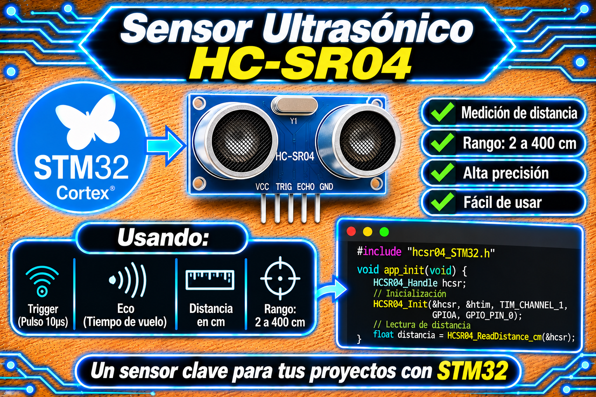

# Driver No Bloqueante para Sensor Ultrasónico HC-SR04 en STM32

<p align="center">
  
</p>

Driver genérico, portátil y de alto rendimiento en lenguaje **C (C99)** para la medición de distancia no bloqueante utilizando **uno o varios sensores ultrasónicos HC-SR04** (o compatibles como HY-SRF05) en cualquier microcontrolador **STM32** bajo la capa **ST HAL**.

Desarrollado y mantenido por **Mamani Flores Carlos (UTN FRT)** para el repositorio **`DriversST-Github`** (materia *Técnicas Digitales 2*).

## 🏛️ Arquitectura de Software y Filosofía de Operación

El driver abstrae la medición de eco eliminando completamente cualquier dependencia de retardo por software bloqueante (sin `HAL_Delay`, ni registros DWT, ni `SysTick` de núcleo):

1. **Captura por Interrupción (*Input Capture*):**

   * El pulso de eco del pin `ECHO` se mide mediante interrupciones de captura de flanco (*Rising* y *Falling*) sobre un temporizador de hardware (Timer TIMx).

   * Operación multicanal de libre carrera: Múltiples sensores pueden compartir el mismo temporizador (un canal por sensor) sin interferir ni reiniciar el contador `CNT`.

2. **Generación de Pulso TRIG Autónomo:**

   * El pulso de activación de $10\ \mu\text{s}$ en el pin `TRIG` se mide realizando una espera activa atómica basada en los *ticks* del propio temporizador asociado, garantizando compatibilidad total con núcleos **Cortex-M0 / M0+ / M3 / M4 / M7 / M33**.

3. **Filtro Estadístico de Mediana Integrado:**

   * Incluye un filtro de mediana móvil configurable de $N$ muestras (`HCSR04_FILTER_SIZE`, por defecto $N=3$) para atenuar rebotes acústicos espurios o ruidos de eco multipath en entornos cerrados.

   * Si se detectan $N$ mediciones consecutivas fuera de rango, el filtro purga automáticamente el historial para evitar lecturas congeladas (*obsoletas*).

## 🔀 Escalabilidad: Operación con Múltiples Sensores

El driver soporta nativamente múltiples instancias (`HCSR04_Handle`) trabajando en simultáneo:

* **Mismo Timer (Recomendado):** Un único temporizador (ej. `TIM3`) se configura en modo Input Capture Direct en canales distintos (`TIM_CHANNEL_1`, `TIM_CHANNEL_2`, etc.). Cada sensor posee su propio pin de `TRIG` y comparte la frecuencia de reloj.

* **Timers Distintos:** Se pueden crear handles asignados a instancias independientes de temporizadores (`TIM2`, `TIM3`, `TIM4`).

* **Secuenciamiento Recomendado:** Se recomienda disparar los sensores en secuencia en lugar de simultáneamente para evitar interferencias acústicas (ecos cruzados entre sensores).

## 📦 Especificaciones del Módulo

| Parámetro | Valor por Defecto | Descripción | 
| ----- | ----- | ----- | 
| **Rango de Medición** | $2.0\text{ cm} \dots 400.0\text{ cm}$ | Rango de validación física configurable (`HCSR04_MIN_CM`, `HCSR04_MAX_CM`). | 
| **Frecuencia de Tick** | $1\text{ MHz}$ ($1\ \mu\text{s}/\text{tick}$) | Frecuencia ideal del contador del temporizador. Configurable vía `HCSR04_SetTickFrequency()`. | 
| **Velocidad del Sonido** | $34300.0\text{ cm/s}$ ($343\text{ m/s}$) | Velocidad a $20\ ^\circ\text{C}$. Ajustable según temperatura ambiental (`HCSR04_SOUND_SPEED_CM_S`). | 
| **Tiempo de Timeout** | $60\text{ ms}$ | Tiempo límite para declarar fuera de rango o sensor desconectado (`HCSR04_TIMEOUT_MS`). | 
| **Tamaño del Filtro** | $3$ muestras | Historial de filtro de mediana ($1 \dots 9$). $1$ deshabilita el filtro. | 

## 📐 Formulación Matemática

### 1. Conversión de Ancho de Pulso a Distancia

El tiempo transcurrido $\Delta t$ entre el flanco de subida $N_{\text{rising}}$ y bajada $N_{\text{falling}}$ capturado en el temporizador se calcula contemplando un posible desbordamiento (*wrap-around*) del registro `ARR`:

$$
\Delta N = (N_{\text{falling}} \ge N_{\text{rising}}) ? (N_{\text{falling}} - N_{\text{rising}}) : \left( (ARR + 1 - N_{\text{rising}}) + N_{\text{falling}} \right)
$$

$$
\Delta t = \frac{\Delta N}{f_{\text{tick}}}
$$

Dado que el pulso representa el recorrido de ida y vuelta de la onda ultrasónica:

$$
d\ [\text{cm}] = \frac{\Delta t \cdot v_{\text{sonido}}}{2} = \frac{\Delta N \cdot 34300}{2 \cdot f_{\text{tick}}}
$$

## 🔌 Conexión de Hardware y Precauciones Eléctricas

> ⚠️ **ATENCIÓN SOBRE TENSIONES (5V vs 3.3V):**
> El sensor HC-SR04 opera internamente con $5\text{V}$ y entrega impulsos de $5\text{V}$ **en el pin `ECHO`**.
> Debe conectarse el pin `ECHO` únicamente a un pin GPIO del STM32 marcado como **Tolerante a 5V (FT)** en el Datasheet, o interponer un **divisor de tensión resistivo** ($1\text{ k}\Omega / 2\text{ k}\Omega$) para adaptar la señal a los $3.3\text{V}$ del microcontrolador.

| Pin HC-SR04 | Pin STM32 | Modo GPIO / Periférico | Descripción | 
| ----- | ----- | ----- | ----- | 
| **VCC** | 5V Fuente Externa | Power | Alimentación principal de $5\text{V DC}$. | 
| **GND** | GND | Power | Masa común con la placa STM32. | 
| **TRIG** | Pin GPIO Seleccionado | GPIO Output (Push-Pull) | Pulso de disparo de $10\ \mu\text{s}$ emitido por el MCU. | 
| **ECHO** | Pin TIMx_CHx (Pin FT) | TIM Input Capture Direct | Entrada de captura de flanco (Timer HW). | 

## 🛠️ Configuración en STM32CubeMX

1. **Timers (TIMx):**

   * Seleccionar el/los canal(es) de captura en **Input Capture direct mode**.

   * Prescaler (`PSC`): Ajustar para obtener un reloj de $1\text{ MHz}$ ($1\ \mu\text{s}$ por tick).

```math
\text{PSC} = \left(\frac{f_{\text{TIM\_CLK}}}{1000000}\right) - 1
```

* Auto-Reload Register (`ARR`): Configurar al valor máximo de 16 bits (`65535`).

* Habilitar la interrupción global del temporizador (**TIMx global interrupt**) en el NVIC.

2. **GPIO Outputs:**

   * Configurar los pines de disparo `TRIG` como **GPIO_Output** (Push-Pull, nivel inicial LOW).

## 🚀 Ejemplo de Integración Completa (`main.c`)

El siguiente ejemplo muestra la inicialización y lectura no bloqueante del sensor ultrasónico sin dependencias externas:

```c
#include "main.h"
#include "hcsr04_STM32.h"

/* Parámetros de asignación de hardware */
#define SONAR_TIM_HANDLE        htim3
#define SONAR_TIM_INSTANCE      TIM3
#define SONAR_TIM_CHANNEL       TIM_CHANNEL_1
#define SONAR_ACTIVE_CHANNEL    HAL_TIM_ACTIVE_CHANNEL_1
#define MEASURE_PERIOD_MS       100U

/* Handle global del sensor */
static HCSR04_Handle sonar;

int main(void)
{
    HAL_Init();
    SystemClock_Config();
    MX_GPIO_Init();
    MX_TIM3_Init();

    /* Asocia el sensor al timer/canal de captura y al pin TRIG */
    HCSR04_Init(&sonar, &SONAR_TIM_HANDLE, SONAR_TIM_CHANNEL, SONAR_TRIG_GPIO_Port, SONAR_TRIG_Pin);

    uint32_t last_trigger_ms = HAL_GetTick();
    uint8_t  measuring       = 0U; /* 1 = hay una medición en curso */
    float    distancia_cm    = 0.0f;

    while (1)
    {
        /* 1) Cada MEASURE_PERIOD_MS, y si no hay medición en curso, se dispara */
        if ((measuring == 0U) && ((HAL_GetTick() - last_trigger_ms) >= MEASURE_PERIOD_MS))
        {
            HCSR04_Trigger(&sonar);
            last_trigger_ms = HAL_GetTick();
            measuring = 1U;
        }

        /* 2) Mientras haya una medición en curso, se consulta el resultado.
           ReadDistance_cm() no bloquea: devuelve NOT_READY hasta que la ISR
           termina de capturar, o TIMEOUT si no llegó eco. */
        if (measuring != 0U)
        {
            float d = HCSR04_ReadDistance_cm(&sonar);

            if (d >= 0.0f)
            {
                /* Medición válida en cm */
                distancia_cm = d;
                (void)distancia_cm; /* Utilizar el dato procesado según la aplicación */
                measuring = 0U;
            }
            else if (d == HCSR04_ERR_TIMEOUT)
            {
                /* Sin eco: fuera de rango o sensor desconectado */
                measuring = 0U;
            }
            /* else: HCSR04_ERR_NOT_READY -> se sigue esperando */
        }
    }
}

/**
 * @brief  Callback de HAL para eventos de Input Capture (flancos de ECHO).
 * @param  htim  Handle del timer que generó la interrupción.
 * @note   Se enruta el evento al handle del sensor según timer y canal. Con
 *         más sensores se agregan más casos (ver documentación del .h).
 */
void HAL_TIM_IC_CaptureCallback(TIM_HandleTypeDef *htim)
{
    if ((htim->Instance == SONAR_TIM_INSTANCE) &&
        (htim->Channel  == SONAR_ACTIVE_CHANNEL))
    {
        HCSR04_InputCapture_Callback(&sonar);
    }
}
```

## 🛠️ API del Driver

| Función | Tipo de Retorno | Descripción | 
| ----- | ----- | ----- | 
| `HCSR04_Init(hcsr, htim, channel, trig_port, trig_pin)` | `void` | Inicializa el contexto del sensor y configura los pines GPIO/Timer asociados. | 
| `HCSR04_SetTickFrequency(hcsr, tick_hz)` | `void` | Define la frecuencia del temporizador si se utiliza una tasa distinta de $1\text{ MHz}$. | 
| `HCSR04_Trigger(hcsr)` | `void` | Inicia una medición armando la captura por IT y emitiendo el pulso TRIG de $10\ \mu\text{s}$. | 
| `HCSR04_InputCapture_Callback(hcsr)` | `void` | Máquina de estados de la ISR para procesar los flancos *Rising/Falling* de `ECHO`. | 
| `HCSR04_ReadDistance_cm(hcsr)` | `float` | Procesa y devuelve la distancia en cm (o código de error `HCSR04_ERR_...`). | 
| `HCSR04_ClearFilter(hcsr)` | `void` | Purga el historial del filtro de mediana. | 

## 📜 Licencia y Soporte Académico

* **Autor:** Mamani Flores Carlos (UTN FRT) — 2026.

* **Materia:** Técnicas Digitales 2 — Universidad Tecnológica Nacional (FRT).

* **Licencia:** **MIT** (Consúltese el archivo [LICENSE](../../LICENSE) en la raíz del repositorio).