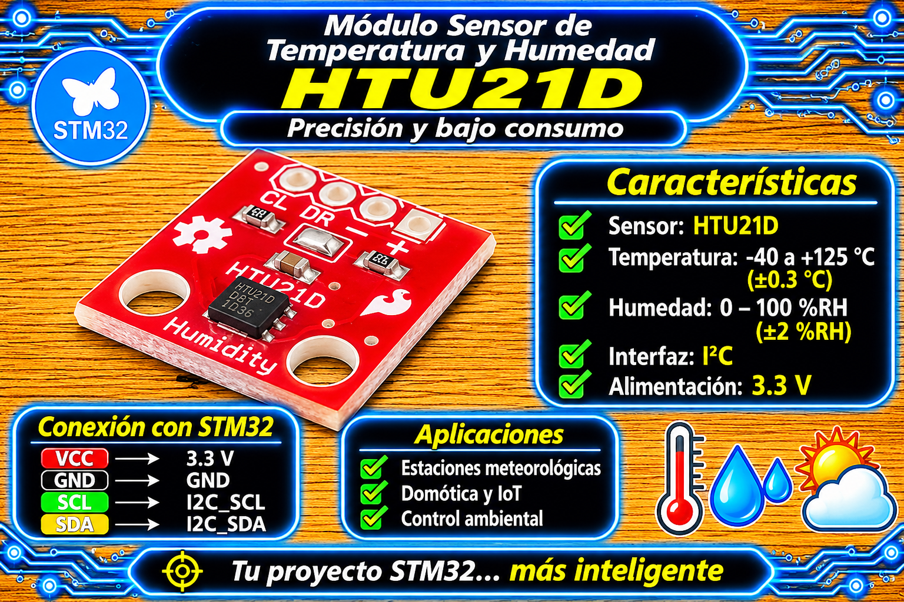
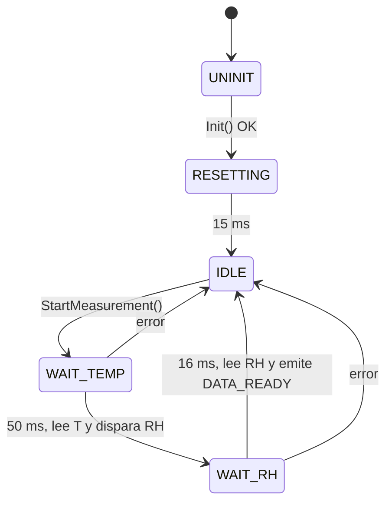

# Driver HTU21D / HTU2x (I2C, no bloqueante) para STM32 HAL

<p align="center">
  
</p>

Driver para leer **temperatura y humedad relativa** del sensor **HTU21D / HTU2x** por I2C en microcontroladores STM32 con HAL. Funciona como una **máquina de estados cooperativa**: se inicia una medición y el driver avanza solo cuando se lo llama desde el bucle principal, sin `HAL_Delay()` durante las conversiones. Mientras el sensor convierte (hasta 50 ms), el micro sigue ejecutando otras tareas.

## Características

* **No bloqueante:** las esperas de conversión se miden con `HAL_GetTick()`; no consumen CPU.
* **Medición completa en una orden:** una llamada a `HTU2X_StartMeasurement()` mide temperatura y humedad.
* **Datos consistentes:** temperatura y humedad que entrega `HTU2X_GetData()` siempre son del mismo ciclo.
* **Humedad compensada** por temperatura y limitada al rango 0 a 100 %.
* **Validación de datos:** CRC-8 de cada lectura y verificación del tipo de trama (temperatura o humedad).
* **Tolerancia a fallos:** reintenta si el sensor responde NACK al leer y reinicializa el periférico I2C ante errores de bus.

## Requisitos

| Requisito | Detalle |
| :--- | :--- |
| Microcontrolador | Cualquier STM32 con HAL (familias con I2C v1 y v2) |
| Periférico | Un I2C ya inicializado (por ejemplo `MX_I2C1_Init()` generado por CubeMX) |
| `main.h` | Debe incluir los headers de la HAL (lo genera CubeMX) |
| Sensor | HTU21D / HTU2x, dirección I2C fija `0x40` (7 bits) |
| Velocidad del bus | 100 kHz (Standard Mode) |

No usa interrupciones ni DMA: las transacciones I2C son por polling.

## Archivos

| Archivo | Descripción |
| :--- | :--- |
| `htu2x_STM32.h` | Interfaz pública: tipo de estado, macro `HTU2X_IS_ERROR()` y prototipos. |
| `htu2x_STM32.c` | Implementación: máquina de estados, comandos I2C, CRC-8, conversiones y recuperación del bus. |

## Conexión del sensor

| Módulo HTU21D | Microcontrolador |
| :--- | :--- |
| VCC / VIN | 3.3 V |
| GND | GND (común con la placa) |
| SDA | Pin SDA del I2C elegido |
| SCL | Pin SCL del I2C elegido |

* SDA y SCL necesitan **resistencias pull-up** de ~4.7 kΩ a 3.3 V. Muchos módulos ya las incluyen; si el tuyo no, agrégalas externamente (las pull-ups internas del STM32 son demasiado débiles).
* Alimenta el sensor a 3.3 V (admite 1.5 a 3.6 V). No lo conectes a 5 V salvo que el módulo tenga regulador y adaptación de niveles.

## Instalación

1. Copia `htu2x_STM32.c` a `Core/Src/` y `htu2x_STM32.h` a `Core/Inc/`.
2. En CubeMX, activa un periférico I2C con esta configuración:
   * **I2C Speed Mode:** Standard Mode (100 kHz).
   * **Addressing Mode:** 7 bits.
   * **No Stretch Mode:** Disabled.
   * Interrupciones y DMA: no hacen falta.
3. Regenera el código e incluye el header donde lo uses:

```c
#include "htu2x_STM32.h"
```

## Uso básico

El uso se resume en tres pasos: **inicializar una vez**, **llamar a `HTU2X_Process()` en cada vuelta del bucle** y **pedir mediciones cuando se necesiten**.

```c
#include "htu2x_STM32.h"

extern I2C_HandleTypeDef hi2c1;          /* el I2C configurado en CubeMX */

#define SAMPLING_INTERVAL_MS  1000U

int main(void)
{
    /* ... HAL_Init(), SystemClock_Config(), MX_I2C1_Init(), etc. ... */

    /* 1. Inicialización (una sola vez) */
    HAL_Delay(20);                       /* el sensor necesita ~15 ms tras encenderse */
    while (HTU2X_Init(&hi2c1) != HTU2X_OK) {
        HAL_Delay(50);                   /* reintenta hasta que el sensor responda */
    }

    uint32_t t_last = 0;

    while (1)
    {
        /* 2. Avanzar la máquina de estados (en CADA vuelta del bucle) */
        HTU2X_Status_t st = HTU2X_Process();

        if (st == HTU2X_DATA_READY) {
            float temperatura, humedad;
            HTU2X_GetData(&temperatura, &humedad);
            /* ... usar temperatura (°C) y humedad (%RH) ... */
        }
        else if (HTU2X_IS_ERROR(st)) {
            /* ... la medición falló; el driver ya volvió a IDLE ... */
        }

        /* 3. Pedir una medición cada SAMPLING_INTERVAL_MS, si el driver está libre */
        if (HTU2X_IsIdle() && (HAL_GetTick() - t_last) >= SAMPLING_INTERVAL_MS) {
            t_last = HAL_GetTick();
            HTU2X_StartMeasurement();
        }

        /* ... resto de tareas del bucle principal ... */
    }
}
```

**Cómo funciona el ciclo:** `HTU2X_StartMeasurement()` solo envía la orden y retorna. En las siguientes vueltas, `HTU2X_Process()` devuelve `HTU2X_BUSY` mientras el sensor convierte; cuando termina devuelve `HTU2X_DATA_READY` **una sola vez** y recién ahí `HTU2X_GetData()` entrega valores nuevos.

## API

| Función | Descripción |
| :--- | :--- |
| `HTU2X_Init(hi2c)` | Guarda el handle I2C y envía el reset por software. Devuelve `HTU2X_OK` o `HTU2X_ERROR_I2C`. Los ~15 ms posteriores al reset los gestiona `HTU2X_Process()`. |
| `HTU2X_Process()` | Avanza la máquina de estados. Debe llamarse en cada iteración del bucle principal. |
| `HTU2X_StartMeasurement()` | Inicia un ciclo asíncrono de temperatura + humedad. No espera el resultado. |
| `HTU2X_IsIdle()` | Devuelve `true` si el driver está libre para una nueva medición. |
| `HTU2X_GetData(&t, &h)` | Copia la última medición completa. Acepta `NULL` en cualquiera de los dos punteros. Devuelve `false` si todavía no hubo ninguna. |
| `HTU2X_StatusToString(st)` | Devuelve un texto descriptivo del código de estado (nunca `NULL`). |
| `HTU2X_IS_ERROR(st)` | Macro: evalúa si un código es de error. |

### Códigos de estado (`HTU2X_Status_t`)

| Código | Significado |
| :--- | :--- |
| `HTU2X_OK` | Driver inactivo y operando correctamente. |
| `HTU2X_BUSY` | Reseteando o midiendo. |
| `HTU2X_DATA_READY` | Ciclo terminado con datos nuevos. Se emite una sola vez por ciclo. |
| `HTU2X_ERROR_I2C` | Falla de comunicación en el bus I2C. |
| `HTU2X_ERROR_CRC` | CRC inválido o tipo de trama inesperado. |
| `HTU2X_ERROR_TIMEOUT` | NACK persistente o timeout durante la lectura. |
| `HTU2X_ERROR_NOT_INIT` | El driver no está inicializado (falta `HTU2X_Init()` o este falló). |

### Qué devuelve cada función según el estado

| Función | Sin inicializar | Reseteando / midiendo | Libre (IDLE) |
| :--- | :--- | :--- | :--- |
| `HTU2X_Process()` | `ERROR_NOT_INIT` | `BUSY` (o `DATA_READY` / error al terminar) | `OK` |
| `HTU2X_StartMeasurement()` | `ERROR_NOT_INIT` | `BUSY` | `OK` o `ERROR_I2C` |

Ante cualquier error durante una medición, el driver vuelve a `IDLE` y se puede reintentar con `HTU2X_StartMeasurement()`.

## Máquina de estados



Un ciclo completo dura **~66 ms** en el peor caso (50 ms + 16 ms), más el tiempo de las transacciones I2C.

## Conversiones

```
T  [°C]  = -46.85 + 175.72 * raw_T  / 65536
RH [%]   =  -6.00 + 125.00 * raw_RH / 65536
RH_comp  =  RH + (25 - T) * (-0.15)          // limitada a 0..100 %
```

Los 2 bits menos significativos de cada lectura son de estado y se descartan antes de convertir.

## Parámetros configurables

Definidos al comienzo de `htu2x_STM32.c`:

| Macro | Valor por defecto | Efecto |
| :--- | :--- | :--- |
| `HTU2X_CHECK_STATUS_BIT` | `1` | Verifica el bit que distingue temperatura de humedad. Poner en `0` (ej. `-DHTU2X_CHECK_STATUS_BIT=0`) si un clon del sensor no lo respeta y aparece `HTU2X_ERROR_CRC` constante. |
| `HTU2X_READ_RETRY_MS` | `10` | Ventana extra de reintentos si el sensor responde NACK al leer. |
| `HTU2X_I2C_TIMEOUT_MS` | `10` | Timeout de cada transacción I2C individual. |
| `HTU2X_T_CONV_TIME_MS` / `HTU2X_RH_CONV_TIME_MS` | `50` / `16` | Tiempos máximos de conversión (resolución por defecto: 14 bits T / 12 bits RH). |

## Limitaciones y advertencias

* **Un solo sensor.** El estado del driver es estático: gestiona una única instancia.
* **No es reentrante.** Llama a todas las funciones desde el mismo contexto (el bucle principal); no las mezcles con una ISR.
* **El "no bloqueante" tiene un alcance concreto.** Las esperas de conversión son cooperativas, pero cada transacción I2C usa la HAL en polling: ~0.3 a 0.5 ms con el bus sano a 100 kHz, y hasta `HTU2X_I2C_TIMEOUT_MS` (10 ms) si el bus está colgado.
* **Llama a `HTU2X_Process()` solo después de un `HTU2X_Init()` exitoso.** Antes de eso devuelve `HTU2X_ERROR_NOT_INIT` en cada llamada.
* **SDA atascada en bajo.** Ante errores de bus el driver reinicializa el periférico I2C, pero no genera pulsos de SCL. Si un esclavo mantiene SDA en bajo, libera el bus por fuera del driver (hasta 9 pulsos de SCL por GPIO) y vuelve a llamar a `HTU2X_Init()`.
* **Familias con I2C v2** (F0, G0, G4, L0, L4, H7, etc.): la recuperación usa `HAL_I2C_DeInit()` + `HAL_I2C_Init()`, que requiere `HAL_I2C_MspInit()` / `HAL_I2C_MspDeInit()` (los genera CubeMX).
* **Resolución fija.** Usa la resolución por defecto del sensor. Si cambias el registro de usuario, ajusta los tiempos de conversión.
* **No implementado:** calefactor integrado ni lectura/escritura del registro de usuario.

## Solución de problemas

| Síntoma | Causa probable |
| :--- | :--- |
| `HTU2X_Init()` devuelve `ERROR_I2C` | Sensor sin alimentar o recién encendido (esperar más de 15 ms), pull-ups ausentes, handle I2C o pines incorrectos. |
| `ERROR_I2C` o `ERROR_TIMEOUT` frecuentes | El sensor no responde (NACK): revisa alimentación, GND común, SDA/SCL y contactos. Con cableado largo o ruidoso, baja la velocidad o acorta los cables. |
| `ERROR_CRC` constante | Clon que no respeta el bit de tipo (`HTU2X_CHECK_STATUS_BIT=0`) o ruido en el bus. |
| `ERROR_NOT_INIT` en cada vuelta | Se llamó a `Process()` o `StartMeasurement()` sin `Init()` exitoso. |
| Humedad siempre en 0 o 100 % | Lectura inválida o sensor dañado: revisa alimentación y CRC. |

**Comprobar que el sensor responde**, sin pasar por el driver:

```c
if (HAL_I2C_IsDeviceReady(&hi2c1, (0x40 << 1), 3, 10) == HAL_OK) {
    /* el sensor contesta en 0x40: el cableado es correcto */
}
```

## Licencia

MIT. Desarrollado por **Mamani Flores Carlos (UTN FRT)** - 2026.