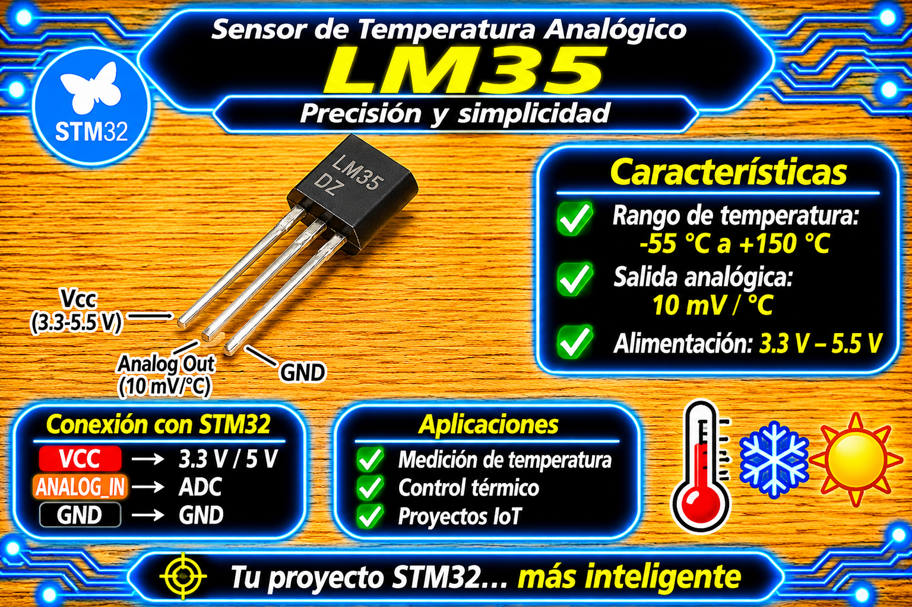

# Driver LM35 (ADC por Interrupciones y Filtro de Media Móvil) para STM32 HAL

<p align="center">
  
</p>

Driver modular, ligero y no bloqueante para el sensor de temperatura analógico **LM35** en microcontroladores STM32 utilizando la capa **HAL**.

Implementa la lectura del conversor analógico-digital (**ADC**) activado mediante interrupciones de hardware (`HAL_ADC_Start_IT`), asegurando cero tiempo de espera bloqueante en la CPU. Incorpora un filtro digital de **media móvil en ventana circular de $O(1)$** en la rutina de interrupción (ISR) empleando exclusivamente aritmética entera, desplazando el cálculo de conversión de punto flotante a la capa de aplicación.

---

## Características

- **Lectura por Interrupción No Bloqueante (`IT`):** Inicia la conversión del canal ADC y libera inmediatamente el núcleo de la CPU. El procesamiento de la muestra se ejecuta al recibir el callback `HAL_ADC_ConvCpltCallback()`.
- **Filtro de Media Móvil Optimizado ($O(1)$):**
  - Mantiene una ventana circular de tamaño potencia de 2 (`LM35_FILTER_SIZE = 8` por defecto).
  - Utiliza direccionamiento por máscara binaria (`idx & (SIZE - 1)`) eliminando divisiones y operaciones de módulo.
  - Mantiene una suma acumulada (`filter_sum`), actualizando el promedio con 1 resta y 1 suma por muestra procesada.
- **Procesamiento de ISR Eficiente:** La rutina de interrupción opera al 100% con enteros. Las operaciones en punto flotante ($\text{mV} \rightarrow ^\circ\text{C}$) se difieren a la llamada de `LM35_STM32_GetTemperature()`.
- **Soporte Monopunto y Multipunto:**
  - **Un solo sensor:** Instancia directa asignada a un canal analógico dedicado.
  - **Múltiples sensores:** Control de $N$ instancias `LM35_STM32_t` independientes sobre diferentes canales del ADC (`ADC_CHANNEL_x`) con disparo secuencial no bloqueante.
- **Manejo Robusto de Errores y Secciones Críticas:**
  - Control de concurrencia atómico mediante la deshabilitación temporal de interrupciones para evitar carreras en el cambio de estado `LM35_STATE_BUSY`.
  - Callback de error de ADC (`LM35_STM32_ADC_ErrorCallback`) para prevenir que el driver quede bloqueado permanentemente en estado de conversión.

---

## Requisitos y Advertencia Eléctrica (Alimentación 3.3V)

| Requisito | Detalle |
| :--- | :--- |
| **Microcontrolador** | Cualquier STM32 (probado en NUCLEO-F439ZI, Blue Pill STM32F103C8T6, Black Pill STM32F411CEU6). |
| **Tensión de Alimentación** | **Estrictamente 3.3V (`VDD`).** Los pines analógicos del STM32 NO son tolerantes a 5V en modo ADC. |
| **Periféricos** | 1 Canal de lectura ADC dedicado por cada sensor LM35 (ej. `ADC1_IN0` / `PA0`, `ADC1_IN1` / `PA1`). |
| **Configuración ADC en CubeMX** | Modo de conversión única (**Single Conversion**), sin escaneo continuo, alineación a la derecha e interrupción habilitada en el NVIC (`ADC1 global interrupt`). |
| **Header Principal** | `main.h` (autogenerado por CubeMX). |

> **¡Atención sobre la Alimentación a 3.3V!**  
> Aunque el integrado LM35 acepta alimentación de 4V a 30V según su hoja de datos, **en placas STM32 debe alimentarse estrictamente a 3.3V (`VDD`)**.  
> - Los pines configurados como entrada analógica pierden la protección de $5\text{V}$ tolerante.  
> - A $3.3\text{ V}$, la salida del LM35 varía entre $0\text{ mV}$ ($0^\circ\text{C}$) y $1500\text{ mV}$ ($+150^\circ\text{C}$), ocupando un rango seguro dentro de los $3300\text{ mV}$ ($V_{\text{REF}}$) del ADC de 12 bits (máximo $\approx 1861$ cuentas a $150^\circ\text{C}$).

---

## Archivos del Driver

| Archivo | Descripción |
| :--- | :--- |
| `lm35_STM32.h` | Cabecera principal: macros de ventana (`LM35_FILTER_SIZE`), tipos de datos (`LM35_STM32_t`, `LM35_Status_t`), y prototipos de la API. |
| `lm35_STM32.c` | Implementación lógica: filtro de media móvil $O(1)$, sección crítica de estado, handlers de interrupción y conversiones. |

---

## Conexión de Hardware

| Pin del Sensor LM35 | Conexión en STM32 / Fuente | Descripción / Notas |
| :---: | :---: | :--- |
| **Vs (Pin 1)** | **3.3V (`VDD`)** | **NO conectar a 5V.** |
| **Vout (Pin 2)** | **Pin ADC STM32** (ej. `PA0`, `PA1`) | Entrada analógica del canal ADC (`ADC_CHANNEL_x`). |
| **GND (Pin 3)** | **GND** | Tierra común del microcontrolador. |

```
       LM35 (VOUT)
      +-----------+
      |  1    Vs  |------> 3.3V (VDD STM32)
      |  2   Vout |------> STM32 ADC Pin (ej. PA0)
      |  3   GND  |------> GND
      +-----------+
```

---

## Formulación Matemática y Principio de Operación

### 1. Sensibilidad del LM35
El LM35 entrega una tensión de salida directamente proporcional a la temperatura en grados Celsius, con un factor de escala constante:

$$S_{\text{LM35}} = 10\ \text{mV}/^\circ\text{C} = 0.010\ \text{V}/^\circ\text{C}$$

### 2. Conversión Digital a Tensión y Temperatura
Para una lectura del ADC con valor sin filtrar o promediado $N_{\text{RAW}}$, una resolución de $B$ bits (donde $N_{\text{MAX}} = 2^B - 1 = 4095$ para 12 bits) y una tensión de referencia $V_{\text{REF}} = 3300\text{ mV}$:

$$V_{\text{out}}\ [\text{mV}] = \frac{N_{\text{RAW}} \times V_{\text{REF}}}{2^B - 1}$$

La temperatura en grados Celsius ($T\ [^\circ\text{C}]$) se obtiene dividiendo la tensión entre la sensibilidad:

$$T\ [^\circ\text{C}] = \frac{V_{\text{out}}\ [\text{mV}]}{10\ \text{mV}/^\circ\text{C}} = \frac{N_{\text{RAW}} \times V_{\text{REF}}}{(2^B - 1) \times 10}$$

### 3. Filtro de Media Móvil de Ventana Circular ($O(1)$)
En cada interrupción del ADC, para una ventana de tamaño $K = 8$:

$$\text{filter\_sum}_k = \text{filter\_sum}_{k-1} - \text{buffer}[\text{idx}] + \text{muestra}_k$$

$$\text{buffer}[\text{idx}] = \text{muestra}_k$$

$$\text{idx} = (\text{idx} + 1) \ \& \ (K - 1)$$

$$\text{avg\_raw}_k = \frac{\text{filter\_sum}_k}{\min(k, K)}$$

---

## Uso Básico

### Ejemplo 1: Muestreo de Un Solo Sensor LM35

Ejemplo de integración directa con temporización no bloqueante mediante `HAL_GetTick()`.

```c
#include "main.h"
#include "lm35_STM32.h"

extern ADC_HandleTypeDef hadc1;

LM35_STM32_t lm35_sensor;
float temp_lm35_celsius = 0.0f;

uint32_t tick_ultimo_muestreo = 0U;

int main(void)
{
    HAL_Init();
    SystemClock_Config();
    MX_GPIO_Init();
    MX_ADC1_Init();

    /* 1. Inicializar el driver LM35 (ADC1, Canal 0, 84 ciclos, Vref = 3300 mV, 12 bits) */
    if (LM35_STM32_Init(&lm35_sensor, &hadc1, ADC_CHANNEL_0,
                        ADC_SAMPLETIME_84CYCLES, 3300.0f, 12U) != LM35_STATUS_OK)
    {
        Error_Handler();
    }

    while (1)
    {
        /* TAREA 1: Disparar muestreo no bloqueante cada 250 ms */
        if ((HAL_GetTick() - tick_ultimo_muestreo) >= 250U)
        {
            tick_ultimo_muestreo = HAL_GetTick();
            (void)LM35_STM32_StartConversion(&lm35_sensor);
        }

        /* TAREA 2: Obtener y consumir la temperatura filtrada */
        if (LM35_STM32_GetTemperature(&lm35_sensor, &temp_lm35_celsius) == LM35_STATUS_OK)
        {
            /* 
             * 'temp_lm35_celsius' contiene la última temperatura filtrada en °C.
             * Aquí podés procesar la variable, mostrarla en un display (ej. SSD1306),
             * o enviar los datos a través de UART (ej. HAL_UART_Transmit / UART_Driver_SendString).
             */
        }
    }
}

/* Callbacks globales de Interrupción del ADC */
void HAL_ADC_ConvCpltCallback(ADC_HandleTypeDef *hadc)
{
    LM35_STM32_ADC_Callback(&lm35_sensor, hadc);
}

void HAL_ADC_ErrorCallback(ADC_HandleTypeDef *hadc)
{
    LM35_STM32_ADC_ErrorCallback(&lm35_sensor, hadc);
}
```

---

### Ejemplo 2: Muestreo de Múltiples Sensores LM35 (2 Canales ADC)

Cada sensor requiere su propia estructura `LM35_STM32_t` y un pin de entrada analógica independiente.

```c
#include "main.h"
#include "lm35_STM32.h"

extern ADC_HandleTypeDef hadc1;

/* Instancias independientes para cada sensor */
LM35_STM32_t lm35_sensor1;
LM35_STM32_t lm35_sensor2;

float temp_sensor1 = 0.0f;
float temp_sensor2 = 0.0f;

uint32_t tick_ultimo_muestreo = 0U;

int main(void)
{
    HAL_Init();
    SystemClock_Config();
    MX_GPIO_Init();
    MX_ADC1_Init();

    /* Inicializar Sensor 1 (PA0 - Canal 0) */
    LM35_STM32_Init(&lm35_sensor1, &hadc1, ADC_CHANNEL_0, ADC_SAMPLETIME_84CYCLES, 3300.0f, 12U);

    /* Inicializar Sensor 2 (PA1 - Canal 1) */
    LM35_STM32_Init(&lm35_sensor2, &hadc1, ADC_CHANNEL_1, ADC_SAMPLETIME_84CYCLES, 3300.0f, 12U);

    while (1)
    {
        /* TAREA 1: Disparo alternado de conversiones no bloqueantes */
        if ((HAL_GetTick() - tick_ultimo_muestreo) >= 250U)
        {
            tick_ultimo_muestreo = HAL_GetTick();

            if (lm35_sensor1.state == LM35_STATE_IDLE) {
                (void)LM35_STM32_StartConversion(&lm35_sensor1);
            } else if (lm35_sensor2.state == LM35_STATE_IDLE) {
                (void)LM35_STM32_StartConversion(&lm35_sensor2);
            }
        }

        /* TAREA 2: Leer temperaturas filtradas de ambas instancias */
        (void)LM35_STM32_GetTemperature(&lm35_sensor1, &temp_sensor1);
        (void)LM35_STM32_GetTemperature(&lm35_sensor2, &temp_sensor2);

        /* 
         * Podés utilizar 'temp_sensor1' y 'temp_sensor2' según lo requiera tu aplicación
         * (ej. enviarlas por UART, registrarlas en memoria o tomar acciones de control).
         */
    }
}

/* Callbacks compartidos: se notifica a ambas instancias */
void HAL_ADC_ConvCpltCallback(ADC_HandleTypeDef *hadc)
{
    LM35_STM32_ADC_Callback(&lm35_sensor1, hadc);
    LM35_STM32_ADC_Callback(&lm35_sensor2, hadc);
}

void HAL_ADC_ErrorCallback(ADC_HandleTypeDef *hadc)
{
    LM35_STM32_ADC_ErrorCallback(&lm35_sensor1, hadc);
    LM35_STM32_ADC_ErrorCallback(&lm35_sensor2, hadc);
}
```

---

## API del Driver

| Función | Descripción |
| :--- | :--- |
| `LM35_STM32_Init(hlm35, hadc, channel, sampling_time, vref_mv, resolution_bits)` | Inicializa el handler, precalcula el fondo de escala ($2^B - 1$) y limpia la ventana del filtro. |
| `LM35_STM32_StartConversion(hlm35)` | Configura el canal analógico e inicia la conversión por interrupción (`HAL_ADC_Start_IT`). Se ejecuta con protección atómica de sección crítica. |
| `LM35_STM32_ADC_Callback(hlm35, hadc)` | Procesa la muestra RAW, actualiza el filtro de media móvil en $O(1)$ y pasa el estado a `LM35_STATE_READY`. Invocar desde `HAL_ADC_ConvCpltCallback()`. |
| `LM35_STM32_ADC_ErrorCallback(hlm35, hadc)` | Libera el estado `LM35_STATE_BUSY` ante un error de hardware. Invocar desde `HAL_ADC_ErrorCallback()`. |
| `LM35_STM32_GetTemperature(hlm35, temp_c)` | Convierte el promedio RAW a grados Celsius y marca el dato como consumido. |
| `LM35_STM32_ConvertRawToTemp(hlm35, raw_val)` | Función matemática de escalado directo de un valor RAW a $^\circ\text{C}$. |

---

## Solución de Problemas

| Síntoma | Causa probable | Solución |
| :--- | :--- | :--- |
| `LM35_STM32_StartConversion()` retorna `LM35_STATUS_BUSY` | Se dispara una nueva conversión antes de que el ADC complete la muestra anterior. | Aumentar el período entre muestreos en el bucle principal. |
| Fluctuación excesiva en las lecturas de temperatura | Tiempo de muestreo del ADC insuficiente para la impedancia de salida del LM35. | Incrementar el `sampling_time` en `Init` (ej. `ADC_SAMPLETIME_84CYCLES` o superior). |
| `LM35_STM32_GetTemperature()` siempre devuelve `LM35_STATUS_NO_DATA` | La interrupción global del ADC no está habilitada en NVIC o no se vincularon los callbacks de HAL. | Activar la interrupción global del ADC en CubeMX (`NVIC Settings`) y verificar `HAL_ADC_ConvCpltCallback()`. |
| Error de lectura / Valor recortado | Sensor alimentado a 5V en lugar de 3.3V o $V_{\text{REF}}$ mal configurada. | Alimentar el LM35 únicamente a 3.3V (`VDD`) y verificar que `vref_mv = 3300.0f`. |

---

## Licencia

- **MIT**. Desarrollado por **Mamani Flores Carlos (UTN FRT)** 2026.